# Software Architecture Plan: Multi-Tenant Academic Records Management Platform
**Target Pilot:** Olivet Baptist High School, Oyo, Nigeria  
**Platform Scope:** Multi-School Academic SaaS (Primary, Junior & Senior Secondary Schools)
**Document Version:** 2.1.0-FASTAPI-SPEC
**Status:** Approved for Implementation Architecture
**M8 Status:** LIVE (Guided Onboarding, Defaults, Branding & Structure Templates; custom domains remain post-pilot)
**M9 Status:** LIVE (Nigerian Primary Basic 1–6 Support; school type, templates, defaults, and report variant)
**Architect:** Senior Software Architect (SaaS, Security & Academic Systems)  
**Primary Tech Stack:** FastAPI, Pydantic v2, SQLAlchemy 2.0 (Async), Alembic, PostgreSQL 16 (RLS), Celery, Redis

---

## Table of Contents
1. [Executive Summary & Architectural Tenets](#1-executive-summary--architectural-tenets)
2. [Product Understanding & Scope Boundary](#2-product-understanding--scope-boundary)
   - 2.1 Problem Statement & Platform Purpose
   - 2.2 Actor & Stakeholder Taxonomy
   - 2.3 MVP vs. Post-MVP Capability Matrix
   - 2.4 Fundamental Architectural Assumptions
3. [Domain Modeling & Ubiquitous Language](#3-domain-modeling--ubiquitous-language)
   - 3.1 Bounded Contexts
   - 3.2 Core Entities & Value Objects
   - 3.3 Domain Life-Cycles & State Machines
   - 3.4 Platform-Level vs. Tenant-Scoped Entity Hierarchy
4. [Relational Database Schema & Data Architecture](#4-relational-database-schema--data-architecture)
   - 4.1 Schema Design Principles & UUIDv7 Standard
   - 4.2 Comprehensive Entity-Relationship Diagram (Mermaid)
   - 4.3 Data Dictionaries & DDL Table Specifications
   - 4.4 Advanced Constraints, Indexes & Historical Snapshots
5. [Application Architecture & Modular Monolith Design (FastAPI)](#5-application-architecture--modular-monolith-design-fastapi)
   - 5.1 FastAPI Modular Monolith Architectural Justification
   - 5.2 Layered Architecture & Module Boundaries
   - 5.3 Communication Contracts Between Modules
   - 5.4 Repository Directory Structure
   - 5.5 Business Logic Placement: Service Layer, Domain Policies & Dependency Injection
   - 5.6 Operational Administration Interface Strategy (SQLAdmin Integration)
6. [API Architecture & Interface Contracts](#6-api-architecture--interface-contracts)
   - 6.1 API Conventions, OpenAPI 3.1 Standards & Response Envelopes
   - 6.2 Endpoint Catalog by Domain
   - 6.3 End-to-End JSON Request/Response Payloads & Pydantic v2 Schemas
   - 6.4 Guided Onboarding, Defaults & Structure Templates (M8 — LIVE)
7. [Result Computation & Processing Engine](#7-result-computation--processing-engine)
   - 7.1 Assessment Aggregation, Missing Scores & Exceptions
   - 7.2 Grading Scales, Grade Points & Performance Remarks
   - 7.3 Ranking Algorithms, Subject Averages & Tie-Breakers
   - 7.4 Historical Immutability, Snapshotting & Post-Publication Amendments
8. [Asynchronous Background Processing & File Generation](#8-asynchronous-background-processing--file-generation)
   - 8.1 Async Workload Topology (Celery & Redis)
   - 8.2 Bulk Student Import Pipeline
   - 8.3 Client-Side Document Assembly & PDF Generation
   - 8.4 Notification Dispatch & Magic Link Verification
   - 8.5 Idempotency, Dead-Letter Queues & Failure Recovery
9. [Multi-Tenancy & Tenant Isolation Architecture](#9-multi-tenancy--tenant-isolation-architecture)
   - 9.1 Multi-Tenancy Strategy Evaluation & Decision
   - 9.2 Request-Level Tenant Context Resolution via FastAPI `Depends`
   - 9.3 Database-Level Scoping & PostgreSQL Row-Level Security (RLS)
   - 9.4 Tenant Context Propagation across Async Tasks & Object Storage
10. [Authentication, Authorization & Security Architecture](#10-authentication-authorization--security-architecture)
    - 10.1 Authentication & Session Life-Cycle (OAuth2 / JWT RS256)
    - 10.2 Role-Based & Attribute-Based Access Control (RBAC/ABAC)
    - 10.3 IDOR Defense, Input Sanitization & Threat Modeling
    - 10.4 Immutable Audit Logging Engine
    - 10.5 Teacher Deactivation & Token Revocation Protocol
11. [Olivet Baptist High School Configuration Blueprint](#11-olivet-baptist-high-school-configuration-blueprint)
    - 11.1 Default Academic Levels, Departments & Arms
    - 11.2 Assessment Weightings & Standard Grading Scales
    - 11.3 Configuration Versioning & Transition Rules
12. [Testing & Quality Assurance Strategy](#12-testing--quality-assurance-strategy)
    - 12.1 Testing Pyramid & Coverage Thresholds
    - 12.2 Async Cross-Tenant Isolation Test Harness
    - 12.3 Academic Computation Property-Based Testing
13. [Deployment, Infrastructure & Operational Runbook](#13-deployment-infrastructure--operational-runbook)
    - 13.1 Deployment Topology & Docker Compose Environment
    - 13.2 Environment Segregation & Secrets Management
    - 13.3 Backup, Point-in-Time Recovery (PITR) & Disaster Recovery
    - 13.4 Observability, Telemetry & Structured Logging
14. [Implementation Roadmap & Milestones](#14-implementation-roadmap--milestones)
15. [Architectural Challenges, Trade-offs & Deep-Dive Critique](#15-architectural-challenges-trade-offs--deep-dive-critique)
16. [Open Architectural Questions (Product Owner Sign-Off Required)](#16-open-architectural-questions-product-owner-sign-off-required)
17. [M9: Nigerian Primary Basic 1-6 Support (LIVE)](#17-m9-nigerian-primary-basic-1-6-support-live)
    - 17.1 Scope decisions
    - 17.2 Data model & migration
    - 17.3 Endpoint additions
    - 17.4 Tasks
    - 17.5 Definition of Done

---

## 1. Executive Summary & Architectural Tenets

This document specifies the technical architecture for a high-performance, multi-tenant academic records management platform designed for primary and secondary institutions in Nigeria and internationally. The pilot deployment is **Olivet Baptist High School, Oyo, Nigeria**, a public secondary institution with deep-rooted traditions (e.g., class arms derived from institution letters `O`, `L`, `I`, `V`, `E`, `T`, `B`, `H`, `S`, `Y`, and department-specific arm distributions). M9 adds Nigerian three-term primary support for Basic 1–6 (LIVE; §17) without changing the live secondary workflows.

The platform is engineered around **FastAPI**, **Pydantic v2**, and **SQLAlchemy 2.0 (Async)**, providing strict schema guarantees, asynchronous request handling, and clear dependency injection.

### Core Architectural Tenets

1. **Configurable by Architecture, Familiar by Default:** Olivet’s structures (class levels JSS1–SS3, Science/Arts/Commercial departments, lettered arms, and the Olivet-specific 10/10/10/70 assessment structure: Test 1, Test 2, Assignments/Attendance, and Terminal Examination) serve as the pre-configured *Initial Seed Template*. The underlying database models enforce zero hardcoded assumptions about arm letters, department existence, or assessment weightings.
2. **Immutable Academic Snapshots:** When an academic term report is officially published, its calculated aggregates, grade boundaries, student positions, and raw scores are cryptographically and relationally frozen. Retroactive changes to grading configurations or department definitions for a subsequent academic year have zero mathematical effect on historical records.
3. **Defense-in-Depth Multi-Tenancy:** Multi-tenancy is enforced across four distinct boundaries: HTTP header/token resolution in FastAPI middleware, dependency-injected SQLAlchemy session scoping, PostgreSQL Row-Level Security (RLS) connection-level policies, and Celery background task payload serialization.
4. **Lean, Maintainable Operations (The Asynchronous Modular Monolith):** The platform avoids distributed microservice complexity. It is structured as an event-informed **Modular Monolith** using FastAPI (running on Uvicorn workers), backed by PostgreSQL 16, Redis 7, and Celery 5.4. This ensures transactional integrity across enrollment, grading, and reporting while maintaining clear module boundaries ready for future extraction if required.

---

## 2. Product Understanding & Scope Boundary

### 2.1 Problem Statement & Platform Purpose
Primary and secondary schools frequently struggle with fragmented end-of-term academic processing:
- Manual score entry errors, inconsistent continuous assessment (CA) formulas, and delayed result compilation.
- Insecure report distribution (transmitting confidential minor records via unencrypted public email attachments or vulnerable web URLs).
- Inflexible school software that hardcodes rigid British, American, or arbitrary state setups, breaking down when handling public Nigerian school hierarchies (e.g., non-departmental Basic/JSS vs. specialized SS arms).
- Lack of auditability when grades are altered post-examination.

The platform provides an authoritative, auditable, and automated system of record for pupil/student life-cycles, subject assignments, continuous assessments, examination marks, grade computation, and tamper-resistant digital report card access.

### 2.2 Actor & Stakeholder Taxonomy

| Actor Role | Context Boundary | Primary Responsibilities | Authorization Tier |
|---|---|---|---|
| **Platform Super Administrator** | Global / Platform-wide | School onboarding, global subscription management, platform audit log inspection, template definitions. | Tier 0 (Global System) |
| **School Principal / Director** | Tenant / School | Final executive approval for term publication, school-wide academic policy setup, staff appointment authorizations. | Tier 1 (Tenant Executive) |
| **Academic Officer / Vice Principal (Academics)** | Tenant / School | Session/term setups, assessment structure creation, curriculum subject offerings, result review, score unlock approvals. | Tier 2 (Tenant Academic Ops) |
| **Class Teacher / Form Master / Homeroom Teacher** | Class Arm / Section (primary or secondary) | Class-level attendance tracking, conduct/psychomotor comments, class-wide performance review, broadsheet verification. In primary schools (M9, LIVE) the homeroom/class teacher supplies the `class_teacher_comment`. | Tier 3 (Class Scoped) |
| **Subject Teacher** | Class-Subject Assignment | Score entry for assigned subjects and class arms, draft submission, correction request initiation. Primary subject teachers work only with compulsory core subjects. | Tier 4 (Subject-Arm Scoped) |
| **Parent / Guardian / Student / Pupil** | Individual Record | Viewing and downloading cryptographically verified, time-limited, signed digital report cards via secure web links. `Pupil` is the primary-school UI label for a `Student` record (M9, LIVE). | Tier 5 (Consumer Token) |

### 2.3 MVP vs. Post-MVP Capability Matrix

```mermaid
graph TD
    subgraph MVP [Phase 1: Core Pilot MVP - Olivet Pilot]
        M1[Multi-Tenant School Provisioning]
        M2[Flexible Session, Term, Level, Dept, Arm Modeling]
        M3[Student Enrollment & Persistent Identity]
        M4[Teacher Subject-Arm Assignment Matrix]
        M5[Configurable CA/Exam Assessment Engine]
        M6[Score Validation & Lifecycle: Draft->Submitted->Approved->Published]
        M7[Automated Result Computation: Totals, Grades, Ranks, Averages]
        M8[Structured Report Payload & Client-Side PDF Generation]
        M9[Magic Link Result Access via Email/SMS Notification]
        M10[Audit Logging for All Score Adjustments]
        M11[SQLAdmin Backoffice for School Ops]
    end

    subgraph PostMVP [Phase 2 & Beyond: Scale & Growth]
        P1[Dedicated Student/Parent Authenticated Portals]
        P2[CBT - Computer-Based Testing Integration]
        P3[Tuition & School Fee Clearance Gating for Results]
        P4[Psychomotor & Affective Domain Skill Rubrics]
        P5[Automated Transcript Generation for Alumni/Transfers]
        P6[SMS Gateway Integration e.g., Termii, Twilio]
        P7[School Custom Subdomains e.g., portal.olivet.edu.ng]
        P8[Cross-Session Performance Predictive Analytics]
    end

    MVP --> PostMVP
```

> **Milestone numbering note:** the `M1`–`M11` labels above are MVP *capability
> tags* used for scope planning; they are distinct from the delivery milestone
> numbers in §14 and `BACKEND_DEV_PLAN.md`. The delivery sequence currently ends
> at M9: **M8 (Guided Onboarding, Defaults, Branding & Structure Templates) is
> LIVE** and specified in §6.4; **M9 (Nigerian Primary Basic 1–6 Support) is
> LIVE** and specified in §17. `P7` (school custom subdomains) remains post-pilot
> and PLANNED.

### 2.4 Fundamental Architectural Assumptions
1. **Academic Session Model:** An Academic Session corresponds to an academic year (e.g., `2024/2025`) and is divided into distinct sequential terms (typically 3 terms: `First Term`, `Second Term`, `Third Term`). Nigerian primary schools (M9, LIVE) use the same three-term model and the existing term computation; no generic multi-term refactor is in scope.
2. **Student Identity Permanence:** A student maintains one permanent identifier (`admission_number`) within a school regardless of promotions, department changes, or disciplinary leaves.
3. **Report Card Delivery Model:** For the MVP, students/parents will **not** require credentialed user accounts. Results will be accessed via high-entropy, cryptographically signed, expiring URLs dispatched to verified guardian email addresses, protected by an optional secondary proof of identity (student birth date or PIN).
4. **Internet Connectivity & Offline Constraints:** While school operations require cloud synchronization, score entry forms must support resilient front-end caching (local session preservation) to prevent data loss during erratic power or network drops typical in developing regions.

---

## 3. Domain Modeling & Ubiquitous Language

### 3.1 Bounded Contexts

```mermaid
flowchart LR
    subgraph IdentityContext [Identity & Access Context]
        User[User Account]
        Role[Role & Permissions]
        Staff[Staff Profile]
        Teacher[Teacher Assignment]
    end

    subgraph StructureContext [Academic Structure Context]
        Session[Academic Session]
        Term[Academic Term]
        Level[Academic Level]
        Dept[Department]
        Arm[Class Arm]
        ClassGroup[Class Section / Group]
    end

    subgraph EnrollmentContext [Student & Enrollment Context]
        Student[Student Record]
        Guardian[Guardian Info]
        Enrollment[Session Enrollment]
        Placement[Class Placement]
    end

    subgraph AssessmentContext [Assessment & Grading Context]
        Subject[Subject]
        Offering[Subject Offering]
        AssConfig[Assessment Structure]
        ScoreEntry[Assessment Score]
        ResultLife[Score Lifecycle State]
    end

    subgraph ComputationContext [Computation & Reporting Context]
        Engine[Computation Engine]
        SubjectRes[Subject Result Record]
        TermReport[Term Report Card]
        Snapshot[Historical Snapshot]
        PDFJob[PDF Generation Job]
    end

    IdentityContext --> StructureContext
    StructureContext --> EnrollmentContext
    StructureContext --> AssessmentContext
    EnrollmentContext --> AssessmentContext
    AssessmentContext --> ComputationContext
```

### 3.2 Core Entities & Value Objects

- **School (Tenant Root):** Represents the educational institution. Top-level boundary for multi-tenancy.
- **AcademicSession & AcademicTerm:** The temporal boundary of academic activity. Terms are child records of sessions.
- **AcademicLevel:** The educational progression tier (e.g., "Basic 1", "JSS 1", "SS 3", "Grade 10"). Holds a display order and category (`PRIMARY`, `JUNIOR_SECONDARY`, or `SENIOR_SECONDARY`).
- **Department:** Specialization cluster within senior secondary education (e.g., "Science", "Commercial", "Arts"). Completely optional at the school and level tier; primary (Basic 1–6) and junior secondary levels have `department_id = NULL`.
- **ClassArm:** Canonical arm designator (e.g., "O", "A", "Gold").
- **ClassGroup (The Section Aggregate):** The physical or organizational cohort of students for a specific academic session. Formed by the tuple `(School, AcademicSession, AcademicLevel, Department [Optional], ClassArm)`. Examples: *"SS1 Science O - 2024/2025"* and *"Basic 1 A - 2026/2027"* (M9, LIVE).
- **Student & StudentEnrollment:** `Student` holds demographic, admission, and guardian data. `StudentEnrollment` binds a `Student` to a `ClassGroup` within an `AcademicSession`.
- **Subject & SubjectOffering:** `Subject` is the catalog item (e.g., "Mathematics", "Catering Craft Practice"). `SubjectOffering` defines a subject taught within a specific `AcademicSession` and `AcademicLevel`, optionally filtered by `Department`. `department_id = NULL` means a universal core offering and is mandatory for primary and junior-secondary levels; senior-secondary offerings may be department-specific.
- **ClassSubject & TeacherAssignment:** `ClassSubject` links a `SubjectOffering` to a concrete `ClassGroup`. `TeacherAssignment` designates which teacher instructs that `ClassSubject`, with assignment timestamps and active status.
- **StudentSubjectRegistration:** The explicit link between a student's session enrollment (`StudentEnrollment`) and a specific `ClassSubject`. Categorized as `COMPULSORY_CORE`, `DEPARTMENT_CORE`, `TRADE_ELECTIVE`, or `FREE_ELECTIVE`. Ensures teachers of elective/trade subjects (e.g., Catering Craft) only see and grade students who registered for that subject, and enables student-specific total obtainable calculations on report cards.
- **AssessmentDefinition:** Configures assessment components for a subject or school-wide term (e.g., "Test 1", max 10; "Test 2", max 10; "Assignments/Attendance", max 10; "Terminal Exam", max 70 for Olivet).
- **AssessmentScore:** The atomic grade entry for a student in an `AssessmentDefinition`. Contains states: numeric value, `ABSENT`, `EXEMPT`, or `PENDING`.
- **SubjectResult (Computed):** The aggregated terminal score for a student in a specific `ClassSubject` for a term, including grade, grade point, and subject ranking.
- **TermReportCard (Computed):** The master report card aggregate for a student's term, containing aggregated totals, class rank, attendance summary, teacher comments, and publication authorization status.

### 3.3 Domain Life-Cycles & State Machines

#### 3.3.1 Assessment Score & Subject Result Lifecycle
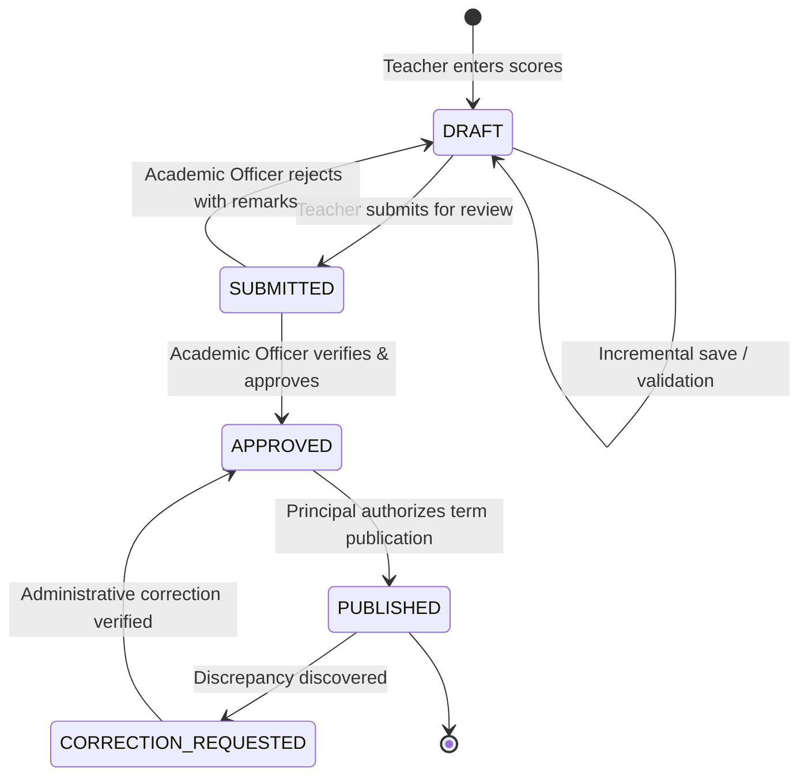

#### 3.3.2 Student & Enrollment Lifecycles

Student lifecycle status is tracked independently from the status of each historical session enrollment:

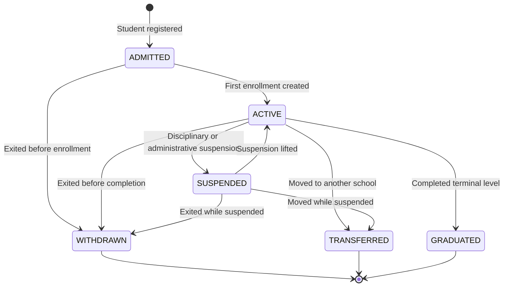

`WITHDRAWN` and `TRANSFERRED` also archive the student record with `deleted_at`; historical reads remain available.

Each `StudentEnrollment` follows its own terminal state machine:

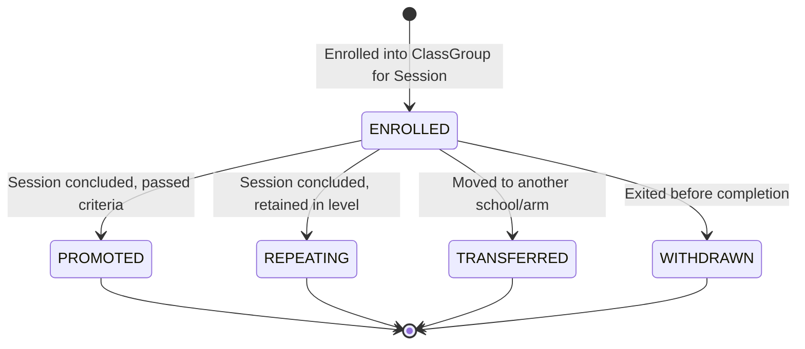

A promotion records `promoted_to_class_group_id`; the student is then enrolled into the target class group for the later session as a new historical enrollment row.

### 3.4 Platform-Level vs. Tenant-Scoped Entity Hierarchy

```
[PLATFORM-WIDE ENTITIES] (No school_id; globally managed)
├── PlatformUser (Super Admins, Support Staff)
├── SubscriptionPlan / BillingRecord
├── GlobalTemplate (Default Olivet Template, Default Universal Template)
└── SystemAuditLog (Cross-tenant platform events)

[TENANT-SCOPED ENTITIES] (Enforce school_id foreign key + strict isolation)
└── School (Tenant Anchor)
    ├── SchoolConfiguration (Grading scales, timezone, branding, domain)
    ├── StaffProfile (Teachers, VPs, Principals)
    ├── AcademicSession
    │   └── AcademicTerm
    ├── AcademicLevel
    ├── Department (Optional)
    ├── ClassArm
    ├── ClassGroup (ClassSection)
    │   └── StudentEnrollment (Student historical junction)
    ├── Student
    │   └── GuardianContact
    ├── Subject
    │   └── SubjectOffering
    │       └── ClassSubject
    │           ├── TeacherAssignment
    │           ├── AssessmentDefinition
    │           │   └── AssessmentScore
    │           └── SubjectResult (Computed snapshot)
    └── TermReportCard (Computed master snapshot)
        └── ResultAccessToken (Magic link token entity)
```

---

## 4. Relational Database Schema & Data Architecture

### 4.1 Schema Design Principles & UUIDv7 Standard
1. **UUIDv7 Primary Keys:** All transactional tables utilize time-ordered UUIDv7 (`uuid`). UUIDv7 embeds a millisecond-precision Unix timestamp in the high bits, ensuring optimal B-Tree index locality, zero sequential integer exposure, and fast monotonic inserts.
2. **Mandatory Foreign Key Scoping:** All tenant-scoped tables feature a mandatory `school_id UUID NOT NULL REFERENCES schools(id) ON DELETE RESTRICT`.
3. **Composite Natural Keys:** Enforced at the relational engine level (e.g., `(school_id, admission_number)` on students; `(assessment_definition_id, student_enrollment_id)` on scores).
4. **Soft Deletion with Partial Indexes:** Core academic records implement `deleted_at TIMESTAMPTZ NULL` with partial unique indexes to guarantee that deleted records do not conflict with active records or break historical integrity.

### 4.2 Comprehensive Entity-Relationship Diagram (Mermaid)

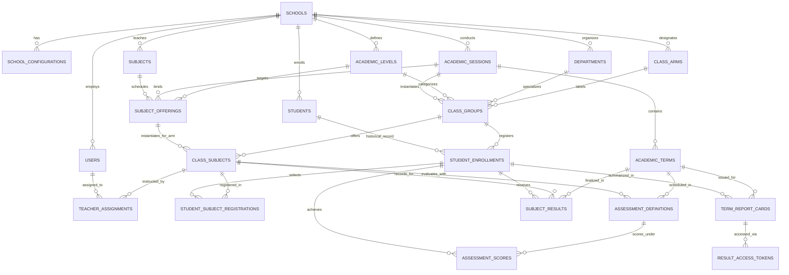

### 4.3 Data Dictionaries & DDL Table Specifications

#### 4.3.1 Core Multi-Tenant Tables

##### `schools`
```sql
CREATE TABLE schools (
    id UUID PRIMARY KEY DEFAULT gen_random_uuid(),
    slug VARCHAR(63) NOT NULL UNIQUE,
    name VARCHAR(255) NOT NULL,
    official_code VARCHAR(32) NOT NULL UNIQUE,
    country_code CHAR(2) NOT NULL DEFAULT 'NG',
    state VARCHAR(64) NOT NULL,
    city VARCHAR(64) NOT NULL,
    address TEXT NOT NULL,
    logo_storage_path VARCHAR(512),
    stamp_image_url VARCHAR(512), -- Official school stamp for digital report cards
    principal_signature_url VARCHAR(512), -- Official principal signature image
    is_active BOOLEAN NOT NULL DEFAULT TRUE,
    created_at TIMESTAMPTZ NOT NULL DEFAULT clock_timestamp(),
    updated_at TIMESTAMPTZ NOT NULL DEFAULT clock_timestamp(),
    deleted_at TIMESTAMPTZ NULL
);
CREATE INDEX idx_schools_slug ON schools(slug) WHERE deleted_at IS NULL;
```

> **M9+ (LIVE):** `school_type VARCHAR(16) NOT NULL DEFAULT 'SECONDARY'` with
> `CHECK (school_type IN ('PRIMARY', 'SECONDARY', 'COMBINED'))` is applied by
> `b1c4d7e9a2f0_m9_primary_school_support.py` and `f1a2b3c4d5e6_add_combined_school_type.py`.
> `b1c4d7e9a2f0_m9_primary_school_support.py`; existing tenants stay
> `SECONDARY`. Seeding rules are specified in §17.2.

##### `school_configurations`
```sql
CREATE TABLE school_configurations (
    id UUID PRIMARY KEY DEFAULT gen_random_uuid(),
    school_id UUID NOT NULL REFERENCES schools(id) ON DELETE CASCADE,
    grading_scale_schema JSONB NOT NULL,
    assessment_weight_schema JSONB NOT NULL,
    academic_term_definitions JSONB NOT NULL,
    annual_results_schema JSONB NOT NULL,
    timezone VARCHAR(64) NOT NULL DEFAULT 'Africa/Lagos',
    currency CHAR(3) NOT NULL DEFAULT 'NGN',
    report_card_template_id VARCHAR(64) NOT NULL DEFAULT 'default_olivet_v1',
    created_at TIMESTAMPTZ NOT NULL DEFAULT clock_timestamp(),
    updated_at TIMESTAMPTZ NOT NULL DEFAULT clock_timestamp(),
    CONSTRAINT uq_school_configuration UNIQUE (school_id)
);
```

##### `users` & `staff_profiles`
```sql
CREATE TABLE users (
    id UUID PRIMARY KEY DEFAULT gen_random_uuid(),
    school_id UUID REFERENCES schools(id) ON DELETE RESTRICT,
    email VARCHAR(255) NOT NULL,
    password_hash VARCHAR(255) NOT NULL,
    first_name VARCHAR(64) NOT NULL,
    last_name VARCHAR(64) NOT NULL,
    phone_number VARCHAR(32),
    role VARCHAR(32) NOT NULL, -- SUPER_ADMIN, SCHOOL_ADMIN, ACADEMIC_OFFICER, TEACHER
    is_active BOOLEAN NOT NULL DEFAULT TRUE,
    is_mfa_enabled BOOLEAN NOT NULL DEFAULT FALSE,
    mfa_secret VARCHAR(64),
    last_login_at TIMESTAMPTZ,
    token_valid_after TIMESTAMPTZ NOT NULL DEFAULT clock_timestamp(),
    created_at TIMESTAMPTZ NOT NULL DEFAULT clock_timestamp(),
    updated_at TIMESTAMPTZ NOT NULL DEFAULT clock_timestamp(),
    deleted_at TIMESTAMPTZ NULL
);
CREATE UNIQUE INDEX uq_users_email_global ON users(email) WHERE deleted_at IS NULL;
CREATE INDEX idx_users_school_role ON users(school_id, role) WHERE deleted_at IS NULL;

CREATE TABLE staff_profiles (
    id UUID PRIMARY KEY DEFAULT gen_random_uuid(),
    school_id UUID NOT NULL REFERENCES schools(id) ON DELETE CASCADE,
    user_id UUID NOT NULL REFERENCES users(id) ON DELETE CASCADE,
    staff_id_number VARCHAR(64) NOT NULL,
    employment_status VARCHAR(32) NOT NULL DEFAULT 'ACTIVE', -- ACTIVE, ON_LEAVE, TERMINATED, TRANSFERRED
    specialization VARCHAR(128),
    signature_image_url VARCHAR(512), -- Form Master / Teacher digital signature for reports
    created_at TIMESTAMPTZ NOT NULL DEFAULT clock_timestamp(),
    updated_at TIMESTAMPTZ NOT NULL DEFAULT clock_timestamp(),
    CONSTRAINT uq_staff_school_id UNIQUE (school_id, staff_id_number),
    CONSTRAINT uq_staff_user UNIQUE (user_id)
);

CREATE TABLE permissions (
    id UUID PRIMARY KEY DEFAULT gen_random_uuid(),
    code VARCHAR(64) NOT NULL UNIQUE, -- e.g., 'scores:approve', 'scores:unlock', 'students:enroll', 'reports:publish'
    name VARCHAR(128) NOT NULL,
    description TEXT,
    category VARCHAR(32) NOT NULL, -- 'ASSESSMENT', 'STUDENT', 'STRUCTURE', 'ADMIN'
    created_at TIMESTAMPTZ NOT NULL DEFAULT clock_timestamp()
);

CREATE TABLE role_default_permissions (
    role VARCHAR(32) NOT NULL, -- 'TEACHER', 'ACADEMIC_OFFICER', 'SCHOOL_ADMIN', etc.
    permission_id UUID NOT NULL REFERENCES permissions(id) ON DELETE CASCADE,
    PRIMARY KEY (role, permission_id)
);

CREATE TABLE school_roles (
    id UUID PRIMARY KEY DEFAULT gen_random_uuid(),
    school_id UUID NOT NULL REFERENCES schools(id) ON DELETE RESTRICT,
    code VARCHAR(32) NOT NULL,
    name VARCHAR(64) NOT NULL,
    description VARCHAR(255),
    created_at TIMESTAMPTZ NOT NULL DEFAULT clock_timestamp(),
    updated_at TIMESTAMPTZ NOT NULL DEFAULT clock_timestamp(),
    deleted_at TIMESTAMPTZ
);

CREATE TABLE school_role_permissions (
    id UUID PRIMARY KEY DEFAULT gen_random_uuid(),
    school_id UUID NOT NULL REFERENCES schools(id) ON DELETE RESTRICT,
    role VARCHAR(32) NOT NULL,
    permission_id UUID NOT NULL REFERENCES permissions(id) ON DELETE CASCADE,
    is_enabled BOOLEAN NOT NULL DEFAULT TRUE,
    created_at TIMESTAMPTZ NOT NULL DEFAULT clock_timestamp(),
    updated_at TIMESTAMPTZ NOT NULL DEFAULT clock_timestamp(),
    CONSTRAINT uq_school_role_permissions_school_role_perm UNIQUE (school_id, role, permission_id)
);

CREATE TABLE user_permission_grants (
    id UUID PRIMARY KEY DEFAULT gen_random_uuid(),
    school_id UUID NOT NULL REFERENCES schools(id) ON DELETE CASCADE,
    user_id UUID NOT NULL REFERENCES users(id) ON DELETE CASCADE,
    permission_id UUID NOT NULL REFERENCES permissions(id) ON DELETE CASCADE,
    granted_by_id UUID NOT NULL REFERENCES users(id) ON DELETE RESTRICT,
    scope_type VARCHAR(32) NOT NULL DEFAULT 'SCHOOL_WIDE', -- 'SCHOOL_WIDE', 'DEPARTMENT', 'ACADEMIC_LEVEL', 'CLASS_GROUP'
    department_id UUID REFERENCES departments(id) ON DELETE CASCADE,
    academic_level_id UUID REFERENCES academic_levels(id) ON DELETE CASCADE,
    class_group_id UUID REFERENCES class_groups(id) ON DELETE CASCADE,
    created_at TIMESTAMPTZ NOT NULL DEFAULT clock_timestamp(),
    CONSTRAINT uq_user_permission_grant UNIQUE (user_id, permission_id, scope_type, department_id, academic_level_id, class_group_id)
);
CREATE INDEX idx_user_permission_grants_lookup ON user_permission_grants(user_id, school_id);
```

#### 4.3.2 Academic Structure Tables

Uniqueness for soft-retirable structure records is enforced with partial unique indexes scoped to rows where `deleted_at IS NULL`.

> **M9 (LIVE):** `academic_levels.category` supports `PRIMARY`; primary and
> junior-secondary `ClassGroup`/`SubjectOffering` rows keep
> `department_id = NULL`. The migration is specified in §17.2.

##### `academic_sessions` & `academic_terms`
```sql
CREATE TABLE academic_sessions (
    id UUID PRIMARY KEY, -- application-generated UUIDv7
    school_id UUID NOT NULL REFERENCES schools(id) ON DELETE RESTRICT,
    name VARCHAR(32) NOT NULL, -- e.g., '2024/2025'
    start_date DATE NOT NULL,
    end_date DATE NOT NULL,
    is_current BOOLEAN NOT NULL DEFAULT FALSE,
    created_at TIMESTAMPTZ NOT NULL DEFAULT clock_timestamp(),
    updated_at TIMESTAMPTZ NOT NULL DEFAULT clock_timestamp(),
    deleted_at TIMESTAMPTZ NULL,
    CONSTRAINT chk_session_dates CHECK (end_date > start_date)
);
CREATE UNIQUE INDEX uq_school_session_name_active ON academic_sessions(school_id, name) WHERE deleted_at IS NULL;
CREATE UNIQUE INDEX uq_current_session_per_school ON academic_sessions(school_id) WHERE is_current AND deleted_at IS NULL;

CREATE TABLE academic_terms (
    id UUID PRIMARY KEY, -- application-generated UUIDv7
    school_id UUID NOT NULL REFERENCES schools(id) ON DELETE RESTRICT,
    academic_session_id UUID NOT NULL REFERENCES academic_sessions(id) ON DELETE RESTRICT,
    name VARCHAR(32) NOT NULL, -- e.g., 'First Term', 'Second Term', 'Third Term'
    term_order SMALLINT NOT NULL, -- 1, 2, 3
    start_date DATE NOT NULL,
    end_date DATE NOT NULL,
    is_current BOOLEAN NOT NULL DEFAULT FALSE,
    is_locked_for_scoring BOOLEAN NOT NULL DEFAULT FALSE,
    created_at TIMESTAMPTZ NOT NULL DEFAULT clock_timestamp(),
    updated_at TIMESTAMPTZ NOT NULL DEFAULT clock_timestamp(),
    deleted_at TIMESTAMPTZ NULL,
    CONSTRAINT chk_term_order_positive CHECK (term_order > 0),
    CONSTRAINT chk_term_dates CHECK (end_date > start_date)
);
CREATE UNIQUE INDEX uq_session_term_name_active ON academic_terms(academic_session_id, name) WHERE deleted_at IS NULL;
CREATE UNIQUE INDEX uq_session_term_order_active ON academic_terms(academic_session_id, term_order) WHERE deleted_at IS NULL;
CREATE UNIQUE INDEX uq_current_term_per_school ON academic_terms(school_id) WHERE is_current AND deleted_at IS NULL;
```

##### `academic_levels`, `departments` & `class_arms`
```sql
CREATE TABLE academic_levels (
    id UUID PRIMARY KEY, -- application-generated UUIDv7
    school_id UUID NOT NULL REFERENCES schools(id) ON DELETE RESTRICT,
    name VARCHAR(64) NOT NULL, -- e.g., 'Basic 1', 'JSS 1', 'SS 1'
    code VARCHAR(16) NOT NULL, -- e.g., 'BASIC1', 'JSS1', 'SS1'
    level_order SMALLINT NOT NULL, -- Sequence: 1, 2, 3, 4, 5, 6
    category VARCHAR(32) NOT NULL, -- 'PRIMARY', 'JUNIOR_SECONDARY', 'SENIOR_SECONDARY' (M9 LIVE)
    created_at TIMESTAMPTZ NOT NULL DEFAULT clock_timestamp(),
    updated_at TIMESTAMPTZ NOT NULL DEFAULT clock_timestamp(),
    deleted_at TIMESTAMPTZ NULL,
    CONSTRAINT chk_level_category CHECK (category IN ('PRIMARY', 'JUNIOR_SECONDARY', 'SENIOR_SECONDARY'))
);
CREATE UNIQUE INDEX uq_school_level_code_active ON academic_levels(school_id, code) WHERE deleted_at IS NULL;
CREATE UNIQUE INDEX uq_school_level_order_active ON academic_levels(school_id, level_order) WHERE deleted_at IS NULL;

CREATE TABLE departments (
    id UUID PRIMARY KEY, -- application-generated UUIDv7
    school_id UUID NOT NULL REFERENCES schools(id) ON DELETE RESTRICT,
    name VARCHAR(64) NOT NULL, -- e.g., 'Science', 'Arts', 'Commercial'
    code VARCHAR(16) NOT NULL, -- e.g., 'SCI', 'ART', 'COMM'
    created_at TIMESTAMPTZ NOT NULL DEFAULT clock_timestamp(),
    updated_at TIMESTAMPTZ NOT NULL DEFAULT clock_timestamp(),
    deleted_at TIMESTAMPTZ NULL
);
CREATE UNIQUE INDEX uq_school_department_code_active ON departments(school_id, code) WHERE deleted_at IS NULL;

CREATE TABLE class_arms (
    id UUID PRIMARY KEY, -- application-generated UUIDv7
    school_id UUID NOT NULL REFERENCES schools(id) ON DELETE RESTRICT,
    name VARCHAR(32) NOT NULL, -- e.g., 'O', 'L', 'I', 'V', 'A', 'B'
    created_at TIMESTAMPTZ NOT NULL DEFAULT clock_timestamp(),
    updated_at TIMESTAMPTZ NOT NULL DEFAULT clock_timestamp(),
    deleted_at TIMESTAMPTZ NULL
);
CREATE UNIQUE INDEX uq_school_arm_name_active ON class_arms(school_id, name) WHERE deleted_at IS NULL;
```

##### `class_groups` (Class Cohort Instances)
```sql
CREATE TABLE class_groups (
    id UUID PRIMARY KEY, -- application-generated UUIDv7
    school_id UUID NOT NULL REFERENCES schools(id) ON DELETE RESTRICT,
    academic_session_id UUID NOT NULL REFERENCES academic_sessions(id) ON DELETE RESTRICT,
    academic_level_id UUID NOT NULL REFERENCES academic_levels(id) ON DELETE RESTRICT,
    department_id UUID REFERENCES departments(id) ON DELETE RESTRICT, -- NULLABLE / required NULL for primary (M9) and JSS or non-departmental schools
    class_arm_id UUID NOT NULL REFERENCES class_arms(id) ON DELETE RESTRICT,
    class_teacher_id UUID REFERENCES users(id) ON DELETE SET NULL,
    display_name VARCHAR(128) NOT NULL, -- e.g., 'SS1 Science O', 'JSS1 A', or 'Basic 1 A' (M9)
    created_at TIMESTAMPTZ NOT NULL DEFAULT clock_timestamp(),
    updated_at TIMESTAMPTZ NOT NULL DEFAULT clock_timestamp(),
    deleted_at TIMESTAMPTZ NULL
);
CREATE UNIQUE INDEX uq_class_group_composition_with_dept
    ON class_groups(school_id, academic_session_id, academic_level_id, department_id, class_arm_id)
    WHERE department_id IS NOT NULL AND deleted_at IS NULL;
CREATE UNIQUE INDEX uq_class_group_composition_no_dept
    ON class_groups(school_id, academic_session_id, academic_level_id, class_arm_id)
    WHERE department_id IS NULL AND deleted_at IS NULL;
CREATE INDEX idx_class_groups_lookup ON class_groups(school_id, academic_session_id, academic_level_id);
```

#### 4.3.3 Students & Enrollments

##### `students` & `student_enrollments`
```sql
CREATE TABLE students (
    id UUID PRIMARY KEY, -- application-generated UUIDv7
    school_id UUID NOT NULL REFERENCES schools(id) ON DELETE RESTRICT,
    admission_number VARCHAR(64) NOT NULL,
    first_name VARCHAR(64) NOT NULL,
    middle_name VARCHAR(64),
    last_name VARCHAR(64) NOT NULL,
    date_of_birth DATE NOT NULL,
    gender CHAR(1) NOT NULL,
    guardian_name VARCHAR(128) NOT NULL,
    guardian_email VARCHAR(255) NOT NULL,
    guardian_phone VARCHAR(32) NOT NULL,
    enrollment_date DATE NOT NULL,
    status VARCHAR(32) NOT NULL, -- application default: 'ADMITTED'
    created_at TIMESTAMPTZ NOT NULL DEFAULT clock_timestamp(),
    updated_at TIMESTAMPTZ NOT NULL DEFAULT clock_timestamp(),
    deleted_at TIMESTAMPTZ NULL,
    CONSTRAINT uq_school_admission_number UNIQUE (school_id, admission_number),
    CONSTRAINT chk_student_gender CHECK (gender IN ('M', 'F')),
    CONSTRAINT chk_student_status CHECK (
        status IN ('ADMITTED', 'ACTIVE', 'SUSPENDED', 'WITHDRAWN', 'TRANSFERRED', 'GRADUATED')
    )
);
CREATE INDEX idx_students_search ON students(school_id, last_name, first_name);
-- pg_trgm GIN indexes support leading-wildcard ILIKE '%...%' search on the student directory
-- (GET /api/v1/students?q=...) without a sequential scan at scale:
CREATE EXTENSION IF NOT EXISTS pg_trgm;
CREATE INDEX idx_students_trgm_admission_number ON students USING gin (admission_number gin_trgm_ops);
CREATE INDEX idx_students_trgm_first_name ON students USING gin (first_name gin_trgm_ops);
CREATE INDEX idx_students_trgm_middle_name ON students USING gin (middle_name gin_trgm_ops);
CREATE INDEX idx_students_trgm_last_name ON students USING gin (last_name gin_trgm_ops);

CREATE TABLE student_enrollments (
    id UUID PRIMARY KEY, -- application-generated UUIDv7
    school_id UUID NOT NULL REFERENCES schools(id) ON DELETE RESTRICT,
    student_id UUID NOT NULL REFERENCES students(id) ON DELETE RESTRICT,
    academic_session_id UUID NOT NULL REFERENCES academic_sessions(id) ON DELETE RESTRICT,
    class_group_id UUID NOT NULL REFERENCES class_groups(id) ON DELETE RESTRICT,
    enrollment_status VARCHAR(32) NOT NULL, -- application default: 'ENROLLED'
    promoted_to_class_group_id UUID REFERENCES class_groups(id) ON DELETE SET NULL,
    created_at TIMESTAMPTZ NOT NULL DEFAULT clock_timestamp(),
    updated_at TIMESTAMPTZ NOT NULL DEFAULT clock_timestamp(),
    deleted_at TIMESTAMPTZ NULL,
    CONSTRAINT uq_student_session UNIQUE (student_id, academic_session_id),
    CONSTRAINT chk_enrollment_status CHECK (
        enrollment_status IN ('ENROLLED', 'PROMOTED', 'REPEATING', 'TRANSFERRED', 'WITHDRAWN')
    )
);
CREATE INDEX idx_enrollments_class ON student_enrollments(class_group_id, enrollment_status);
```

#### 4.3.4 Subjects, Assignments & Assessments

> **M3/M4 implementation note (2026-11):** the DDL below reflects what was actually
> built, which differs from the original draft in three ways found during
> implementation: (1) `subjects`, `subject_offerings`, and `class_subjects` gained
> full soft-delete (`updated_at`/`deleted_at`) and their uniqueness is enforced via
> partial indexes `WHERE deleted_at IS NULL` (a plain `UNIQUE` constraint does not
> prevent duplicate rows where `department_id IS NULL`, since SQL `NULL <> NULL`);
> (2) `teacher_assignments.uq_active_teacher_class_subject` is a partial index
> `WHERE is_active`, not a plain constraint, so a teacher can be reassigned to the
> same class subject after a prior assignment ends; (3) `class_subjects`' FKs to
> `teacher_assignments`/`student_subject_registrations` are `ON DELETE RESTRICT`,
> not `CASCADE` — those child rows are retired (soft-deleted), never hard-deleted
> as a side effect of retiring their parent.

##### `subjects`, `subject_offerings` & `class_subjects`
```sql
CREATE TABLE subjects (
    id UUID PRIMARY KEY DEFAULT gen_random_uuid(),
    school_id UUID NOT NULL REFERENCES schools(id) ON DELETE RESTRICT,
    name VARCHAR(128) NOT NULL, -- e.g., 'General Mathematics', 'Catering Craft Practice'
    code VARCHAR(16) NOT NULL, -- e.g., 'MTH', 'CCP'
    is_elective BOOLEAN NOT NULL DEFAULT FALSE,
    is_trade_subject BOOLEAN NOT NULL DEFAULT FALSE, -- Identifies national senior trade/entrepreneurship subjects
    created_at TIMESTAMPTZ NOT NULL DEFAULT clock_timestamp(),
    updated_at TIMESTAMPTZ NOT NULL DEFAULT clock_timestamp(),
    deleted_at TIMESTAMPTZ NULL
);
CREATE UNIQUE INDEX uq_school_subject_code_active ON subjects(school_id, code) WHERE deleted_at IS NULL;

CREATE TABLE subject_offerings (
    id UUID PRIMARY KEY DEFAULT gen_random_uuid(),
    school_id UUID NOT NULL REFERENCES schools(id) ON DELETE RESTRICT,
    subject_id UUID NOT NULL REFERENCES subjects(id) ON DELETE RESTRICT,
    academic_session_id UUID NOT NULL REFERENCES academic_sessions(id) ON DELETE CASCADE,
    academic_level_id UUID NOT NULL REFERENCES academic_levels(id) ON DELETE RESTRICT,
    department_id UUID REFERENCES departments(id) ON DELETE RESTRICT, -- Nullable: universal core; must be NULL for primary (M9) and junior levels
    created_at TIMESTAMPTZ NOT NULL DEFAULT clock_timestamp(),
    updated_at TIMESTAMPTZ NOT NULL DEFAULT clock_timestamp(),
    deleted_at TIMESTAMPTZ NULL
);
-- Two partial indexes (rather than one plain UNIQUE) because NULL <> NULL in SQL:
-- a plain constraint would not prevent duplicate (subject, session, level, NULL) rows.
CREATE UNIQUE INDEX uq_offering_no_dept_active ON subject_offerings(subject_id, academic_session_id, academic_level_id)
    WHERE department_id IS NULL AND deleted_at IS NULL;
CREATE UNIQUE INDEX uq_offering_with_dept_active ON subject_offerings(subject_id, academic_session_id, academic_level_id, department_id)
    WHERE department_id IS NOT NULL AND deleted_at IS NULL;

CREATE TABLE class_subjects (
    id UUID PRIMARY KEY DEFAULT gen_random_uuid(),
    school_id UUID NOT NULL REFERENCES schools(id) ON DELETE RESTRICT,
    subject_offering_id UUID NOT NULL REFERENCES subject_offerings(id) ON DELETE RESTRICT,
    class_group_id UUID NOT NULL REFERENCES class_groups(id) ON DELETE CASCADE,
    created_at TIMESTAMPTZ NOT NULL DEFAULT clock_timestamp(),
    updated_at TIMESTAMPTZ NOT NULL DEFAULT clock_timestamp(),
    deleted_at TIMESTAMPTZ NULL
);
CREATE UNIQUE INDEX uq_class_subject_active ON class_subjects(subject_offering_id, class_group_id) WHERE deleted_at IS NULL;

CREATE TABLE student_subject_registrations (
    id UUID PRIMARY KEY DEFAULT gen_random_uuid(),
    school_id UUID NOT NULL REFERENCES schools(id) ON DELETE CASCADE,
    student_enrollment_id UUID NOT NULL REFERENCES student_enrollments(id) ON DELETE CASCADE,
    class_subject_id UUID NOT NULL REFERENCES class_subjects(id) ON DELETE RESTRICT,
    subject_category VARCHAR(32) NOT NULL DEFAULT 'COMPULSORY_CORE',
    is_active BOOLEAN NOT NULL DEFAULT TRUE,
    created_at TIMESTAMPTZ NOT NULL DEFAULT clock_timestamp(),
    CONSTRAINT uq_student_subject_registration UNIQUE (student_enrollment_id, class_subject_id),
    CONSTRAINT chk_subject_category CHECK (
        subject_category IN ('COMPULSORY_CORE', 'DEPARTMENT_CORE', 'TRADE_ELECTIVE', 'FREE_ELECTIVE')
    )
);
CREATE INDEX idx_student_subject_reg ON student_subject_registrations(class_subject_id, is_active);
CREATE INDEX idx_student_subject_enrollment ON student_subject_registrations(student_enrollment_id, is_active);
```

##### `teacher_assignments`
```sql
CREATE TABLE teacher_assignments (
    id UUID PRIMARY KEY DEFAULT gen_random_uuid(),
    school_id UUID NOT NULL REFERENCES schools(id) ON DELETE RESTRICT,
    teacher_id UUID NOT NULL REFERENCES users(id) ON DELETE RESTRICT,
    class_subject_id UUID NOT NULL REFERENCES class_subjects(id) ON DELETE RESTRICT,
    assigned_by_id UUID NOT NULL REFERENCES users(id) ON DELETE RESTRICT,
    is_active BOOLEAN NOT NULL DEFAULT TRUE,
    start_date DATE NOT NULL DEFAULT CURRENT_DATE,
    end_date DATE NULL,
    created_at TIMESTAMPTZ NOT NULL DEFAULT clock_timestamp(),
    updated_at TIMESTAMPTZ NOT NULL DEFAULT clock_timestamp(),
    deleted_at TIMESTAMPTZ NULL
);
-- Partial, not plain: uniqueness only applies while is_active, so a teacher can be
-- reassigned to the same class subject after a prior assignment has ended.
CREATE UNIQUE INDEX uq_active_teacher_class_subject ON teacher_assignments(class_subject_id, teacher_id) WHERE is_active;
CREATE INDEX idx_teacher_assignments_lookup ON teacher_assignments(teacher_id, is_active);
```

##### `assessment_definitions`, `assessment_scores` & `score_sheet_statuses`
```sql
CREATE TABLE assessment_definitions (
    id UUID PRIMARY KEY DEFAULT gen_random_uuid(),
    school_id UUID NOT NULL REFERENCES schools(id) ON DELETE CASCADE,
    academic_term_id UUID NOT NULL REFERENCES academic_terms(id) ON DELETE CASCADE,
    class_subject_id UUID NOT NULL REFERENCES class_subjects(id) ON DELETE CASCADE,
    name VARCHAR(64) NOT NULL, -- e.g., 'Test 1', 'Test 2', 'Assignments/Attendance', 'Terminal Exam'
    code VARCHAR(16) NOT NULL, -- e.g., 'TEST1', 'TEST2', 'ASSIGN', 'EXAM'
    assessment_type VARCHAR(32) NOT NULL, -- 'CONTINUOUS_ASSESSMENT', 'EXAMINATION', 'PRACTICAL'
    max_score NUMERIC(5,2) NOT NULL CHECK (max_score > 0),
    weight_percentage NUMERIC(5,2) NOT NULL CHECK (weight_percentage >= 0 AND weight_percentage <= 100),
    sequence_order SMALLINT NOT NULL DEFAULT 1,
    created_at TIMESTAMPTZ NOT NULL DEFAULT clock_timestamp(),
    CONSTRAINT uq_term_class_subject_assessment_code UNIQUE (academic_term_id, class_subject_id, code)
);
-- Auto-provisioned: creating a ClassSubject clones the school's active
-- school_configurations.assessment_weight_schema into one row per code, per
-- AcademicTerm in the offering's session (see §16 Decision 6).

CREATE TABLE assessment_scores (
    id UUID PRIMARY KEY DEFAULT gen_random_uuid(),
    school_id UUID NOT NULL REFERENCES schools(id) ON DELETE CASCADE,
    assessment_definition_id UUID NOT NULL REFERENCES assessment_definitions(id) ON DELETE CASCADE,
    student_enrollment_id UUID NOT NULL REFERENCES student_enrollments(id) ON DELETE CASCADE,
    score_status VARCHAR(16) NOT NULL DEFAULT 'SCORED', -- 'SCORED', 'ABSENT', 'EXEMPT', 'PENDING'
    raw_score NUMERIC(5,2) NULL,
    recorded_by_id UUID NOT NULL REFERENCES users(id) ON DELETE RESTRICT,
    last_modified_by_id UUID NOT NULL REFERENCES users(id) ON DELETE RESTRICT,
    created_at TIMESTAMPTZ NOT NULL DEFAULT clock_timestamp(),
    updated_at TIMESTAMPTZ NOT NULL DEFAULT clock_timestamp(),
    CONSTRAINT uq_student_assessment_score UNIQUE (assessment_definition_id, student_enrollment_id),
    CONSTRAINT chk_score_validity CHECK (
        (score_status = 'SCORED' AND raw_score IS NOT NULL AND raw_score >= 0) OR
        (score_status IN ('ABSENT', 'EXEMPT', 'PENDING') AND raw_score IS NULL)
    )
);
CREATE INDEX idx_scores_enrollment ON assessment_scores(student_enrollment_id);

-- Added during M4 implementation (see §16 Decision 6): the DRAFT -> SUBMITTED ->
-- APPROVED lifecycle has nowhere else to live at score-entry time, since
-- subject_results (the only other table with a matching `status` column) is a
-- Computed table normally written by the Computation Engine (M5), not teachers.
CREATE TABLE score_sheet_statuses (
    id UUID PRIMARY KEY DEFAULT gen_random_uuid(),
    school_id UUID NOT NULL REFERENCES schools(id) ON DELETE RESTRICT,
    academic_term_id UUID NOT NULL REFERENCES academic_terms(id) ON DELETE RESTRICT,
    class_subject_id UUID NOT NULL REFERENCES class_subjects(id) ON DELETE RESTRICT,
    status VARCHAR(16) NOT NULL DEFAULT 'DRAFT', -- 'DRAFT', 'SUBMITTED', 'APPROVED'
    submitted_by_id UUID REFERENCES users(id) ON DELETE SET NULL,
    submitted_at TIMESTAMPTZ NULL,
    approved_by_id UUID REFERENCES users(id) ON DELETE SET NULL,
    approved_at TIMESTAMPTZ NULL,
    unlocked_by_id UUID REFERENCES users(id) ON DELETE SET NULL,
    unlocked_at TIMESTAMPTZ NULL,
    unlock_reason VARCHAR(500) NULL,
    created_at TIMESTAMPTZ NOT NULL DEFAULT clock_timestamp(),
    updated_at TIMESTAMPTZ NOT NULL DEFAULT clock_timestamp(),
    deleted_at TIMESTAMPTZ NULL,
    CONSTRAINT chk_score_sheet_status CHECK (status IN ('DRAFT', 'SUBMITTED', 'APPROVED')),
    CONSTRAINT uq_score_sheet_status UNIQUE (academic_term_id, class_subject_id)
);
```

#### 4.3.5 Computed Results, Snapshots & Distribution

##### `subject_results` & `term_report_cards`
```sql
CREATE TABLE subject_results (
    id UUID PRIMARY KEY DEFAULT gen_random_uuid(),
    school_id UUID NOT NULL REFERENCES schools(id) ON DELETE CASCADE,
    academic_term_id UUID NOT NULL REFERENCES academic_terms(id) ON DELETE CASCADE,
    class_subject_id UUID NOT NULL REFERENCES class_subjects(id) ON DELETE CASCADE,
    student_enrollment_id UUID NOT NULL REFERENCES student_enrollments(id) ON DELETE CASCADE,
    total_score NUMERIC(5,2) NOT NULL,
    grade VARCHAR(8) NOT NULL, -- 'A1', 'B2', 'B3', 'C4', etc.
    grade_point NUMERIC(3,2), -- e.g., 4.00
    remark VARCHAR(64) NOT NULL, -- 'EXCELLENT', 'VERY GOOD'
    subject_position SMALLINT NULL, -- Position in arm
    class_highest_score NUMERIC(5,2) NOT NULL,
    class_lowest_score NUMERIC(5,2) NOT NULL,
    class_average_score NUMERIC(5,2) NOT NULL,
    -- Annual Cumulative Fields (populated on Third Term reports)
    first_term_score NUMERIC(5,2) NULL,
    second_term_score NUMERIC(5,2) NULL,
    third_term_score NUMERIC(5,2) NULL,
    cumulative_annual_score NUMERIC(5,2) NULL, -- e.g., weighted average (T1 + T2 + T3)
    cumulative_annual_grade VARCHAR(8) NULL,
    status VARCHAR(32) NOT NULL DEFAULT 'DRAFT', -- 'DRAFT', 'SUBMITTED', 'APPROVED', 'PUBLISHED'
    approved_by_id UUID REFERENCES users(id) ON DELETE SET NULL,
    approved_at TIMESTAMPTZ NULL,
    frozen_config_snapshot JSONB NOT NULL, -- Freezes grading scale and calculation formulas
    created_at TIMESTAMPTZ NOT NULL DEFAULT clock_timestamp(),
    updated_at TIMESTAMPTZ NOT NULL DEFAULT clock_timestamp(),
    CONSTRAINT uq_term_student_class_subject UNIQUE (academic_term_id, student_enrollment_id, class_subject_id)
);

CREATE TABLE term_report_cards (
    id UUID PRIMARY KEY DEFAULT gen_random_uuid(),
    school_id UUID NOT NULL REFERENCES schools(id) ON DELETE CASCADE,
    academic_term_id UUID NOT NULL REFERENCES academic_terms(id) ON DELETE CASCADE,
    student_enrollment_id UUID NOT NULL REFERENCES student_enrollments(id) ON DELETE CASCADE,
    total_obtainable_marks NUMERIC(7,2) NOT NULL,
    total_marks_obtained NUMERIC(7,2) NOT NULL,
    overall_percentage NUMERIC(5,2) NOT NULL,
    class_position SMALLINT NULL,
    total_students_in_arm SMALLINT NOT NULL,
    times_school_opened SMALLINT DEFAULT 0,
    times_present SMALLINT DEFAULT 0,
    times_absent SMALLINT DEFAULT 0,
    teacher_comment TEXT,
    principal_comment TEXT,
    -- Annual Cumulative & Promotion Fields (for Third Term / Session end)
    is_cumulative_annual BOOLEAN NOT NULL DEFAULT FALSE,
    cumulative_total_obtainable NUMERIC(7,2) NULL,
    cumulative_total_obtained NUMERIC(7,2) NULL,
    cumulative_average_percentage NUMERIC(5,2) NULL,
    cumulative_class_position SMALLINT NULL,
    promotion_decision VARCHAR(32) NULL, -- 'PROMOTED', 'REPEATING', 'PROMOTED_ON_TRIAL', 'WITHDRAWN'
    publication_status VARCHAR(32) NOT NULL DEFAULT 'DRAFT', -- 'DRAFT', 'APPROVED', 'PUBLISHED'
    published_at TIMESTAMPTZ NULL,
    frozen_config_snapshot JSONB NOT NULL, -- Freezes grading scale and calculation formulas
    created_at TIMESTAMPTZ NOT NULL DEFAULT clock_timestamp(),
    updated_at TIMESTAMPTZ NOT NULL DEFAULT clock_timestamp(),
    CONSTRAINT uq_term_student_report_card UNIQUE (academic_term_id, student_enrollment_id)
);
CREATE INDEX idx_report_cards_lookup ON term_report_cards(school_id, academic_term_id, publication_status);

-- PostgreSQL triggers block UPDATE and DELETE on any row whose status is
-- subject_results.status = 'PUBLISHED' or term_report_cards.publication_status = 'PUBLISHED'.

CREATE TABLE result_access_tokens (
    id UUID PRIMARY KEY DEFAULT gen_random_uuid(),
    school_id UUID NOT NULL REFERENCES schools(id) ON DELETE CASCADE,
    term_report_card_id UUID NOT NULL REFERENCES term_report_cards(id) ON DELETE CASCADE,
    token_hash VARCHAR(64) NOT NULL UNIQUE, -- SHA-256 hash of token
    expires_at TIMESTAMPTZ NOT NULL,
    access_count INTEGER NOT NULL DEFAULT 0,
    max_access_limit INTEGER NOT NULL DEFAULT 20,
    last_accessed_at TIMESTAMPTZ NULL,
    last_accessed_ip INET NULL,
    is_revoked BOOLEAN NOT NULL DEFAULT FALSE,
    created_at TIMESTAMPTZ NOT NULL DEFAULT clock_timestamp()
);
CREATE INDEX idx_result_tokens_lookup ON result_access_tokens(token_hash, is_revoked, expires_at);
```

#### 4.3.6 Security Audit Logging Table

```sql
CREATE TABLE audit_logs (
    id UUID PRIMARY KEY DEFAULT gen_random_uuid(),
    school_id UUID REFERENCES schools(id) ON DELETE CASCADE,
    actor_id UUID REFERENCES users(id) ON DELETE SET NULL,
    actor_ip INET NOT NULL,
    action VARCHAR(64) NOT NULL, -- e.g., 'SCORE_ENTRY', 'SCORE_MODIFY', 'RESULT_PUBLISH'
    resource_type VARCHAR(64) NOT NULL, -- 'AssessmentScore', 'SubjectResult'
    resource_id UUID NOT NULL,
    diff_payload JSONB NOT NULL, -- { "before": {...}, "after": {...} }
    timestamp TIMESTAMPTZ NOT NULL DEFAULT clock_timestamp()
);
CREATE INDEX idx_audit_logs_tenant_resource ON audit_logs(school_id, resource_type, resource_id);
CREATE INDEX idx_audit_logs_actor ON audit_logs(actor_id, timestamp);
```

---

## 5. Application Architecture & Modular Monolith Design (FastAPI)

### 5.1 FastAPI Modular Monolith Architectural Justification

Adopting **FastAPI** provides significant performance and developer-velocity advantages:
1. **Pydantic v2 Performance:** Serializing large academic broadsheets (e.g., 2,000 students across 10 subjects) in DRF is notoriously CPU-heavy. Pydantic v2 (compiled in Rust) provides 5x–20x serialization throughput, making broadsheet and score validation instantaneous.
2. **First-Class OpenAPI 3.1 & Client Code-Gen:** Clean, auto-generated documentation enables rapid front-end integration (TypeScript SDK generation via `openapi-ts`).
3. **Explicit Dependency Injection (`Depends`):** FastAPI’s `Depends` system provides an idiomatic mechanism for multi-tenant context resolution, database session life-cycle control, and granular role/assignment authorization.
4. **Asynchronous I/O:** High concurrent throughput for read-heavy operations (e.g., thousands of parents fetching magic-link reports simultaneously at term publication).

### 5.2 Layered Architecture & Module Boundaries

```
┌────────────────────────────────────────────────────────────────────────┐
│                        HTTP / REST / API LAYER                         │
│       (FastAPI APIRouter, Request Handlers, Pydantic v2 Schemas)       │
└───────────────────────────────────┬────────────────────────────────────┘
                                    │ (Invokes via Dependency Injection)
┌───────────────────────────────────▼────────────────────────────────────┐
│                         SERVICE / DOMAIN LAYER                         │
│  (Pure Python Services, Invariant Rules, Aggregations, State Machines) │
│                                                                        │
│  ┌──────────────────┐  ┌──────────────────┐  ┌──────────────────────┐  │
│  │ Identity Service │  │ Structure Service│  │  Enrollment Service  │  │
│  └──────────────────┘  └──────────────────┘  └──────────────────────┘  │
│  ┌──────────────────┐  ┌──────────────────┐  ┌──────────────────────┐  │
│  │Assessment Service│  │Computation Engine│  │ Distribution Service │  │
│  └──────────────────┘  └──────────────────┘  └──────────────────────┘  │
└───────────────────────────────────┬────────────────────────────────────┘
                                    │ (Operates on)
┌───────────────────────────────────▼────────────────────────────────────┐
│                    DATA ACCESS & REPOSITORY LAYER                      │
│     (SQLAlchemy 2.0 AsyncSession, Declarative Models, Repositories)    │
└───────────────────────────────────┬────────────────────────────────────┘
                                    │ (Executes via asyncpg)
┌───────────────────────────────────▼────────────────────────────────────┐
│                      PERSISTENCE & STORAGE LAYER                       │
│    PostgreSQL 16 (Row-Level Security)   │   Local/Cloud Asset Storage  │
└────────────────────────────────────────────────────────────────────────┘
```

### 5.3 Communication Contracts Between Modules
- **Modular Boundaries:** Code is structured into domain packages under `app/modules/`.
- **Public Service Interfaces:** A module must never access the database models of an unrelated module directly. It must invoke the public service functions located in `app.modules.<name>.services`.
- **Async Event Dispatching:** Inter-module side effects (e.g., notifying parents after term publication) are dispatched as asynchronous Celery tasks via Redis.

### 5.4 Repository Directory Structure

```
olivet-platform/
├── Dockerfile
├── docker-compose.yml
├── pyproject.toml               # Poetry / UV package definition
├── alembic.ini                  # Database migration configuration
├── docs/
│   └── ARCHITECTURE.md
├── alembic/
│   ├── env.py                   # Async Alembic runner with RLS context
│   └── versions/                # Versioned SQL migrations
├── app/
│   ├── main.py                  # FastAPI application entrypoint & middleware assembly
│   ├── admin.py                 # SQLAdmin dashboard definitions
│   ├── core/                    # Infrastructure & shared kernel
│   │   ├── config.py            # Pydantic Settings (Environment variables)
│   │   ├── database.py          # SQLAlchemy 2.0 async engine & sessionmaker
│   │   ├── security.py          # JWT, Passlib Argon2, TOTP MFA utilities
│   │   ├── dependencies.py      # Common FastAPI dependencies (Auth, DB, Tenant)
│   │   ├── middleware.py        # Request timing, Correlation ID, Tenant resolver
│   │   └── exceptions.py        # Global error handlers (standard error envelope)
│   ├── modules/
│   │   ├── common/              # Base SQLAlchemy models, Pagination, Enums
│   │   │   ├── models.py        # TenantBase, TimestampMixin, UUIDv7 generator
│   │   │   └── schemas.py       # Base Pydantic models & standard response envelopes
│   │   ├── identity/            # Users, StaffProfiles, Roles, Auth endpoints
│   │   │   ├── models.py
│   │   │   ├── schemas.py
│   │   │   ├── services.py
│   │   │   └── router.py
│   │   ├── academic_structure/  # Sessions, Terms, Levels, Departments, Arms, ClassGroups
│   │   │   ├── models.py
│   │   │   ├── schemas.py
│   │   │   ├── services.py
│   │   │   └── router.py
│   │   ├── students/            # Students, Demographics, Enrollments
│   │   │   ├── models.py
│   │   │   ├── schemas.py
│   │   │   ├── services.py
│   │   │   └── router.py
│   │   ├── subjects/            # Subjects, Offerings, ClassSubjects, TeacherAssignments
│   │   │   ├── models.py
│   │   │   ├── schemas.py
│   │   │   ├── services.py
│   │   │   └── router.py
│   │   ├── assessments/         # AssessmentDefinitions, Scores, Bulk entry
│   │   │   ├── models.py
│   │   │   ├── schemas.py
│   │   │   ├── services.py
│   │   │   └── router.py
│   │   ├── computation/         # Pure Python Computation Engine & Broadsheets
│   │   │   ├── models.py
│   │   │   ├── engine.py        # Zero-IO calculation engine
│   │   │   ├── services.py
│   │   │   └── router.py
│   │   ├── distribution/        # Result Tokens, Report Payloads, Notifications
│   │   │   ├── models.py
│   │   │   ├── schemas.py
│   │   │   ├── services.py
│   │   │   ├── tasks.py         # Celery tasks (Email/SMS dispatch)
│   │   │   └── router.py
│   │   └── audit/               # Security audit logging
│   │       ├── models.py
│   │       ├── services.py
│   │       └── router.py
└── tests/
    ├── conftest.py              # Async DB fixtures & mock tenant context
    ├── test_tenant_isolation.py
    ├── test_computation_engine.py
    └── test_score_lifecycle.py
```

### 5.5 Business Logic Placement: Service Layer, Domain Policies & Dependency Injection

#### Dependency Injection Pattern for Multi-Tenant Scoping
FastAPI cleanly isolates tenant-scoped database sessions via `Depends`:

```python
# app/core/dependencies.py
from typing import AsyncGenerator
from uuid import UUID
from fastapi import Depends, HTTPException, Header, status
from sqlalchemy.ext.asyncio import AsyncSession
from sqlalchemy import text
from app.core.database import async_session_factory
from app.core.security import get_current_authenticated_user
from app.modules.identity.models import User

async def get_tenant_db(
    current_user: User = Depends(get_current_authenticated_user),
) -> AsyncGenerator[AsyncSession, None]:
    """
    Yields an AsyncSession with PostgreSQL Row-Level Security (RLS)
    scoped strictly to the authenticated user's school_id.
    """
    if not current_user.school_id and current_user.role != "SUPER_ADMIN":
        raise HTTPException(
            status_code=status.HTTP_403_FORBIDDEN,
            detail="User is not associated with an active school tenant."
        )
    
    async with async_session_factory() as session:
        # Enforce PostgreSQL Row-Level Security session context
        await session.execute(
            text("SET LOCAL app.current_school_id = :school_id"),
            {"school_id": str(current_user.school_id)}
        )
        if current_user.role == "SUPER_ADMIN":
            await session.execute(text("SET LOCAL app.is_super_admin = 'true'"))
            
        yield session
```

### 5.6 Operational Administration Interface Strategy (SQLAdmin Integration)

Because FastAPI lacks Django's built-in administration dashboard, we integrate **SQLAdmin** (`sqladmin`), a fast, Starlette-compatible administrative panel for SQLAlchemy models:
- **Mount Point:** `/admin/` (Secured behind superuser authentication and MFA).
- **Tenant Filtering:** Automatically displays school-scoped views for school administrators and a cross-school dashboard for platform super-admins.
- **Audit Interceptors:** Model modifications made via SQLAdmin trigger `audit_logs` entries identical to standard API mutations.

---

## 6. API Architecture & Interface Contracts

### 6.1 API Conventions, OpenAPI 3.1 Standards & Response Envelopes

#### Route naming rules

- **Base URI:** `/api/v1/`
- **Mandatory domain namespace:** every route must start with `/api/v1/<domain>/...`. The only exception is the system health route, `/api/v1/health`.
- **Allowed domains:** `identity`, `structure`, `students`, `enrollments`, `subjects`, `class-subjects`, `assessments`, `computation`, `publication`, `results`, and `audit`.
- **Resource segments:** use lowercase, plural, kebab-case nouns (for example `/class-subjects`, `/teacher-assignments`, `/subject-registrations`).
- **Identifiers:** use named path parameters such as `{student_id}`, `{class_subject_id}`, and `{enrollment_id}`. Never use generic `{id}` in new routes.
- **Nesting:** nest a resource only when it cannot exist without its parent (for example, terms under sessions, teacher assignments under class subjects, and subject registrations under enrollments).
- **Workflow actions:** verbs are allowed only for non-CRUD transitions and bulk operations, such as `/submit`, `/approve`, `/unlock`, `/publish-term`, `/bulk-import`, `/bulk-entry`, and `/bulk`.
- **No legacy aliases:** do not add parallel flat routes for namespaced endpoints. The catalog below is the single canonical contract.
- **OpenAPI generation:** FastAPI routers must produce this exact structure. If a new domain is required, add it here before implementing the route.

#### Standard response envelopes

- **Standard Success Envelope:**
```json
{
  "success": true,
  "data": { ... }
}
```
- **Standard Error Envelope:**
```json
{
  "error": {
    "code": "VALIDATION_ERROR",
    "message": "Score 12.00 exceeds the configured maximum permitted score of 10.00 for Test 1.",
    "details": [
      {
        "field": "scores[0].raw_score",
        "reason": "Must be less than or equal to 10.00"
      }
    ],
    "path": "/api/v1/assessments/scores/bulk-entry"
  }
}
```

Every success response must use `SuccessResponse[T]` from `app/modules/common/schemas.py`. Every failure, including authentication, validation, domain, and unexpected failures, must use the error envelope. Technical codes belong in `error.code`; `error.message` must remain human-friendly and actionable.

### 6.2 Endpoint Catalog by Domain

This catalog is authoritative. `BACKEND_DEV_PLAN.md`, module routers, tests, and frontend clients must match these paths exactly. Rows marked **(LIVE — M8)** or **(LIVE — M9)** are implemented contracts; custom-domain rows remain explicitly post-pilot.

| Domain | Method | Canonical Path | Description | Permitted Roles |
|---|---|---|---|---|
| **Identity** | `POST` | `/api/v1/identity/schools` | Onboard a school tenant and initial administrator | `SUPER_ADMIN` |
| **Identity** | `GET`, `PATCH` | `/api/v1/identity/schools/{school_id}/configuration` | Read or update grading and annual result rules | `SCHOOL_ADMIN` (with `configuration:manage`) |
| **Identity** | `GET` | `/api/v1/identity/onboarding/templates` | **(LIVE — M8)** Public default-template catalog: configuration defaults and structure template preview | `ANONYMOUS` |
| **Identity** | `GET`, `PATCH` | `/api/v1/identity/schools/{school_id}/setup` | **(LIVE — M8)** Read or transactionally save the aggregate setup payload (profile, full configuration, branding references, structure status, custom-domain status) | `SCHOOL_ADMIN` (admin-only) |
| **Identity** | `POST` | `/api/v1/identity/schools/{school_id}/branding/uploads` | **(LIVE — M8)** Multipart upload of logo, stamp, and principal signature; local storage for pilot | `SCHOOL_ADMIN` (admin-only) |
| **Identity** | `POST` | `/api/v1/identity/login` | Authenticate and issue tokens | `ANONYMOUS` |
| **Identity** | `POST` | `/api/v1/identity/refresh` | Rotate refresh token | `ANONYMOUS` |
| **Identity** | `POST` | `/api/v1/identity/logout` | Revoke access and refresh tokens | `AUTHENTICATED` |
| **Identity** | `GET` | `/api/v1/identity/me` | Current profile and effective permissions | `AUTHENTICATED` |
| **Identity** | `POST` | `/api/v1/identity/staff/invite` | Invite a staff member | `SCHOOL_ADMIN` |
| **Identity** | `POST` | `/api/v1/identity/staff/bulk-import` | Queue a bulk staff import | `SCHOOL_ADMIN` |
| **Identity** | `GET` | `/api/v1/identity/staff/bulk-import/{task_id}` | Check bulk staff import status | `SCHOOL_ADMIN` |
| **Identity** | `GET` | `/api/v1/identity/staff/verify-invite` | Verify an invitation token | `ANONYMOUS` |
| **Identity** | `POST` | `/api/v1/identity/staff/accept-invitation` | Accept an invitation and set a password | `ANONYMOUS` |
| **Identity** | `POST` | `/api/v1/identity/users/{user_id}/permissions` | Delegate a scoped permission | `SCHOOL_ADMIN` |
| **Identity** | `DELETE` | `/api/v1/identity/users/{user_id}/permissions/{grant_id}` | Revoke a delegated permission | `SCHOOL_ADMIN` |
| **Identity** | `POST` | `/api/v1/identity/users/{user_id}/deactivate` | Deactivate a staff account | `SCHOOL_ADMIN` |
| **Structure** | `GET`, `POST` | `/api/v1/structure/sessions` | List or create academic sessions | `SCHOOL_ADMIN`, `ACADEMIC_OFFICER` |
| **Structure** | `GET`, `PATCH`, `DELETE` | `/api/v1/structure/sessions/{session_id}` | Read, update, or retire a session | `SCHOOL_ADMIN`, `ACADEMIC_OFFICER` |
| **Structure** | `GET`, `POST` | `/api/v1/structure/sessions/{session_id}/terms` | List or create terms for a session | `SCHOOL_ADMIN`, `ACADEMIC_OFFICER` |
| **Structure** | `GET`, `PATCH`, `DELETE` | `/api/v1/structure/terms/{term_id}` | Read, update, or retire a term | `SCHOOL_ADMIN`, `ACADEMIC_OFFICER` |
| **Structure** | `GET`, `POST` | `/api/v1/structure/levels` | List or create academic levels | `SCHOOL_ADMIN`, `ACADEMIC_OFFICER` |
| **Structure** | `GET`, `PATCH`, `DELETE` | `/api/v1/structure/levels/{level_id}` | Read, update, or retire a level | `SCHOOL_ADMIN`, `ACADEMIC_OFFICER` |
| **Structure** | `GET`, `POST` | `/api/v1/structure/departments` | List or create departments | `SCHOOL_ADMIN`, `ACADEMIC_OFFICER` |
| **Structure** | `GET`, `PATCH`, `DELETE` | `/api/v1/structure/departments/{department_id}` | Read, update, or retire a department | `SCHOOL_ADMIN`, `ACADEMIC_OFFICER` |
| **Structure** | `GET`, `POST` | `/api/v1/structure/arms` | List or create class arms | `SCHOOL_ADMIN`, `ACADEMIC_OFFICER` |
| **Structure** | `GET`, `PATCH`, `DELETE` | `/api/v1/structure/arms/{arm_id}` | Read, update, or retire a class arm | `SCHOOL_ADMIN`, `ACADEMIC_OFFICER` |
| **Structure** | `GET`, `POST` | `/api/v1/structure/class-groups` | List or instantiate class cohorts | `SCHOOL_ADMIN`, `ACADEMIC_OFFICER` |
| **Structure** | `GET`, `PATCH`, `DELETE` | `/api/v1/structure/class-groups/{class_group_id}` | Read, update, or retire a class group | `SCHOOL_ADMIN`, `ACADEMIC_OFFICER` |
| **Structure** | `POST` | `/api/v1/structure/templates/apply` | **(LIVE — M8/M9+)** Idempotently apply secondary (`olivet_nigeria_jss_ss3`, `nigeria_junior_secondary`, `nigeria_senior_secondary`), primary (`nigeria_primary_basic1_6`), or combined (`nigeria_combined_k12`) structure templates for a session | `structure:manage` |
| **Structure** | `POST` | `/api/v1/structure/sessions/{session_id}/rollover` | **(LIVE)** Idempotently copy active class groups, class teachers, subject offerings, class subjects, and active teacher assignments from a previous session | `structure:manage` |
| **Identity** | `POST` | `/api/v1/identity/schools` | **(LIVE — M9+)** Accept `school_type = PRIMARY\|SECONDARY\|COMBINED` and seed the matching defaults/report template | `SUPER_ADMIN` |
| **Identity** | `GET`, `PATCH` | `/api/v1/identity/schools/{school_id}/setup` | **(LIVE — M9+)** Read/save `school_type` and the selected primary, secondary, or combined template | `SCHOOL_ADMIN` |
| **Identity** | `GET`, `POST` | `/api/v1/identity/roles/permissions`, `/api/v1/identity/roles` | **(LIVE)** List per-school role permissions (system + custom) and create custom school roles | `users:manage` |
| **Identity** | `PUT`, `DELETE` | `/api/v1/identity/roles/{role}/permissions`, `/api/v1/identity/roles/{role}` | **(LIVE)** Update role permissions for all staff with that role, or soft-delete an unused custom role | `users:manage` |
| **Students** | `GET`, `POST` | `/api/v1/students` | List or register students | `SCHOOL_ADMIN`, `ACADEMIC_OFFICER` |
| **Students** | `GET`, `PATCH` | `/api/v1/students/{student_id}` | Read or update a student | `SCHOOL_ADMIN`, `ACADEMIC_OFFICER` |
| **Students** | `POST` | `/api/v1/students/{student_id}/status` | Transition student lifecycle status with an audit note | `SCHOOL_ADMIN`, `ACADEMIC_OFFICER` |
| **Students** | `GET`, `POST` | `/api/v1/students/{student_id}/enrollments` | List enrollment history or enroll a student | `SCHOOL_ADMIN`, `ACADEMIC_OFFICER` |
| **Students** | `POST` | `/api/v1/students/bulk-import` | Queue a bulk student import | `SCHOOL_ADMIN`, `ACADEMIC_OFFICER` |
| **Students** | `GET` | `/api/v1/students/bulk-import/{task_id}` | Check bulk student import status | `SCHOOL_ADMIN`, `ACADEMIC_OFFICER` |
| **Enrollments** | `GET`, `PATCH` | `/api/v1/enrollments/{enrollment_id}` | Read or update an enrollment | `SCHOOL_ADMIN`, `ACADEMIC_OFFICER` |
| **Enrollments** | `GET`, `POST` | `/api/v1/enrollments/{enrollment_id}/subject-registrations` | List or register subjects for an enrollment | `ACADEMIC_OFFICER`, `TEACHER` (Form Master) |
| **Enrollments** | `DELETE` | `/api/v1/enrollments/{enrollment_id}/subject-registrations/{registration_id}` | Deactivate a student's subject registration | `ACADEMIC_OFFICER`, `TEACHER` (Form Master) |
| **Subjects** | `GET`, `POST` | `/api/v1/subjects` | List or create subjects | `SCHOOL_ADMIN`, `ACADEMIC_OFFICER` |
| **Subjects** | `GET`, `PATCH`, `DELETE` | `/api/v1/subjects/{subject_id}` | Read, update, or retire a subject | `SCHOOL_ADMIN`, `ACADEMIC_OFFICER` |
| **Subjects** | `GET`, `POST` | `/api/v1/subjects/offerings` | List or create session offerings | `SCHOOL_ADMIN`, `ACADEMIC_OFFICER` |
| **Subjects** | `GET`, `PATCH`, `DELETE` | `/api/v1/subjects/offerings/{offering_id}` | Read, update, or retire an offering | `SCHOOL_ADMIN`, `ACADEMIC_OFFICER` |
| **Subjects** | `GET`, `POST` | `/api/v1/class-subjects` | List or link offerings to class groups | `SCHOOL_ADMIN`, `ACADEMIC_OFFICER` |
| **Subjects** | `GET`, `DELETE` | `/api/v1/class-subjects/{class_subject_id}` | Read or retire a class subject (no mutable fields beyond retirement, so `PATCH` was dropped during implementation) | `SCHOOL_ADMIN`, `ACADEMIC_OFFICER` |
| **Subjects** | `GET`, `POST` | `/api/v1/class-subjects/{class_subject_id}/teacher-assignments` | List or create teacher assignments | `SCHOOL_ADMIN`, `ACADEMIC_OFFICER` |
| **Subjects** | `DELETE` | `/api/v1/class-subjects/{class_subject_id}/teacher-assignments/{assignment_id}` | Deactivate a single teacher assignment | `SCHOOL_ADMIN`, `ACADEMIC_OFFICER` |
| **Subjects** | `POST` | `/api/v1/class-subjects/teacher-assignments/bulk` | Cascading teacher assignment across arms | `SCHOOL_ADMIN`, `ACADEMIC_OFFICER` |
| **Subjects** | `POST` | `/api/v1/class-subjects/{class_subject_id}/subject-registrations/bulk` | Bulk-register a cohort for a trade or elective | `ACADEMIC_OFFICER` |
| **Assessments** | `GET`, `POST` | `/api/v1/assessments/definitions` | List or configure assessment components | `ACADEMIC_OFFICER` |
| **Assessments** | `POST` | `/api/v1/assessments/definitions/bulk`, `/definitions/bulk-remove` | **(LIVE)** Bulk-apply or remove assessment components across a level category (`PRIMARY`/`JUNIOR_SECONDARY`/`SENIOR_SECONDARY`) or selected class levels | `subjects:manage` |
| **Assessments** | `GET`, `PATCH`, `DELETE` | `/api/v1/assessments/definitions/{definition_id}` | Read, update, or remove an unused assessment component | `ACADEMIC_OFFICER` |
| **Assessments** | `GET` | `/api/v1/assessments/scores` | Read a class-subject score sheet | `TEACHER` (Assigned only), `ACADEMIC_OFFICER` |
| **Assessments** | `POST` | `/api/v1/assessments/scores/bulk-entry` | Enter or update a score sheet | `TEACHER` (Assigned only), `ACADEMIC_OFFICER` |
| **Assessments** | `POST` | `/api/v1/assessments/submit` | Submit scores for review | `TEACHER` (Assigned only) |
| **Assessments** | `POST` | `/api/v1/assessments/approve` | Approve and lock scores | `ACADEMIC_OFFICER`, `SCHOOL_ADMIN` |
| **Assessments** | `POST` | `/api/v1/assessments/unlock` | Unlock scores with a mandatory reason | `ACADEMIC_OFFICER`, `SCHOOL_ADMIN` |
| **Computation** | `POST` | `/api/v1/computation/calculate-term` | Calculate grades, totals, and positions | `ACADEMIC_OFFICER`, `SCHOOL_ADMIN` |
| **Computation** | `GET` | `/api/v1/computation/broadsheet/{class_group_id}` | Term broadsheet for a class group | `ACADEMIC_OFFICER`, `SCHOOL_ADMIN`, `TEACHER` (Form Master) |
| **Publication** | `POST` | `/api/v1/publication/publish-term` | Seal result snapshots and authorize distribution | `SCHOOL_ADMIN` (Principal) |
| **Results** | `GET` | `/api/v1/results/verify/{token}` | Public token verification and report-card payload | `ANONYMOUS` (token + DOB/admission PIN) |
| **Results** | `GET` | `/api/v1/results/verify-qr` | QR payload verification | `ANONYMOUS` |
| **Audit** | `GET` | `/api/v1/audit/logs` | Query tenant audit logs | `SCHOOL_ADMIN` (with `audit:view`) |

### 6.3 End-to-End JSON Request/Response Payloads & Pydantic v2 Schemas

#### 6.3.1 Bulk Score Entry by Teacher
`POST /api/v1/assessments/scores/bulk-entry`  
**Authorization:** `Bearer <JWT>` with role `TEACHER`.  
*Pre-condition:* Authenticated teacher must have an active `TeacherAssignment` for `class_subject_id`.

**Pydantic v2 Schema Definition:**
```python
# app/modules/assessments/schemas.py
from decimal import Decimal
from typing import List, Optional
from uuid import UUID
from enum import Enum
from pydantic import BaseModel, Field, model_validator

class ScoreStatus(str, Enum):
    SCORED = "SCORED"
    ABSENT = "ABSENT"
    EXEMPT = "EXEMPT"
    PENDING = "PENDING"

class ScoreEntryItem(BaseModel):
    student_enrollment_id: UUID
    score_status: ScoreStatus = ScoreStatus.SCORED
    raw_score: Optional[Decimal] = Field(None, ge=0, max_digits=5, decimal_places=2)

    @model_validator(mode="after")
    def validate_score_status_consistency(self):
        if self.score_status == ScoreStatus.SCORED and self.raw_score is None:
            raise ValueError("raw_score is mandatory when score_status is 'SCORED'.")
        if self.score_status in (ScoreStatus.ABSENT, ScoreStatus.EXEMPT, ScoreStatus.PENDING):
            if self.raw_score is not None:
                raise ValueError(f"raw_score must be null when score_status is '{self.score_status}'.")
        return self

class BulkScoreEntryRequest(BaseModel):
    class_subject_id: UUID
    assessment_definition_id: UUID
    scores: List[ScoreEntryItem] = Field(..., min_length=1)
```

**Request Payload:**
```json
{
  "class_subject_id": "018f2195-4444-7777-8888-1234567890ab",
  "assessment_definition_id": "018f2195-5555-7777-8888-1234567890cd",
  "scores": [
    {
      "student_enrollment_id": "018f2195-6666-7777-8888-aaaaaaaaaaaa",
      "score_status": "SCORED",
      "raw_score": 18.50
    },
    {
      "student_enrollment_id": "018f2195-6666-7777-8888-bbbbbbbbbbbb",
      "score_status": "ABSENT",
      "raw_score": null
    },
    {
      "student_enrollment_id": "018f2195-6666-7777-8888-cccccccccccc",
      "score_status": "EXEMPT",
      "raw_score": null
    }
  ]
}
```

**Response Payload (`200 OK`):**
```json
{
  "status": "SUCCESS",
  "records_processed": 3,
  "records_updated": 3,
  "errors": [],
  "assessment_summary": {
    "assessment_name": "Test 1",
    "max_score": 10.00,
    "class_subject": "General Mathematics - SS1 Science O"
  }
}
```

#### 6.3.2 Accessing Published Results via Magic Link
`GET /api/v1/results/verify/{token}?dob=2010-05-14`  
**Authorization:** Public access, authenticated via secure cryptographic single-use/time-limited token and verified against student Date of Birth (`dob`).

**Response Payload (`200 OK`):**
```json
{
  "student": {
    "admission_number": "OBHS/2022/0412",
    "full_name": "Tayo Olusola Babatunde",
    "class_group": "SS1 Science O",
    "academic_session": "2024/2025",
    "term": "First Term"
  },
  "summary": {
    "total_subjects": 9,
    "total_obtainable": 900.00,
    "total_obtained": 748.50,
    "percentage": 83.17,
    "class_position": 4,
    "total_students_in_arm": 45,
    "class_teacher_comment": "An exemplary student with outstanding aptitude in Physical Sciences.",
    "principal_comment": "Splendid academic performance. Maintain this focus."
  },
  "subject_breakdown": [
    {
      "subject_code": "MTH",
      "subject_name": "General Mathematics",
      "test_score": 38.50,
      "exam_score": 54.00,
      "total_score": 92.50,
      "grade": "A1",
      "remark": "EXCELLENT",
      "subject_position": 2,
      "class_average": 64.20
    },
    {
      "subject_code": "PHY",
      "subject_name": "Physics",
      "test_score": 34.00,
      "exam_score": 48.00,
      "total_score": 82.00,
      "grade": "A1",
      "remark": "EXCELLENT",
      "subject_position": 5,
      "class_average": 58.10
    }
  ],
  "verification": {
    "qr_payload": "VERIFY:OBHS/2022/0412:2024-T1:748.50:SIG_7f8a9b",
    "issued_at": "2026-11-13T13:40:00Z",
    "is_authentic": true
  }
}
```

> **Client-Side PDF Generation:** The frontend client (web or mobile) receives this complete structured JSON payload and renders the report card directly in the browser or app (e.g. using CSS `@media print`, `@react-pdf/renderer`, or client-side PDF export). This eliminates server-side PDF compiling bottlenecks and removes the need for object storage (S3) for rendered reports.

> **Branding assets (M8):** the verified payload also embeds the school's logo,
> stamp, and principal-signature paths/URLs returned by `GET .../setup` (§6.4.3).
> These are local paths during the pilot; generated PDFs are never stored
> server-side.

> **M9 primary variant (LIVE):** the same payload shape is used for primary
> schools, with `student.department = null`, `student.academic_level = "Basic 4"`,
> `class_group = "Basic 4 A"`, letter grades `A`–`F`, and
> `summary.class_teacher_comment` (the homeroom/class teacher comment) in place of
> a secondary form-master comment. Illustration of the changed fields only:
> ```json
> {
>   "student": {
>     "academic_level": "Basic 4",
>     "department": null,
>     "class_group": "Basic 4 A"
>   },
>   "summary": {
>     "class_teacher_comment": "A diligent pupil who reads widely and helps classmates."
>   },
>   "subject_breakdown": [
>     { "subject_code": "MTH", "grade": "B", "remark": "VERY GOOD" }
>   ]
> }
> ```
> Frontends should render this variant for primary schools.

### 6.4 Guided Onboarding, Defaults & Structure Templates (M8 — LIVE)

**Status: LIVE.** M8 adds an optional guided setup
path: a new school reviews suggested defaults, saves its own profile and academic
configuration, optionally materialises a predefined academic structure, and
uploads branding assets before continuing into normal staff workflows.

#### 6.4.1 Three classes of defaults

| Class | Definition | Exposed where | Editable by |
| --- | --- | --- | --- |
| **School-editable defaults** | Values seeded into `school_configurations` and the school profile at onboarding: grading scale, assessment weights, term definitions, annual rules, timezone, currency, report template id, and profile fields. | `GET /api/v1/identity/onboarding/templates` (preview) and `GET .../setup` (current values). | School admin via `PATCH .../setup`. |
| **Optional structure templates** | Named previews of levels, departments, arms, and optional class groups (for example the Olivet blueprint in §11). Applied only on explicit opt-in. | Catalog preview; applied via `POST /api/v1/structure/templates/apply`. | School admin with `structure:manage`. |
| **Platform defaults (not exposed)** | Internal constants such as token TTLs, rate limits, rounding mode, audit retention, and seed ordering. | Never returned by the catalog or setup payloads. | Platform only; not tenant-configurable. |

> **Critical rule:** assessment weight edits must be saved **before** any
> `ClassSubject` is created. Creating a `ClassSubject` clones the active
> `school_configurations.assessment_weight_schema` into concrete
> `assessment_definitions` rows (§16 Decision 6). Later weight changes do not
> rewrite existing definitions, so the guided wizard places the setup edit step
> before structure/subject creation and warns the user accordingly.

#### 6.4.2 Setup contracts

- `GET /api/v1/identity/onboarding/templates` — public. Returns default
  configuration values and a structure-template preview; requires no auth and
  reveals no tenant data.
- `GET /api/v1/identity/schools/{school_id}/setup` — admin-only. Returns one
  aggregate payload: school profile, full `school_configurations`, branding asset
  paths/URLs, structure setup status, and custom-domain status (`PLANNED`, not
  implemented).
- `PATCH /api/v1/identity/schools/{school_id}/setup` — admin-only, transactional
  partial save for profile, the full configuration block (grading scale,
  assessment weights, term definitions, annual rules, timezone, currency, report
  template), and branding references. All supplied fields commit together or
  none do.
- `POST /api/v1/structure/templates/apply` — `structure:manage`. Idempotently
  creates the selected levels, departments, arms, and optionally class groups for
  a session. Re-applying the same template must not create duplicates; use the
  active-row partial unique indexes (§4.3.2) to detect existing records. Junior
  levels keep `department_id = NULL`.

> **M9 extension (LIVE):** `GET /api/v1/identity/onboarding/templates` returns
> both secondary (`olivet_nigeria_default`) and primary
> (`nigeria_primary_default`) templates; setup carries `school_type`. Changing
> school type without explicit config reseeds the matching defaults. The primary
> template (`nigeria_primary_basic1_6`) creates Basic 1–6 levels, arms A–D, and
> compulsory core subject offerings/class subjects with `department_id = NULL`.
> See §17.

#### 6.4.3 Branding storage

- `POST /api/v1/identity/schools/{school_id}/branding/uploads?asset_type=logo|stamp|principal_signature`
  accepts a multipart image file and stores it behind the `StorageService`
  abstraction (§16 Decision 5).
- For the pilot the `LocalStorageBackend` is used; `S3`/`Cloudinary` remain future
  providers. Assets are namespaced strictly by `{school_slug}/branding/` (or
  school id), and every read/write must verify the authenticated tenant matches
  the namespace (§9.4).
- The setup GET returns the stored paths/URLs; the verified report payload
  (§6.3.2 / §8.3) embeds those URLs for client-side rendering.
- Generated report-card PDFs are **not** stored server-side; parents render and
  export locally from the verified JSON payload.

#### 6.4.4 Custom domains — PLANNED, post-pilot only

No custom-domain endpoints are implemented and none should be exposed in the
pilot. Post-pilot support requires:

- domain ownership **DNS verification**, and only **verified domains** may be
  accepted;
- the `Host` header must **never** select the tenant for authenticated APIs —
  tenant context always comes from the authenticated JWT and `get_tenant_db`;
- dynamic CORS derived from the verified-domain allow-list (not a wildcard);
- HTTPS only, with secure, HTTP-only, SameSite cookies for refresh tokens.

#### 6.4.5 M8 test / DoD requirements

Every M8 endpoint must include tests for:

- success (public catalog; authenticated admin setup read/save; branding upload;
  template apply);
- cross-tenant denial (school A cannot read, patch, or upload into school B's
  setup or branding namespace);
- validation failures (invalid grading/weight schemas, missing or oversized
  uploads, unauthenticated setup/template calls);
- idempotent template apply (re-applying creates no duplicate levels,
  departments, arms, or class groups);
- branding asset isolation (namespaced paths; no cross-tenant read of another
  school's assets).

---

## 7. Result Computation & Processing Engine

### 7.1 Assessment Aggregation, Missing Scores & Exceptions
The computation engine enforces strict mathematical integrity rules:

$$\text{Subject Total} = \sum_{i=1}^{n} \text{ScaledScore}(A_i)$$

Where:
- $\text{ScaledScore}(A_i) = \text{raw\_score}_i \times \left(\frac{\text{weight\_percentage}_i}{\text{max\_score}_i}\right)$

#### Handling Special Score States:
1. **`ABSENT` (Explicit Absence):** Treated mathematically as `0.00` in score sums and averages, but flagged with status code `ABS` on the generated report card.
2. **`EXEMPT` (Excused/Medically Excused):**
   - The assessment is omitted from the student's obtainable total.
   - The student's remaining assessments are scaled proportionally:
     $$\text{Subject Total} = \left(\frac{\sum_{\text{attempted}} \text{raw\_score}}{\sum_{\text{attempted}} \text{max\_score}}\right) \times 100$$
   - Flagged with status code `EX` on the report card.
3. **`PENDING` / Incomplete Scores:** If any score remains unrecorded when a teacher attempts submission, the system raises a validation block: `ScoresIncompleteException`. Results **cannot** be submitted, approved, or published while any registered student has unrecorded (`PENDING`) assessments.

#### Dynamic Total Obtainable Marks & Trade Elective Handling:
Because senior secondary students enroll in varying numbers of subjects (e.g., compulsory core + department core + student-selected trade subjects like Catering Craft or Data Processing):
- A student's **Total Obtainable Marks** is computed dynamically from their active records in `student_subject_registrations`:
  $$\text{Total Obtainable Marks} = \sum_{s \in \text{RegisteredSubjects}} \text{MaxScore}(s)$$
- **Overall Percentage** is calculated strictly against the student's individual obtainable total:
  $$\text{Overall Percentage} = \left(\frac{\sum_{s \in \text{RegisteredSubjects}} \text{SubjectTotal}(s)}{\text{Total Obtainable Marks}}\right) \times 100$$
- This guarantees that a student taking 9 subjects (900 max) is evaluated fairly alongside a student taking 10 subjects (1000 max), with zero manual adjustment.

### 7.2 Grading Scales, Grade Points & Performance Remarks

The engine implements dynamic grading lookup against a JSON schema stored per school and frozen into historical snapshots upon publication.

#### Olivet Default Senior Secondary Grading Scale (Standard WAEC/NECO Alignment)

| Lower Bound | Upper Bound | Grade | Grade Point | Standard Remark |
|---|---|---|---|---|
| 75.00 | 100.00 | **A1** | 4.00 | EXCELLENT |
| 70.00 | 74.99 | **B2** | 3.50 | VERY GOOD |
| 65.00 | 69.99 | **B3** | 3.00 | GOOD |
| 60.00 | 64.99 | **C4** | 2.50 | CREDIT |
| 55.00 | 59.99 | **C5** | 2.00 | CREDIT |
| 50.00 | 54.99 | **C6** | 1.50 | CREDIT |
| 45.00 | 49.99 | **D7** | 1.00 | PASS |
| 40.00 | 44.99 | **E8** | 0.50 | PASS |
| 0.00 | 39.99 | **F9** | 0.00 | FAIL |

*Precision Rule:* All raw scores and percentage summations are calculated using high-precision `Decimal` objects and rounded to two decimal places using the `ROUND_HALF_UP` financial rounding standard.

#### Nigerian Primary Default Grading Scale (M9 — LIVE)

| Lower Bound | Upper Bound | Grade | Grade Point | Standard Remark |
|---|---|---|---|---|
| 70.00 | 100.00 | **A** | 0.00 | EXCELLENT |
| 60.00 | 69.99 | **B** | 0.00 | VERY GOOD |
| 50.00 | 59.99 | **C** | 0.00 | GOOD |
| 45.00 | 49.99 | **D** | 0.00 | PASS |
| 40.00 | 44.99 | **E** | 0.00 | FAIR |
| 0.00 | 39.99 | **F** | 0.00 | FAIL |

Primary grade points are deliberately `0.00` for every band; primary reports use letter grades and remarks, not a grade-point average. This scale is the `PRIMARY` seed default in `school_configurations.grading_scale_schema` and is frozen into published snapshots like any other scale.

### 7.3 Ranking Algorithms, Subject Averages & Tie-Breakers

#### Class Group Position Ranking
The engine utilizes the **Standard Competition Ranking ("1224" Ranking)** algorithm:
- Students with identical percentage marks receive the same ordinal position.
- The immediate subsequent rank skips the corresponding number of tied positions.
- *Example:* Two students tie for 1st place (`89.50%`). Both are ranked `1st`. The subsequent student (`87.20%`) is ranked `3rd`.

#### Statistical Computations per ClassSubject
For each subject within a ClassGroup:
- **Highest Score:** $\max(S_1, S_2, \dots, S_n)$
- **Lowest Score:** $\min(S_1, S_2, \dots, S_n)$
- **Class Average:** $\mu = \frac{1}{N} \sum_{k=1}^N S_k$ (Only students with status `SCORED` or `ABSENT` are counted in $N$; `EXEMPT` students are excluded from the class mean denominator).

### 7.4 Historical Immutability, Snapshotting & Post-Publication Amendments

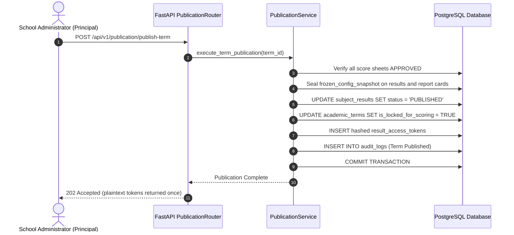

#### Post-Publication Correction Protocol
If an arithmetic error or grading omission is discovered *after* publication:
1. Direct inline updates are blocked by DB triggers.
2. An authorized Academic Officer submits an **Amendment Request**:
   - Includes: `student_enrollment_id`, `class_subject_id`, `new_score`, `justification_reason`.
3. Principal approves the amendment.
4. The system executes a versioned recalculation:
   - Increments report card version: `version = version + 1`.
   - Records full `before` and `after` diffs in `audit_logs`.
   - Revokes previous tokens and generates a revised report card snapshot with an explicit header stamp: *"AMENDED REPORT - ISSUED [TIMESTAMP]"*.

### 7.5 M5 Implementation Status & M5A Boundary
- M5 is live: `calculate-term`, `broadsheet`, `publish-term`, configuration read/update, frozen snapshots, database immutability triggers, and one-time SHA-256-hashed token issuance are implemented.
- M5 publication requires every score sheet to be `APPROVED`; it freezes the active grading, assessment, term, and annual-rule configuration into both `subject_results` and `term_report_cards`.
- Public token verification, report-card JSON payload assembly, branding storage, and email/SMS delivery remain in M6.
- Term attendance is Milestone 5A. Until 5A is implemented, `times_school_opened`, `times_present`, and `times_absent` remain `0` placeholders and do not block publication.
- Assessment-level `score_status = ABSENT` is unrelated to daily attendance and remains part of score computation.

---

## 8. Asynchronous Background Processing & File Generation

### 8.1 Async Workload Topology (Celery & Redis)

Heavy computational and I/O-bound operations are strictly isolated from HTTP web request worker threads.

```
[FastAPI Uvicorn Async Workers]
       │
       │ (Enqueues Tasks with Tenant Context)
       ▼
[Redis 7 Broker & Result Backend]
       ├── Queue: default         (General housekeeping, cache invalidations)
       ├── Queue: bulk_imports    (CSV/Excel student & score parsing)
       └── Queue: notifications   (Email & SMS delivery)
       │
       ▼
[Dedicated Celery Worker Pool]
  └── Worker Pool: Concurrency 8  (Imports & Notifications)
```

### 8.2 Bulk Student Import Pipeline
- Handled via `app.modules.students.tasks.process_student_bulk_import`.
- Accepts Excel (`.xlsx`) or CSV files uploaded to temporary staging storage.
- Validates rows sequentially using Pydantic v2 schemas.
- Implements atomic batch inserts via SQLAlchemy ORM batch operations.
- Generates a row-by-row error report if validation fails, returning it to the initiating administrator without committing partial dirty records.

### 8.3 Client-Side Document Assembly & PDF Generation Architecture

To eliminate high server memory consumption and recurring object storage (S3) costs, the platform utilizes **Client-Side Document Assembly**:

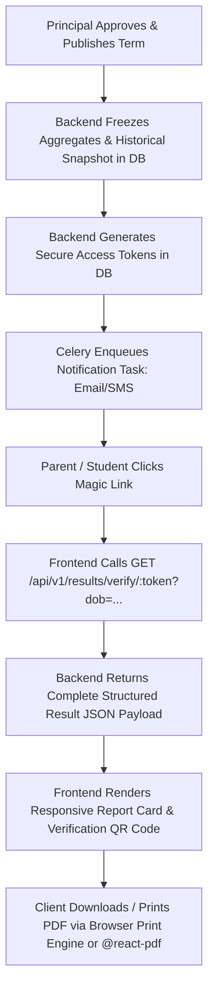

#### Key Advantages:
1. **Zero Storage Costs:** No need to store thousands of static PDF files per term on S3/MinIO.
2. **Immediate Availability:** Results are viewable instantly upon publication without waiting for long server-side PDF compilation queues.
3. **Responsive Mobile View:** Parents on smartphones view interactive, mobile-optimized grade breakdowns directly on their screens, with a one-click button to download or print a physical copy.
4. **Offline Resilience & Integrity:** The JSON payload includes a cryptographic verification signature (`qr_payload`) that prints onto the client-rendered document, allowing instant tamper verification.

### 8.4 Notification Dispatch & Magic Link Verification
- **Link Construction:** Magic links are generated with 256-bit entropy:
  `/r/v1/{token_value}` (relative to the configured frontend application URL).
- **Notification Body:** Emails do **not** attach PDF files directly. They contain an institutional greeting, term performance summary, and the secure call-to-action link.
- **Token Security:** Tokens expire after 14 days by default, or immediately upon manual revocation. Subsequent clicks regenerate fresh tokens if requested by verified guardians.

### 8.5 Idempotency, Dead-Letter Queues & Failure Recovery
- **Celery Task Idempotency:** Every task uses an `idempotency_key` based on `(task_name, tenant_id, resource_id, version)`. If a task is accidentally retried, the task checks Redis or DB state before executing duplicate work.
- **Dead-Letter Queue (DLQ):** Tasks that fail three consecutive retry attempts (with exponential backoff: 10s, 60s, 300s) are transferred to a `celery_dead_letter` queue for operational inspection and alerting via Sentry.

---

## 9. Multi-Tenancy & Tenant Isolation Architecture

### 9.1 Multi-Tenancy Strategy Evaluation & Decision

| Strategy | Operational Overhead | Data Isolation Level | Query Performance | Scalability (100+ Schools) | Recommendation |
|---|---|---|---|---|---|
| **Database-per-Tenant** | Extremely High (100s of DB migrations, connection pool explosion). | Absolute (Physical DB separation). | High per DB. | Poor for cost and fleet management. | Rejected |
| **Schema-per-Tenant** | High (Postgres schema limits, slow migration runs). | High (Separate schema namespaces). | Moderate. | Moderate (max ~500 schemas before catalog bloat). | Rejected |
| **Shared DB, Shared Schema (Tenant Scoped + RLS)** | Low to Moderate (Standard migrations, pooled connections). | Very High (Cryptographic & Kernel-enforced isolation). | High (Indexed on `school_id`). | Excellent (Thousands of schools on shared clusters). | **CHOSEN ARCHITECTURE** |

### 9.2 Request-Level Tenant Context Resolution via FastAPI `Depends`

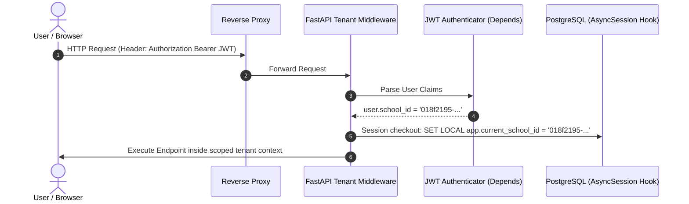

### 9.3 Database-Level Scoping & PostgreSQL Row-Level Security (RLS)

To eliminate the risk of application code omitting `school_id` in a SQLAlchemy query, the database itself enforces Row-Level Security:

#### 9.3.1 Enabling PostgreSQL RLS
```sql
-- Enable RLS on core tables
ALTER TABLE students ENABLE ROW LEVEL SECURITY;
ALTER TABLE assessment_scores ENABLE ROW LEVEL SECURITY;
ALTER TABLE subject_results ENABLE ROW LEVEL SECURITY;
ALTER TABLE term_report_cards ENABLE ROW LEVEL SECURITY;

-- Define tenant isolation policy
CREATE POLICY tenant_isolation_students ON students
    FOR ALL
    USING (
        school_id = NULLIF(current_setting('app.current_school_id', true), '')::UUID
        OR
        current_setting('app.is_super_admin', true) = 'true'
    );

CREATE POLICY tenant_isolation_scores ON assessment_scores
    FOR ALL
    USING (
        school_id = NULLIF(current_setting('app.current_school_id', true), '')::UUID
        OR
        current_setting('app.is_super_admin', true) = 'true'
    );
```

#### 9.3.2 SQLAlchemy 2.0 Base Model & Scoping Mixin
```python
# app/modules/common/models.py
from datetime import datetime
from uuid import UUID, uuid4
from sqlalchemy.orm import DeclarativeBase, Mapped, mapped_column
from sqlalchemy import DateTime, ForeignKey, text

class Base(DeclarativeBase):
    pass

class TenantMixin:
    """Ensures school_id is consistently defined across all tenant tables."""
    school_id: Mapped[UUID] = mapped_column(
        ForeignKey("schools.id", ondelete="RESTRICT"),
        index=True,
        nullable=False
    )

class TimestampMixin:
    created_at: Mapped[datetime] = mapped_column(
        DateTime(timezone=True),
        server_default=text("clock_timestamp()"),
        nullable=False
    )
    updated_at: Mapped[datetime] = mapped_column(
        DateTime(timezone=True),
        server_default=text("clock_timestamp()"),
        onupdate=datetime.utcnow,
        nullable=False
    )
```

### 9.4 Tenant Context Propagation across Async Tasks & Static Assets
- **Celery Tasks:** Every Celery task signature accepting tenant work must declare `school_id: str` as its first parameter. The task worker automatically sets the PostgreSQL session variable `app.current_school_id` upon connection checkout.
- **Tenant Asset Isolation:** School branding assets (logos, stamps, signatures) are namespaced strictly by `{school_slug}/branding/{asset_name}`, and every read/write must verify the authenticated tenant matches that namespace. M8 uses the local storage backend for the pilot; S3/Cloudinary are later providers. Static PDF files are not stored on disk or cloud buckets; results are served on-demand as structured JSON payloads for client-side rendering.

---

## 10. Authentication, Authorization & Security Architecture

### 10.1 Authentication, Session Life-Cycle & Rapid Token Revocation
- **JWT (JSON Web Tokens) with Time-Ordered `jti`:**
  - **Access Token:** Short-lived (15 minutes), signed with asymmetric RS256 (or HS256 in local development). Contains user claims: `sub` (user_id), `school_id`, `role`, `iat`, `exp`, and a unique time-ordered **`jti` (JWT ID)** generated via UUIDv7.
  - **Refresh Token:** Stored in secure, HTTP-only, SameSite=Strict cookies (7-day validity). Retained in database table `user_refresh_tokens` for renewal.
- **Two-Tier Rapid Token Revocation Architecture:**
  - **Tier 1 (Instant Single-Token Revocation via `jti`):** When a user logs out or an administrator terminates an active session, the backend registers `token:revoked:{jti}` in Redis with a TTL equal to the token's remaining lifespan. The `get_current_authenticated_user` dependency queries Redis (<1ms); once revoked, subsequent API calls fail immediately with `401 Unauthorized`.
  - **Tier 2 (Global Account Invalidation):** When a teacher is deactivated or changes password, `users.token_valid_after` is set to `clock_timestamp()`. Any access token with `iat < token_valid_after` is rejected across all devices.
- **Password Hashing:** Argon2id (via `passlib[argon2]`), with tuned cost parameters in test mode for sub-5ms suite execution.
- **Multi-Factor Authentication (MFA):** Mandatory for `SUPER_ADMIN` and `SCHOOL_ADMIN` accounts via TOTP (RFC 6238 / Authenticator Apps).
- **Rate Limiting:** Enforced via `slowapi` (Redis backend):
  - `/api/v1/identity/login`: 5 attempts per minute per IP.
  - `/api/v1/results/verify/`: 20 requests per minute per IP.

### 10.2 Staff & Teacher Onboarding Protocol
Teachers do not register via public signups. The onboarding lifecycle is strictly controlled by school administration:

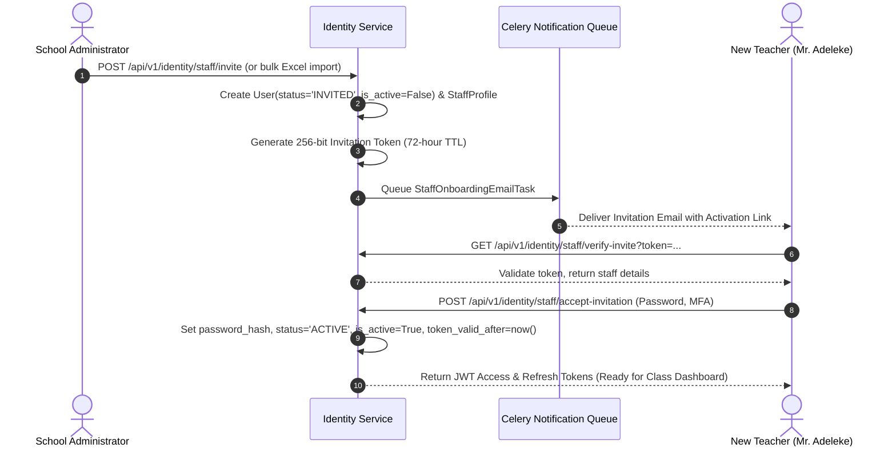

1. **Invitation Methods:**
   - **Single Staff Invitation:** Admin submits staff profile, email, phone, and optional initial arm/subject allocations.
   - **Bulk Staff Onboarding:** Admin uploads a staff roster spreadsheet (`.xlsx` or `.csv`). Celery parses and creates staff profiles in batch, queuing invitation emails.
2. **Activation Guarantee:**
   - Initial temporary passwords do not exist; accounts cannot authenticate until the invited teacher establishes their private password via the single-use invitation token.

### 10.2 Hybrid Access Control Architecture (RBAC + Scoped Delegated Permissions)

Real-world secondary school administration frequently requires teachers to perform administrative duties (e.g., **Examination Officer**, **Head of Department (HOD)**, **Level Coordinator**, or **Form Master**) alongside their normal teaching schedule. A rigid role-based system forces schools into a dangerous dilemma: either deny teachers the access they need, or escalate them to full School Admins.

The platform solves this with a **Hybrid Access Control Model**:
1. **Baseline Role Defaults (RBAC):** Every user is assigned a baseline role (`TEACHER`, `ACADEMIC_OFFICER`, `SCHOOL_ADMIN`), which confers an out-of-the-box set of permissions defined in `role_default_permissions`. For a teacher, this includes entering draft scores for assigned subjects.
2. **Direct Delegated Permission Grants:** School Administrators can grant atomic permissions (e.g., `scores:approve`, `scores:unlock`, `classes:enter_remarks`, `students:enroll`) directly to an individual user via `user_permission_grants`.
3. **Contextual Scoping (ABAC):** A delegated permission can be granted **school-wide** or scoped to a specific organizational boundary:
   - **`DEPARTMENT` Scope:** An HOD (e.g., Mr. Adeola) can approve scores for all subjects in the *Science* department.
   - **`ACADEMIC_LEVEL` Scope:** An SS1 Level Coordinator can approve results across all arms of *SS 1*.
   - **`CLASS_GROUP` Scope:** A Form Master can enter attendance and conduct remarks for *SS1 Science O*.
   - **`SCHOOL_WIDE` Scope:** An Assistant Examination Officer can approve or unlock scores across the entire school.

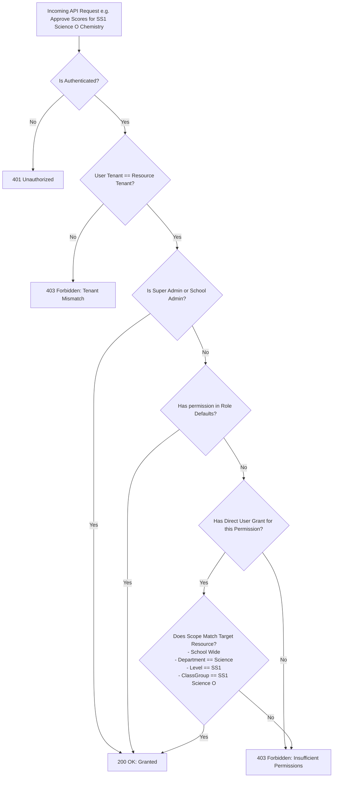

> **Implementation note (2026-11):** the snippet below reflects the as-built
> `app/core/permissions.py`, which differs from an earlier draft in two ways
> found during implementation. First, the scoped-grant query guards each
> column comparison with its own `scope_type` (`and_(scope_type == "DEPARTMENT",
> department_id == target_dept_id)`, not a bare `department_id == target_dept_id`
> inside the `or_`) — without that guard, SQLAlchemy compiles `Column == None`
> as `IS NULL`, so a `DEPARTMENT`-scoped grant would wrongly satisfy an
> `ACADEMIC_LEVEL`/`CLASS_GROUP` check whenever the caller doesn't supply that
> dimension, which is the normal case. Second, `scope_extractor` only works when
> the target resource's scope is derivable from the `Request` before the route
> body is parsed (path/query params); for the many routes where the resource
> (and therefore its department/level/class-group) is only known after the
> service layer resolves a request body or looks up a parent record, the
> scoped check instead happens inside the service function itself, via
> `require_scoped_permission(db, user, code, department_id=..., ...)`, called
> once the resource is in hand. `require_permission` (the FastAPI dependency)
> and `require_scoped_permission` (the service-layer call) share the same
> underlying `user_has_permission` check, so the semantics are identical either
> way.

#### Core Hybrid Permission Check
```python
# app/core/permissions.py
from uuid import UUID
from fastapi import Depends, Request
from sqlalchemy import and_, or_, select
from sqlalchemy.ext.asyncio import AsyncSession
from app.core.dependencies import get_current_authenticated_user, get_tenant_db
from app.core.exceptions import InsufficientPermissionException
from app.modules.identity.models import Permission, RoleDefaultPermission, User, UserPermissionGrant

async def user_has_permission(
    db: AsyncSession,
    user: User,
    permission_code: str,
    *,
    department_id: UUID | None = None,
    academic_level_id: UUID | None = None,
    class_group_id: UUID | None = None,
) -> bool:
    if user.role in ("SUPER_ADMIN", "SCHOOL_ADMIN"):
        return True

    scope_requested = department_id is not None or academic_level_id is not None or class_group_id is not None
    stmt_role = (
        select(Permission)
        .join(RoleDefaultPermission, RoleDefaultPermission.permission_id == Permission.id)
        .where(RoleDefaultPermission.role == user.role, Permission.code == permission_code)
    )
    if (await db.execute(stmt_role)).scalar_one_or_none() and not scope_requested:
        return True

    stmt_grant = (
        select(UserPermissionGrant)
        .join(Permission, Permission.id == UserPermissionGrant.permission_id)
        .where(
            UserPermissionGrant.user_id == user.id,
            UserPermissionGrant.school_id == user.school_id,
            UserPermissionGrant.deleted_at.is_(None),
            Permission.code == permission_code,
            or_(
                UserPermissionGrant.scope_type == "SCHOOL_WIDE",
                and_(UserPermissionGrant.scope_type == "DEPARTMENT", UserPermissionGrant.department_id == department_id),
                and_(UserPermissionGrant.scope_type == "ACADEMIC_LEVEL", UserPermissionGrant.academic_level_id == academic_level_id),
                and_(UserPermissionGrant.scope_type == "CLASS_GROUP", UserPermissionGrant.class_group_id == class_group_id),
            ),
        )
    )
    return (await db.execute(stmt_grant)).scalar_one_or_none() is not None


async def require_scoped_permission(
    db: AsyncSession, user: User, permission_code: str, *,
    department_id: UUID | None = None, academic_level_id: UUID | None = None, class_group_id: UUID | None = None,
) -> None:
    """Called from service code once the target resource is resolved. Checked
    in two passes: an unscoped role-default/SCHOOL_WIDE/admin bypass first
    (so e.g. an ACADEMIC_OFFICER's baseline permission isn't wrongly rejected
    just because this resource happens to carry a scope), then the resource's
    real scope against any DEPARTMENT/ACADEMIC_LEVEL/CLASS_GROUP grant."""
    if await user_has_permission(db, user, permission_code):
        return
    if await user_has_permission(db, user, permission_code, department_id=department_id,
                                   academic_level_id=academic_level_id, class_group_id=class_group_id):
        return
    raise InsufficientPermissionException(permission_code=permission_code)


def require_permission(permission_code: str, scope_extractor=None):
    """FastAPI dependency factory for routes whose scope is derivable from the
    Request alone (path/query params). Delegates to user_has_permission."""
    async def permission_checker(
        request: Request,
        current_user: User = Depends(get_current_authenticated_user),
        db: AsyncSession = Depends(get_tenant_db),
    ) -> bool:
        target_context = scope_extractor(request) if scope_extractor else {}
        allowed = await user_has_permission(
            db, current_user, permission_code,
            department_id=target_context.get("department_id"),
            academic_level_id=target_context.get("academic_level_id"),
            class_group_id=target_context.get("class_group_id"),
        )
        if not allowed:
            raise InsufficientPermissionException(permission_code=permission_code)
        return True
    return permission_checker
```

Resource-aware routes (class groups, subject offerings, class subjects, teacher assignments, student subject registrations, enrollments, assessment definitions, score sheets) call `require_scoped_permission` directly from their service function instead of passing a `scope_extractor` to the router-level dependency. Cross-cutting list endpoints (e.g. `GET /structure/class-groups`) keep the plain router-level `require_permission(code)` with no scope, since there is no single target resource to scope against.

### 10.3 IDOR Defense, Input Sanitization & Threat Modeling

#### Mitigation of OWASP Top 10 Threats

| Threat Vector | Potential Vulnerability in Academic SaaS | Architectural Mitigation Strategy |
|---|---|---|
| **BOLA / IDOR** | Teacher alters or reads another class arm's scores by guessing `class_subject_id`. | `assessments.services._check_class_subject_access` validates ownership against `TeacherAssignment` (score entry, submission, and read), falling back to scoped/`SCHOOL_WIDE` delegation for non-owning staff. Direct ID query without tenant scoping is blocked. |
| **Cross-Tenant Leakage** | Tenant A queries results of Tenant B via predictable URLs. | Multi-tier enforcement: RLS database policies + `get_tenant_db` dependency + UUIDv7 IDs + Tenant prefix validation. |
| **Grade Tampering** | Rogue actor changes published terminal exam score. | Immutability triggers on `subject_results` prevent updates once `status = 'PUBLISHED'`. All adjustments require a formal `CORRECTION_REQUEST` and are logged to immutable `audit_logs`. |
| **Insecure Direct Object File Access** | Public download of minor student report cards without authentication. | No static PDF files are stored or exposed. Access to report card payloads requires a cryptographically signed, expiring token validated against student verification parameters (e.g. Date of Birth). |
| **Denial of Service (DoS)** | Mass report request spikes exhausting server memory. | Client-side PDF rendering shifts CPU-heavy rendering to the client device; the backend only returns lightweight, cached JSON payloads. |

### 10.4 Immutable Audit Logging Engine
The `audit_logs` table records every critical state mutation. An asynchronous database trigger and Python listener record:
- Exact actor UUID, authenticated school UUID, client IP, and User-Agent.
- Action name (e.g., `SCORE_ENTERED`, `SCORE_AMENDED`, `PUBLICATION_APPROVED`).
- Full JSON serialization of the pre-change state and post-change state.
- **Tamper Resistance:** The `audit_logs` table has database-level revocation of `UPDATE` and `DELETE` permissions for the application user. Only `INSERT` and `SELECT` are granted.

### 10.5 Teacher Deactivation & Token Revocation Protocol
When a teacher departs an institution or is transferred, the `deactivate_teacher(user_id)` procedure executes atomically:
1. `users.is_active` set to `FALSE`.
2. `users.token_valid_after` set to `clock_timestamp()`. (Instantly invalidates all active JWT access tokens; API gateway checks token issue time against this timestamp).
3. All active refresh tokens for the user in Redis and PostgreSQL are deleted.
4. Active `teacher_assignments.is_active` set to `FALSE` with `end_date = CURRENT_DATE`.
5. **Historical Preservation:** All historical `assessment_scores.recorded_by_id`, `audit_logs`, and past assignment records remain intact. Foreign keys use `ON DELETE RESTRICT`.

---

## 11. Olivet Baptist High School Configuration Blueprint

### 11.1 Default Academic Levels, Departments & Arms

#### 1. Academic Levels
- **Junior Secondary:** `JSS 1`, `JSS 2`, `JSS 3` (Codes: `JSS1`, `JSS2`, `JSS3`, Orders: 1, 2, 3). Category: `JUNIOR_SECONDARY`.
- **Senior Secondary:** `SS 1`, `SS 2`, `SS 3` (Codes: `SS1`, `SS2`, `SS3`, Orders: 4, 5, 6). Category: `SENIOR_SECONDARY`.

#### 2. Senior Secondary Departments
- `Science` (Code: `SCI`)
- `Arts` (Code: `ART`)
- `Commercial` (Code: `COMM`)
*(Note: Junior Secondary levels have `department_id = NULL`).*

#### 3. Olivet Historic Class Arm Designations & Department Allocations

| Academic Level | Department | Canonical Class Arms Allocated | Resulting Class Cohort Display Names |
|---|---|---|---|
| **JSS 1** | *None* | `O`, `L`, `I`, `V`, `E`, `T`, `B`, `H`, `S`, `Y` | JSS1 O, JSS1 L, JSS1 I, JSS1 V, JSS1 E, ... |
| **JSS 2** | *None* | `O`, `L`, `I`, `V`, `E`, `T`, `B`, `H`, `S`, `Y` | JSS2 O, JSS2 L, JSS2 I, JSS2 V, JSS2 E, ... |
| **JSS 3** | *None* | `O`, `L`, `I`, `V`, `E`, `T`, `B`, `H`, `S`, `Y` | JSS3 O, JSS3 L, JSS3 I, JSS3 V, JSS3 E, ... |
| **SS 1** | **Science** | `O`, `L`, `I`, `V` | SS1 Science O, SS1 Science L, SS1 Science I, SS1 Science V |
| **SS 1** | **Commercial** | `E` | SS1 Commercial E |
| **SS 1** | **Arts** | `T`, `B`, `H`, `S`, `Y` | SS1 Arts T, SS1 Arts B, SS1 Arts H, SS1 Arts S, SS1 Arts Y |
| **SS 2** | **Science** | `O`, `L`, `I`, `V` | SS2 Science O, SS2 Science L, SS2 Science I, SS2 Science V |
| **SS 2** | **Commercial** | `E` | SS2 Commercial E |
| **SS 2** | **Arts** | `T`, `B`, `H`, `S`, `Y` | SS2 Arts T, SS2 Arts B, SS2 Arts H, SS2 Arts S, SS2 Arts Y |
| **SS 3** | **Science** | `O`, `L`, `I`, `V` | SS3 Science O, SS3 Science L, SS3 Science I, SS3 Science V |
| **SS 3** | **Commercial** | `E` | SS3 Commercial E |
| **SS 3** | **Arts** | `T`, `B`, `H`, `S`, `Y` | SS3 Arts T, SS3 Arts B, SS3 Arts H, SS3 Arts S, SS3 Arts Y |

### 11.2 Assessment Weightings & Standard Grading Scales
- **Assessment Components (Olivet-specific):**
  - Test 1: **10 marks** (Weight: 10%)
  - Test 2: **10 marks** (Weight: 10%)
  - Assignments/Attendance: **10 marks** (Weight: 10%)
  - Terminal Examination: **70 marks** (Weight: 70%)
  - **Total Obtainable per Subject:** **100 marks** (Weight: 100%)
- **Term Structure:**
  - `First Term` (September – December)
  - `Second Term` (January – April)
  - `Third Term` (May – July)

### 11.3 Configuration Versioning & Transition Rules
- Configuration changes (e.g., altering Olivet's assessment weighting from 10/10/10/70 to a different split) require an **Academic Session Boundary**.
- An existing active term’s assessment weights cannot be altered once score entry has commenced (`DRAFT` scores > 0).
- When a new academic session is created, the system clones the configuration of the previous session into a new versioned schema row, allowing the school administrator to adjust parameters without affecting past records.

### 11.4 Nigerian Primary School Blueprint (M9 — LIVE)

Seed defaults for Nigerian three-term primary schools. These are template values, not hardcoded business rules; the existing configuration/template routes remain authoritative.

- **Levels:** `Basic 1`–`Basic 6`, codes `BASIC1`–`BASIC6`, orders 1–6, category `PRIMARY`.
- **Arms:** `A`, `B`, `C`, `D`.
- **Departments:** none. Primary class groups, subject offerings, and permission scopes use `department_id = NULL`; use `ACADEMIC_LEVEL` or `CLASS_GROUP` scopes where delegation is needed.
- **Subjects:** all primary subjects are compulsory core (`is_elective = FALSE`, `is_trade_subject = FALSE`, registration category `COMPULSORY_CORE`). No electives, trade subjects, or elective-registration steps. The live primary template (`nigeria_primary_basic1_6`) seeds 10 configurable core subjects: English Language (`ENG`), Mathematics (`MTH`), Basic Science (`BSC`), Social Studies (`SOS`), Civic Education (`CIV`), Religious and Moral Education (`RME`), Physical and Health Education (`PHE`), Creative Arts (`CRA`), Computer Studies (`CST`), and Nigerian Language (`NLG`).
- **Assessment defaults:** `TEST1` 10, `TEST2` 10, `ASSIGN` 10, `EXAM` 70 — 30% continuous assessment / 70% terminal examination.
- **Grading default:** the primary `A`–`F` scale in §7.2 (grade point `0.00`).
- **Annual rules:** the same three terms with equal weights (1/3 each); `>= 50%` → `PROMOTED`, `40–49.99%` → `PROMOTED_ON_TRIAL`, `< 40%` → `REPEATING`. Reuse the current three-term computation; no generic multi-term refactor in M9.
- **Report template id:** `default_primary_v1`.

---

## 12. Testing & Quality Assurance Strategy

### 12.1 Testing Pyramid & Coverage Thresholds
The platform enforces a mandatory **minimum 85% automated test coverage** across domain services and computation engines.

```
       / \
      /   \      E2E Tests (Playwright) - 10%
     /-----\     Critical paths: Login -> Bulk Score Entry -> Publish -> Magic Link View
    /       \
   /---------\   Integration & API Tests (pytest-asyncio + httpx) - 30%
  /           \  Tenant isolation, DB transactions, Celery tasks, Auth boundaries
 /-------------\
/               \ Pure Unit & Property-Based Tests (Hypothesis) - 60%
----------------- Calculation engine, grading scales, tie-breakers, serializers
```

### 12.2 Async Cross-Tenant Isolation Test Harness
Tests execute with `httpx.AsyncClient` against isolated tenant contexts:

```python
# tests/test_tenant_isolation.py
import pytest
from httpx import AsyncClient
from uuid import uuid4

@pytest.mark.asyncio
async def test_cross_tenant_student_isolation(
    async_client: AsyncClient,
    tenant_a_headers: dict,
    tenant_b_student_id: uuid4
):
    """Verify that Tenant A cannot access Tenant B's student record via direct ID."""
    response = await async_client.get(
        f"/api/v1/students/{tenant_b_student_id}",
        headers=tenant_a_headers
    )
    # Must return 404 Not Found (Row-Level Security hides the row completely)
    assert response.status_code == 404
```

### 12.3 Academic Computation Property-Based Testing
Using the `Hypothesis` library, the computation engine is fuzzed with thousands of generated score combinations:
- **Invariant 1:** Sum of assessment scores must never exceed 100.00 unless explicitly configured.
- **Invariant 2:** Standard competition rank must always equal `1 + count(students with strictly greater score)`.
- **Invariant 3:** Overall percentage calculation must be mathematically identical whether computed per subject or in aggregate.

---

## 13. Deployment, Infrastructure & Operational Runbook

### 13.1 Deployment Topology & Docker Compose Environment

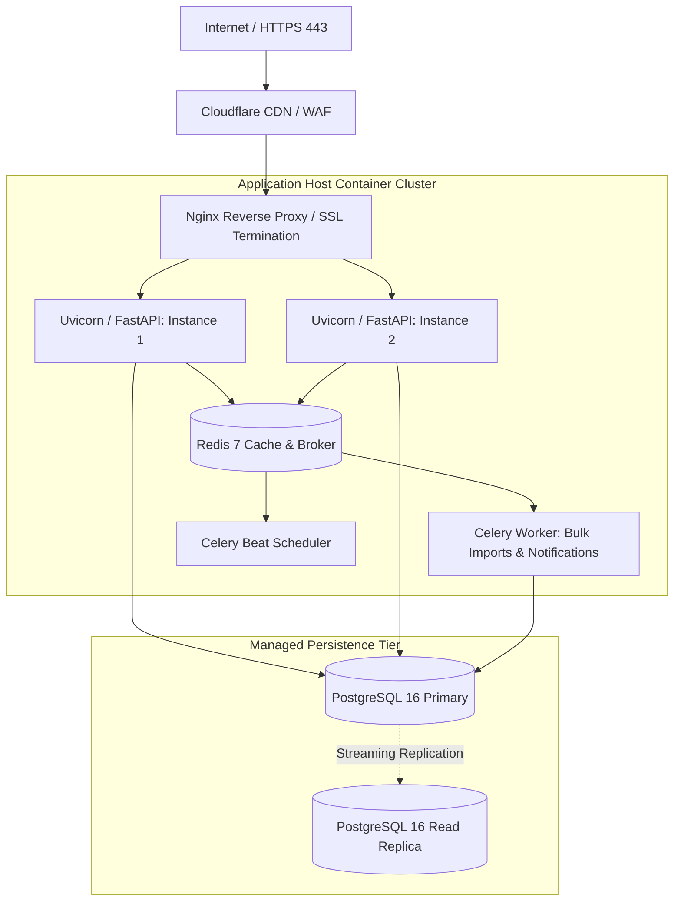

### 13.2 Environment Segregation & Secrets Management
- **Environments:** Development (`local`), Staging (`staging`), Production (`production`).
- **Secrets Management:** Injected at container runtime via AWS Secrets Manager or HashiCorp Vault. Zero secrets stored in Git repositories.

### 13.3 Backup, Point-in-Time Recovery (PITR) & Disaster Recovery
- **Continuous Archiving:** PostgreSQL WAL (Write-Ahead Logging) archiving streamed directly to an isolated, multi-region encrypted backup storage.
- **Automated Snapshots:** Full daily database dumps executed via `pg_dump` at 02:00 Africa/Lagos time, retained with a 30-day GFS (Grandfather-Father-Son) rotation policy.
- **RPO / RTO Targets:**
  - **Recovery Point Objective (RPO):** < 15 minutes (via WAL streaming).
  - **Recovery Time Objective (RTO):** < 2 hours (via automated Docker/Postgres restoration script).

### 13.4 Observability, Telemetry & Structured Logging
- **Structured JSON Logging:** All application events logged in JSON format to stdout, parsed by Promtail/Fluentbit and ingested into Grafana Loki.
- **APM & Error Monitoring:** Sentry integrated for real-time unhandled exception tracking, tagged with `school_id`, `role`, and `release_version`.
- **Metrics:** Prometheus endpoint `/metrics` exposing request latency histograms, Celery queue depth, and database connection pool saturation.

---

## 14. Implementation Roadmap & Milestones

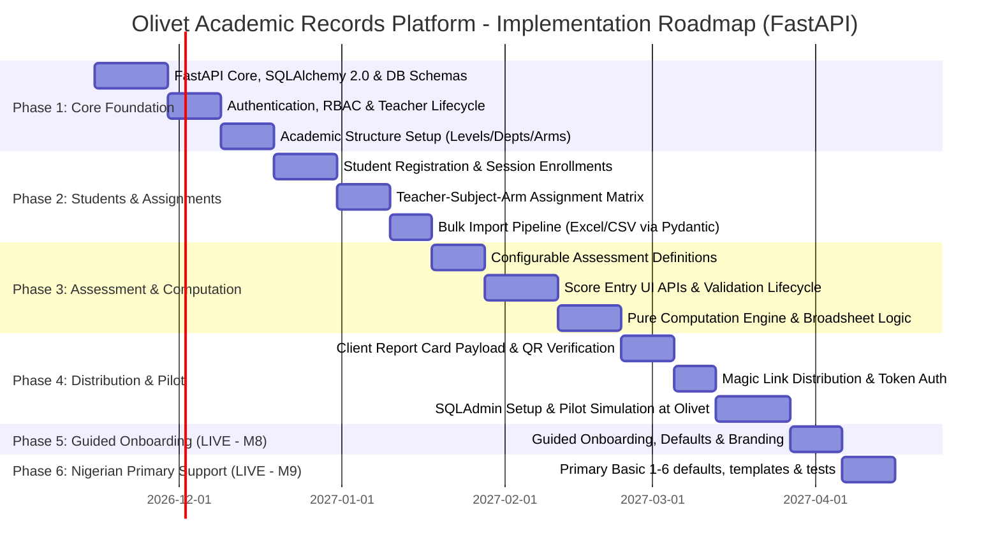

### Detailed Phase Deliverables & Acceptance Criteria

#### Phase 1: Multi-Tenant Foundation & Academic Structure
- **Deliverables:** Working Docker environment, Alembic async migrations, `get_tenant_db` dependency with PostgreSQL RLS, User/Staff models, Academic Structure models (Sessions, Terms, Levels, Departments, ClassArms, ClassGroups).
- **Acceptance Criteria:** Successfully provision two distinct schools (Olivet and a generic test school) in a single DB; verify that academic levels and arm designations are completely isolated.

#### Phase 2: Student Enrollment & Subject Allocation
- **Deliverables:** Student entity, Session enrollment engine, Subject catalog, ClassSubject instantiation, Teacher assignment APIs.
- **Acceptance Criteria:** Bulk import 1,000 students via Excel; allocate teachers to multiple arms in SS1 Science; verify that deactivating a teacher immediately revokes their assignment access while preserving historical ties.

#### Phase 3: Score Entry, Approval Workflow & Computation Engine
- **Deliverables:** Assessment definitions, Score bulk entry endpoints, State machine (`DRAFT` $\to$ `SUBMITTED` $\to$ `APPROVED`), Computation engine for totals, grades, positions, and averages.
- **Acceptance Criteria:** Score entries validated against assessment maximums; competition ranking mathematically verified with ties; approval workflow locks records from further editing.

#### Phase 4: Result Publication, Client-Side PDF & Pilot Delivery
- **Deliverables:** Publication snapshotting engine, Structured report JSON payload with QR verification, Magic link verification API, email notification worker, SQLAdmin dashboard.
- **Acceptance Criteria:** Publish 1,500 individual student report records in seconds without storage bottlenecks; verify frontend client can assemble and export print-ready PDFs locally from the verified payload without server-side rendering delay.

#### Phase 5: Guided Onboarding, Defaults, Branding & Structure Templates (M8 — LIVE)
- **Deliverables:** Public default-template catalog, aggregate admin setup read/save, tenant-isolated local branding uploads, and idempotent structure template apply.
- **Acceptance Criteria:** A new school can review defaults, save its configuration, optionally apply a structure template twice without duplicates, and upload branding that only its own tenant can read. Custom domains remain out of scope.

#### Phase 6: Nigerian Primary Basic 1–6 Support (M9 — LIVE)
- **Deliverables:** `school_type` plus `PRIMARY` level category, primary defaults/templates, onboarding template choice, and a primary structure/subject template that creates core offerings and class subjects.
- **Acceptance Criteria:** See §17.5: no departments/electives/trades, idempotent template apply, primary grading/assessment/annual rules verified, and cross-tenant isolation preserved.

---

## 15. Architectural Challenges, Trade-offs & Deep-Dive Critique

### 1. Challenge: Class Arms vs. Department Relationships
- **The Pitfall:** In some systems, `ClassArm` is made a child of `Department`. This fails in junior secondary schools where departments do not exist!
- **Our Resolution:** We model `ClassArm` as an independent entity representing the canonical letter/name (`O`, `L`, `A`, `B`). The physical cohort is the `ClassGroup`, which sits at the intersection of `(Level, Department [Optional], Arm)`. This cleanly supports both non-departmental JSS (`JSS1 A`) and departmental SS (`SS1 Science O`).

### 2. Challenge: Subject Assignment Granularity
- **The Pitfall:** Forcing administrators to manually create 10 separate teacher assignments if one teacher handles Mathematics for 10 arms causes administrative fatigue. Conversely, assigning a teacher only at the Department level prevents assigning different teachers to different arms.
- **Our Resolution:** Assignments are stored at the granular `ClassSubject` level (`ClassGroup` + `SubjectOffering`). However, the API provides a **Cascading Bulk Assignment Endpoint**: an administrator can select `SS1 Science` (all arms) and a teacher; the service automatically cascades and populates the individual `ClassSubject` assignment records. This gives bulk convenience with granular override flexibility.

### 3. Challenge: Historical Result Preservation vs. Dynamic Config Changes
- **The Pitfall:** If a school changes its grading scale in 2026 (e.g., raising the A1 threshold from 70 to 75), a naive database query recalculating past 2024 results would erroneously downgrade historical student honors.
- **Our Resolution:** The `term_report_cards` and `subject_results` tables store the computed grades, points, and ranks as frozen columns alongside a complete `frozen_config_snapshot` JSON blob. Once published, results are never recomputed dynamically on read.

### 4. Challenge: Handling Score Omissions (Absent vs. Exempt vs. Zero)
- **The Pitfall:** Many commercial systems treat unentered or excused scores as `0`, unfairly destroying a student’s grade point average when medically excused.
- **Our Resolution:** We introduced an explicit `score_status` enum (`SCORED`, `ABSENT`, `EXEMPT`, `PENDING`). `ABSENT` equates to zero, while `EXEMPT` scales the obtainable denominator, protecting student fairness. Incomplete (`PENDING`) scores strictly halt the publication pipeline.

---

## 16. Architectural Decisions & Product Owner Confirmations

All core architectural questions have been formally reviewed and confirmed:

1. **Third Term Cumulative (Annual) Computation Model: [RESOLVED & APPROVED]**
   - *Decision:* The platform natively supports **both** standard terminal report cards (Term 1, Term 2, Term 3 individual terminal scores) and an **Annual Cumulative Summary** on Third Term report cards.
   - *Implementation:* `subject_results` stores terminal scores for Terms 1, 2, and 3 alongside cumulative annual totals and grades. `term_report_cards` stores cumulative average percentages, annual class positions, and official promotion decisions (`PROMOTED`, `REPEATING`, `PROMOTED_ON_TRIAL`).

2. **Subject Elective Boundaries & Trade Subjects per Student: [RESOLVED & APPROVED]**
   - *Decision:* Fully supported via `student_subject_registrations`.
   - *Implementation:* Compulsory core subjects auto-register upon class enrollment; senior trade electives (Catering Craft, Data Processing, etc.) are registered individually. Score entry sheets for trade subjects display only enrolled students, and obtainable mark totals adapt dynamically per student.

3. **Parent Distribution Channels: [RESOLVED & APPROVED]**
   - *Decision:* **Email-only distribution for MVP.** Magic links to access the client-side assembled report cards are delivered securely via email.
   - *Roadmap:* WhatsApp and SMS distribution gateways (e.g. Termii / Infobip) are deferred to Post-MVP (Phase 2).

4. **School Stamp & Digital Signatures: [RESOLVED & APPROVED]**
   - *Decision:* **Supported out of the box.**
   - *Implementation:* Digital asset storage fields are integrated on `schools` (`stamp_image_url`, `principal_signature_url`) and `staff_profiles` (`signature_image_url`). These image assets are passed securely in the verified JSON report payload and embedded directly into the client-rendered PDF.

5. **Storage Provider Strategy (Branding & Signatures): [RESOLVED & APPROVED]**
   - *Decision:* Design an abstract `StorageService` interface supporting both **AWS S3** and **Cloudinary** (with local disk storage for development).
   - *Scope:* Storage is required only for institutional branding assets (logos, stamps, signatures); rendered student report cards require zero object storage as they are generated client-side on-demand.

6. **M3/M4 Implementation Gaps, Resolved During Build: [RESOLVED & APPROVED]**
   - *Auto-registration category (M3):* On `StudentEnrollment` creation, every `ClassSubject` reachable from the enrollment's `ClassGroup` whose `Subject.is_elective = FALSE` is auto-registered: `COMPULSORY_CORE` if its `SubjectOffering.department_id IS NULL`, else `DEPARTMENT_CORE`. Electives (`is_elective = TRUE`, including trade subjects) are never auto-registered — they always go through `POST /enrollments/{id}/subject-registrations`, categorized `TRADE_ELECTIVE` (if `is_trade_subject`) or `FREE_ELECTIVE`.
   - *Assessment definition auto-provisioning (M3 → M4 boundary):* Creating a `ClassSubject` calls `assessments.services.seed_assessment_definitions_for_class_subject`, which clones the school's active `school_configurations.assessment_weight_schema` into concrete `assessment_definitions` rows for every `AcademicTerm` already present in the offering's `AcademicSession` at creation time.
   - *Score-sheet lifecycle (M4):* Added a new `score_sheet_statuses` table (see §4.3.4) keyed by `(academic_term_id, class_subject_id)` to carry the DRAFT → SUBMITTED → APPROVED state — the originally specified `subject_results.status` column is a Computed-entity field normally written by the M5 Computation Engine, not by teachers submitting raw scores, so it could not serve this purpose.
   - *Teacher-assignment and student-registration removal:* Added `DELETE /class-subjects/{id}/teacher-assignments/{assignment_id}` and `DELETE /enrollments/{id}/subject-registrations/{registration_id}` (both deactivate, never hard-delete) — the original endpoint catalog specified creating these links but not removing a single one independently of deactivating the whole teacher account or re-running a bulk import.

7. **Scoped Delegation Enforcement, Resolved Platform-Wide: [RESOLVED & APPROVED]**
   - *Problem found:* `DEPARTMENT`/`ACADEMIC_LEVEL`/`CLASS_GROUP`-scoped grants could never pass a router-level `require_permission(code)` dependency, because that dependency has no way to see the target resource's scope before the request body is parsed or a parent record is looked up — it would reject any non-`SCHOOL_WIDE` grant outright, regardless of what §10.2's scope-matching logic would otherwise allow.
   - *Fix:* for every resource with a real department/level/class-group dimension — class groups, subject offerings, class subjects, teacher assignments, student subject registrations, enrollments, assessment definitions, and score sheets — the router-level dependency was removed from the single-resource (create/get/update/retire) routes and replaced with a `require_scoped_permission` call inside the service function, once the resource (and therefore its scope) is resolved. See §10.2 for the mechanism.
    - *List endpoints, resolved in the same pass:* `GET /structure/class-groups`, `GET /subjects/offerings`, `GET /class-subjects`, `GET /assessments/definitions`, and `GET /students/{id}/enrollments` now call `get_permission_scope` + `build_scope_filter` (§10.2) to add a `WHERE department_id IN (...) OR academic_level_id IN (...) OR class_group_id IN (...)` clause for callers who hold only scoped grants, rather than requiring unscoped access or rejecting outright. A caller with no applicable grant at all (not even a scoped one) still gets `403` on the list itself. The subject catalog list (`GET /subjects`) and staff/user management (`users:manage`, `permissions:delegate`) have no department/level/class-group dimension in the data model and remain unscoped-only — there is nothing to filter them by.

8. **Guided Onboarding Decisions (M8): [RESOLVED & APPROVED]**
   - *Structure templates are optional:* applied at onboarding only on explicit opt-in via `POST /api/v1/structure/templates/apply`, which is idempotent. Defaults are never forced on a school.
   - *Custom domains are post-pilot/PLANNED:* documented in §6.4.4 only; no custom-domain endpoints ship for the pilot.
   - *Branding uploads are included in M8:* local storage for the pilot, with S3/Cloudinary as later providers behind the existing `StorageService` abstraction. Assets are tenant-namespaced and PDFs are not stored server-side.
   - *Catalog vs. setup access:* the default-template catalog is public; school-specific setup read/save, branding uploads, and template application are admin-authenticated.

---

## 17. M9: Nigerian Primary Basic 1-6 Support (LIVE)

**Status: LIVE.** M9 extends the platform to Nigerian three-term primary schools
(Basic 1–6). It reuses the current term computation, publication snapshots, and
verification flow unchanged; there is **no generic multi-term refactor** in this
milestone. All M9 routes, fields, templates, and the primary report variant are
live.

### 17.1 Scope decisions

- Target: Nigerian primary schools with three terms per session, levels `Basic 1`
  through `Basic 6` (`PRIMARY`, codes `BASIC1`–`BASIC6`), and arms `A`, `B`, `C`,
  `D`.
- No departments anywhere in primary: class groups, subject offerings, and
  scoped grants use `department_id = NULL` with `ACADEMIC_LEVEL`/`CLASS_GROUP`
  scopes instead.
- All primary subjects are compulsory core. No electives, trade subjects, or
  `student_subject_registrations` choices for `TRADE_ELECTIVE`/`FREE_ELECTIVE`.
- `Student` remains the data-model name; primary UIs may label the person
  **pupil**. The class teacher is the **homeroom teacher** and supplies the
  report's `class_teacher_comment`.
- Defaults: primary `A`–`F` grading (§7.2), `10/10/10/70` assessment split
  (30% CA / 70% exam), equal term weights, `50%`/`40%` promotion thresholds
  (§11.4), and report template `default_primary_v1`.

### 17.2 Data model & migration

- `schools.school_type VARCHAR(16) NOT NULL DEFAULT 'SECONDARY'`, constrained to
  `PRIMARY | SECONDARY`. Existing tenants are backfilled to `SECONDARY`.
- `academic_levels.category` extends its check constraint to
  `PRIMARY | JUNIOR_SECONDARY | SENIOR_SECONDARY`; no new tables are required.
- Existing nullable `department_id` columns on `class_groups` and
  `subject_offerings` are reused; M9 services enforce `NULL` for primary rows.
- Alembic revision `b1c4d7e9a2f0_m9_primary_school_support.py` applies the column,
  constraint, and backfill. Downgrade restores the previous category constraint
  and drops `school_type`. Configuration defaults/templates are seeded by a
  service/seed step, not by DDL.

```sql
ALTER TABLE schools ADD COLUMN school_type VARCHAR(16) NOT NULL DEFAULT 'SECONDARY';
ALTER TABLE schools ADD CONSTRAINT chk_schools_school_type
  CHECK (school_type IN ('PRIMARY', 'SECONDARY', 'COMBINED'));
ALTER TABLE academic_levels DROP CONSTRAINT chk_level_category;
ALTER TABLE academic_levels ADD CONSTRAINT chk_level_category
  CHECK (category IN ('PRIMARY', 'JUNIOR_SECONDARY', 'SENIOR_SECONDARY'));
```

### 17.3 Endpoint additions (all LIVE)

No new domains or legacy aliases; M9 extends existing canonical routes.

| Method | Path | M9 change | Permission |
|---|---|---|---|
| `GET` | `/api/v1/identity/onboarding/templates` | Public catalog returns a JSON array (`data: [...]`) containing `olivet_nigeria_default`, `nigeria_junior_secondary_default`, `nigeria_senior_secondary_default` (`SECONDARY`), `nigeria_primary_default` (`PRIMARY`), and `nigeria_combined_default` (`COMBINED`). | `ANONYMOUS` |
| `POST` | `/api/v1/identity/schools` | Accept `school_type = PRIMARY\|SECONDARY\|COMBINED`; seed the matching grading/assessment/annual schema and report template (`default_primary_v1` for primary). | `SUPER_ADMIN` |
| `GET`, `PATCH` | `/api/v1/identity/schools/{school_id}/setup` | Read/save `school_type` and the selected template in the aggregate setup payload. | `SCHOOL_ADMIN` |
| `POST` | `/api/v1/structure/templates/apply` | Accept `template_type = PRIMARY\|SECONDARY\|COMBINED` or `template_id` (`olivet_nigeria_jss_ss3`, `nigeria_junior_secondary`, `nigeria_senior_secondary`, `nigeria_primary_basic1_6`, `nigeria_combined_k12`). Idempotent. | `structure:manage` |
| `GET`, `POST` | `/api/v1/subjects/offerings`, `/api/v1/class-subjects` | Unchanged routes used by the primary template; primary rows have `department_id = NULL` and `is_elective = FALSE`. | `subjects:manage` |
| `POST` | `/api/v1/computation/calculate-term`, `GET /api/v1/computation/broadsheet/{class_group_id}`, `POST /api/v1/publication/publish-term` | Unchanged reuse of the live three-term flow. (Note: `GET /api/v1/results/verify/{token}` and the rendered report card JSON payload in §6.3.2—where `TermReportCard.teacher_comment` maps to `class_teacher_comment`—are specified for **Milestone 6**, which remains PLANNED/PARTIAL.) | Existing permissions |

### 17.4 Tasks

- [x] **Task 9.1: Documentation and architecture alignment.** Mark M9 LIVE in `ARCHITECTURE.md`, `BACKEND_DEV_PLAN.md`, and the frontend docs; record shipped primary scope, defaults, endpoints, and report variant.
- [x] **Task 9.2: Schema and migration.** Added `schools.school_type`, extended `academic_levels.category` with `PRIMARY`, backfilled existing schools, and verified clean upgrade/downgrade in `b1c4d7e9a2f0_m9_primary_school_support.py`.
- [x] **Task 9.3: Primary defaults and templates.** Seed the `A`–`F` grading scale, `10/10/10/70` assessment weights, equal term weights, `50%`/`40%` promotion thresholds, Basic 1–6 levels, arms A–D, 10 compulsory core subjects, and `default_primary_v1`.
- [x] **Task 9.4: Onboarding `school_type`.** Accept PRIMARY/SECONDARY at school creation and in setup; return both templates from the public catalog; select the matching defaults while preserving existing secondary behaviour. Changing school type without explicit config reseeds the matching defaults.
- [x] **Task 9.5: Structure/subject template apply.** `POST /api/v1/structure/templates/apply` accepts `template_type`; `nigeria_primary_basic1_6` idempotently creates levels, arms, 60 core offerings, and 240 class subjects across 24 groups with no departments/electives/trades, and backfills registrations.
- [x] **Task 9.6: Tests.** Cover success, validation, cross-tenant denial, idempotent re-apply, primary computation/annual rules, and end-to-end primary lifecycle.

### 17.5 Definition of Done

- [x] Migration upgrades/downgrades cleanly; all existing secondary tenants remain `SECONDARY` and all existing levels retain valid categories.
- [x] Onboarding can select a primary school; the public catalog exposes both secondary and primary templates and primary seeds `default_primary_v1`.
- [x] Applying the primary template twice creates no duplicates: six `PRIMARY` levels, four arms, no departments, 10 core subjects, 60 offerings, and 240 class subjects across 24 groups.
- [x] All primary registrations are `COMPULSORY_CORE`; no elective or trade registration path is exposed for primary.
- [x] `Decimal` engine tests verify `70–100 = A`, `60–69.99 = B`, `50–59.99 = C`, `45–49.99 = D`, `40–44.99 = E`, `0–39.99 = F`, grade point `0.00`, 30/70 assessment split, equal term weights, and `50%`/`40%` promotion outcomes.
- [x] Cross-tenant denial and validation tests pass for every changed route; idempotency is asserted for template apply; M9 is **LIVE** in all docs (with M6 report verification payload clearly separated as M6).

---
*End of Architectural Specification. Document maintained under strict version control.*
