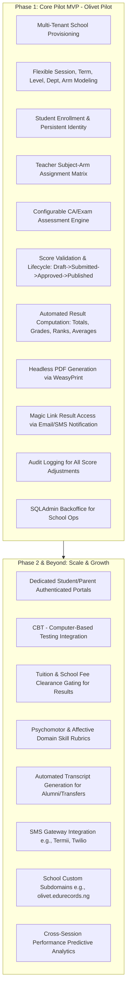
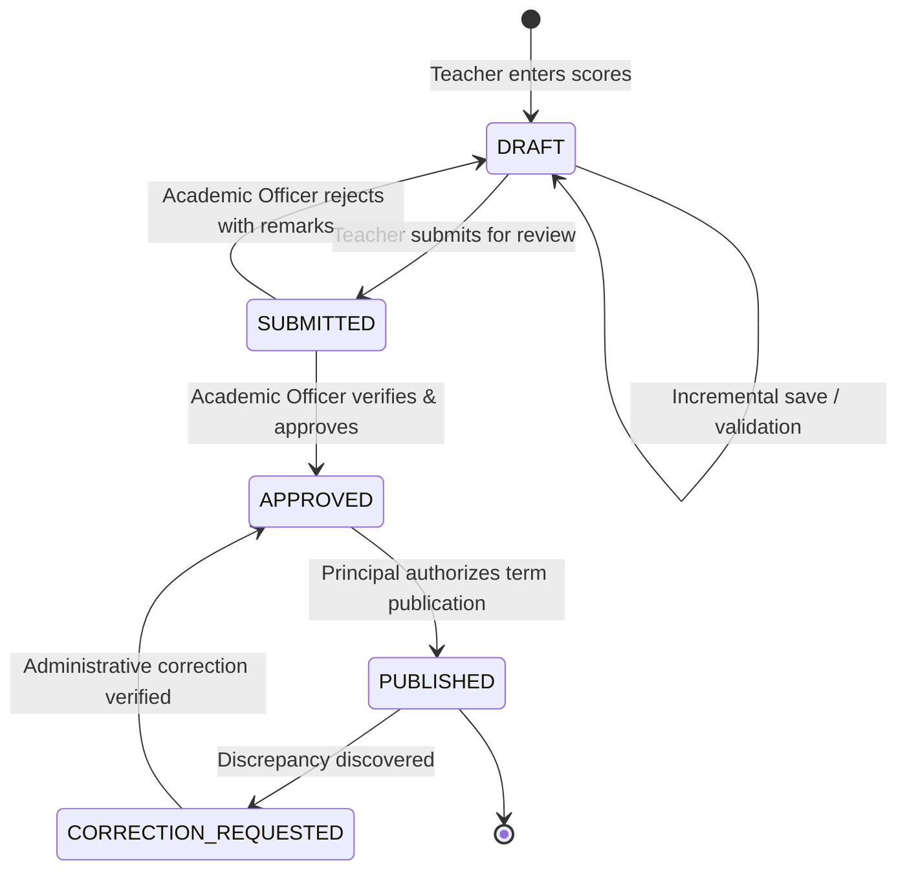
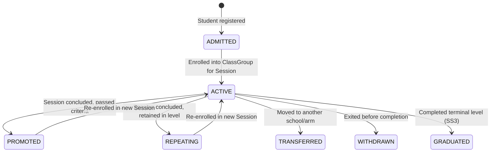
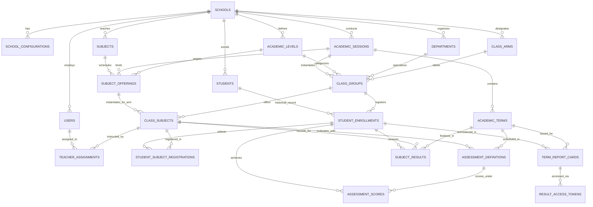
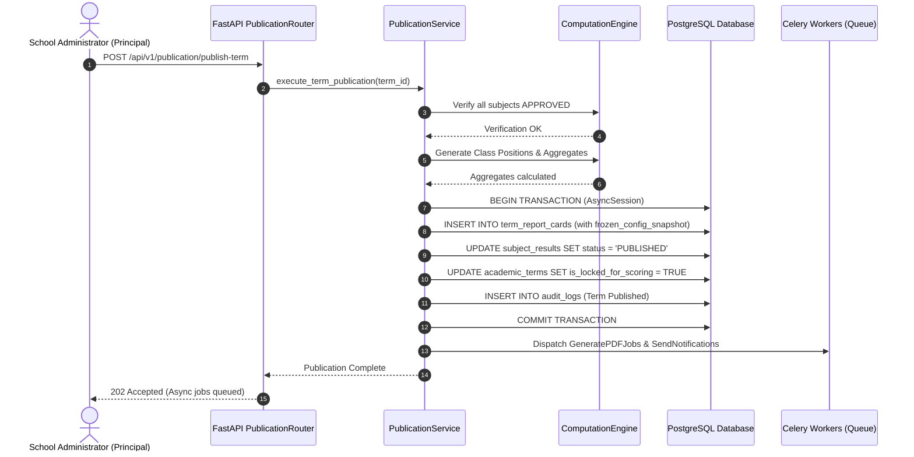
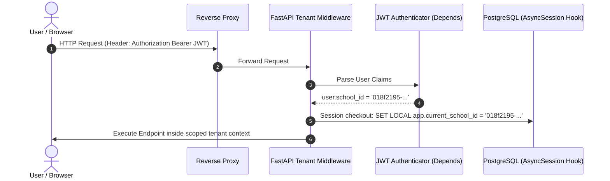
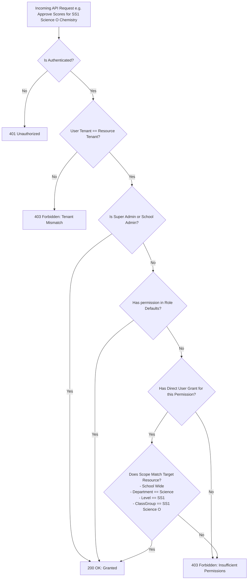
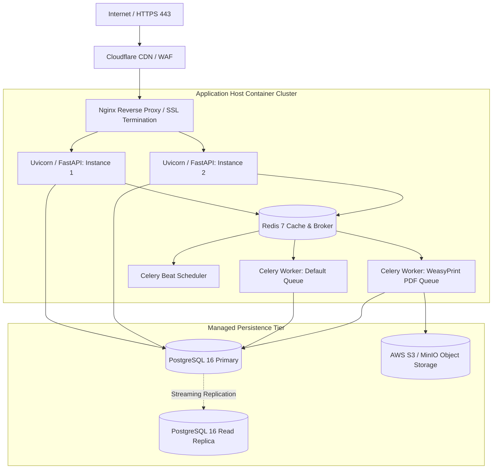
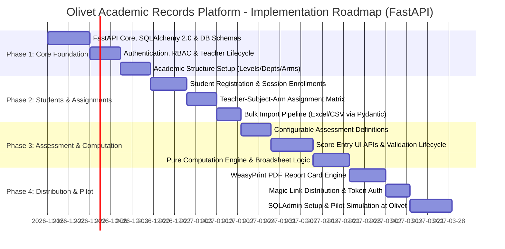

# Software Architecture Plan: Multi-Tenant Academic Records Management Platform
**Target Pilot:** Olivet Baptist High School, Oyo, Nigeria  
**Platform Scope:** Multi-School Academic SaaS (Junior & Senior Secondary Schools)  
**Document Version:** 2.0.0-FASTAPI-SPEC  
**Status:** Approved for Implementation Architecture  
**Architect:** Senior Software Architect (SaaS, Security & Academic Systems)  
**Primary Tech Stack:** FastAPI, Pydantic v2, SQLAlchemy 2.0 (Async), Alembic, PostgreSQL 16 (RLS), Celery, Redis, WeasyPrint

---

## Table of Contents
1. [Executive Summary & Architectural Tenets](#1-executive-summary--architectural-tenets)
2. [Product Understanding & Scope Boundary](#2-product-understanding--scope-boundary)
   - 2.1 Problem Statement & Platform Purpose
   - 2.2 Actor & Stakeholder Taxonomy
   - 2.3 MVP vs. Post-MVP Capability Matrix
   - 2.4 Fundamental Architectural Assumptions
3. [Domain Modeling & Ubiquitous Language](#3-domain-modeling--ubiquitous-language)
   - 3.1 Bounded Contexts
   - 3.2 Core Entities & Value Objects
   - 3.3 Domain Life-Cycles & State Machines
   - 3.4 Platform-Level vs. Tenant-Scoped Entity Hierarchy
4. [Relational Database Schema & Data Architecture](#4-relational-database-schema--data-architecture)
   - 4.1 Schema Design Principles & UUIDv7 Standard
   - 4.2 Comprehensive Entity-Relationship Diagram (Mermaid)
   - 4.3 Data Dictionaries & DDL Table Specifications
   - 4.4 Advanced Constraints, Indexes & Historical Snapshots
5. [Application Architecture & Modular Monolith Design (FastAPI)](#5-application-architecture--modular-monolith-design-fastapi)
   - 5.1 FastAPI Modular Monolith Architectural Justification
   - 5.2 Layered Architecture & Module Boundaries
   - 5.3 Communication Contracts Between Modules
   - 5.4 Repository Directory Structure
   - 5.5 Business Logic Placement: Service Layer, Domain Policies & Dependency Injection
   - 5.6 Operational Administration Interface Strategy (SQLAdmin Integration)
6. [API Architecture & Interface Contracts](#6-api-architecture--interface-contracts)
   - 6.1 API Conventions, OpenAPI 3.1 Standards & Error Envelopes
   - 6.2 Endpoint Catalog by Domain
   - 6.3 End-to-End JSON Request/Response Payloads & Pydantic v2 Schemas
7. [Result Computation & Processing Engine](#7-result-computation--processing-engine)
   - 7.1 Assessment Aggregation, Missing Scores & Exceptions
   - 7.2 Grading Scales, Grade Points & Performance Remarks
   - 7.3 Ranking Algorithms, Subject Averages & Tie-Breakers
   - 7.4 Historical Immutability, Snapshotting & Post-Publication Amendments
8. [Asynchronous Background Processing & File Generation](#8-asynchronous-background-processing--file-generation)
   - 8.1 Async Workload Topology (Celery & Redis)
   - 8.2 Bulk Student Import Pipeline
   - 8.3 PDF Compilation via WeasyPrint
   - 8.4 Notification Dispatch & Magic Link Verification
   - 8.5 Idempotency, Dead-Letter Queues & Failure Recovery
9. [Multi-Tenancy & Tenant Isolation Architecture](#9-multi-tenancy--tenant-isolation-architecture)
   - 9.1 Multi-Tenancy Strategy Evaluation & Decision
   - 9.2 Request-Level Tenant Context Resolution via FastAPI `Depends`
   - 9.3 Database-Level Scoping & PostgreSQL Row-Level Security (RLS)
   - 9.4 Tenant Context Propagation across Async Tasks & Object Storage
10. [Authentication, Authorization & Security Architecture](#10-authentication-authorization--security-architecture)
    - 10.1 Authentication & Session Life-Cycle (OAuth2 / JWT RS256)
    - 10.2 Role-Based & Attribute-Based Access Control (RBAC/ABAC)
    - 10.3 IDOR Defense, Input Sanitization & Threat Modeling
    - 10.4 Immutable Audit Logging Engine
    - 10.5 Teacher Deactivation & Token Revocation Protocol
11. [Olivet Baptist High School Configuration Blueprint](#11-olivet-baptist-high-school-configuration-blueprint)
    - 11.1 Default Academic Levels, Departments & Arms
    - 11.2 Assessment Weightings & Standard Grading Scales
    - 11.3 Configuration Versioning & Transition Rules
12. [Testing & Quality Assurance Strategy](#12-testing--quality-assurance-strategy)
    - 12.1 Testing Pyramid & Coverage Thresholds
    - 12.2 Async Cross-Tenant Isolation Test Harness
    - 12.3 Academic Computation Property-Based Testing
13. [Deployment, Infrastructure & Operational Runbook](#13-deployment-infrastructure--operational-runbook)
    - 13.1 Deployment Topology & Docker Compose Environment
    - 13.2 Environment Segregation & Secrets Management
    - 13.3 Backup, Point-in-Time Recovery (PITR) & Disaster Recovery
    - 13.4 Observability, Telemetry & Structured Logging
14. [Implementation Roadmap & Milestones](#14-implementation-roadmap--milestones)
15. [Architectural Challenges, Trade-offs & Deep-Dive Critique](#15-architectural-challenges-trade-offs--deep-dive-critique)
16. [Open Architectural Questions (Product Owner Sign-Off Required)](#16-open-architectural-questions-product-owner-sign-off-required)

---

## 1. Executive Summary & Architectural Tenets

This document specifies the technical architecture for a high-performance, multi-tenant academic records management platform designed for secondary institutions in Nigeria and internationally. The pilot deployment is **Olivet Baptist High School, Oyo, Nigeria**, a public secondary institution with deep-rooted traditions (e.g., class arms derived from institution letters `O`, `L`, `I`, `V`, `E`, `T`, `B`, `H`, `S`, `Y`, and department-specific arm distributions).

The platform is engineered around **FastAPI**, **Pydantic v2**, and **SQLAlchemy 2.0 (Async)**, providing strict schema guarantees, asynchronous request handling, and clear dependency injection.

### Core Architectural Tenets

1. **Configurable by Architecture, Familiar by Default:** Olivet’s structures (class levels JSS1–SS3, Science/Arts/Commercial departments, lettered arms, 20/20/60 continuous assessment weights) serve as the pre-configured *Initial Seed Template*. The underlying database models enforce zero hardcoded assumptions about arm letters, department existence, or assessment weightings.
2. **Immutable Academic Snapshots:** When an academic term report is officially published, its calculated aggregates, grade boundaries, student positions, and raw scores are cryptographically and relationally frozen. Retroactive changes to grading configurations or department definitions for a subsequent academic year have zero mathematical effect on historical records.
3. **Defense-in-Depth Multi-Tenancy:** Multi-tenancy is enforced across four distinct boundaries: HTTP header/token resolution in FastAPI middleware, dependency-injected SQLAlchemy session scoping, PostgreSQL Row-Level Security (RLS) connection-level policies, and Celery background task payload serialization.
4. **Lean, Maintainable Operations (The Asynchronous Modular Monolith):** The platform avoids distributed microservice complexity. It is structured as an event-informed **Modular Monolith** using FastAPI (running on Uvicorn workers), backed by PostgreSQL 16, Redis 7, and Celery 5.4. This ensures transactional integrity across enrollment, grading, and reporting while maintaining clear module boundaries ready for future extraction if required.

---

## 2. Product Understanding & Scope Boundary

### 2.1 Problem Statement & Platform Purpose
Secondary schools frequently struggle with fragmented end-of-term academic processing:
- Manual score entry errors, inconsistent continuous assessment (CA) formulas, and delayed result compilation.
- Insecure report distribution (transmitting confidential minor records via unencrypted public email attachments or vulnerable web URLs).
- Inflexible school software that hardcodes rigid British, American, or arbitrary state setups, breaking down when handling public Nigerian school hierarchies (e.g., non-departmental JSS vs. specialized SS arms).
- Lack of auditability when grades are altered post-examination.

The platform provides an authoritative, auditable, and automated system of record for student life-cycles, subject assignments, continuous assessments, examination marks, grade computation, and tamper-resistant digital report card access.

### 2.2 Actor & Stakeholder Taxonomy

| Actor Role | Context Boundary | Primary Responsibilities | Authorization Tier |
|---|---|---|---|
| **Platform Super Administrator** | Global / Platform-wide | School onboarding, global subscription management, platform audit log inspection, template definitions. | Tier 0 (Global System) |
| **School Principal / Director** | Tenant / School | Final executive approval for term publication, school-wide academic policy setup, staff appointment authorizations. | Tier 1 (Tenant Executive) |
| **Academic Officer / Vice Principal (Academics)** | Tenant / School | Session/term setups, assessment structure creation, curriculum subject offerings, result review, score unlock approvals. | Tier 2 (Tenant Academic Ops) |
| **Class Teacher / Form Master** | Class Arm / Section | Class-level attendance tracking, conduct/psychomotor comments, class-wide performance review, broadsheet verification. | Tier 3 (Class Scoped) |
| **Subject Teacher** | Class-Subject Assignment | Score entry for assigned subjects and class arms, draft submission, correction request initiation. | Tier 4 (Subject-Arm Scoped) |
| **Parent / Guardian / Student** | Individual Record | Viewing and downloading cryptographically verified, time-limited, signed digital report cards via secure web links. | Tier 5 (Consumer Token) |

### 2.3 MVP vs. Post-MVP Capability Matrix



### 2.4 Fundamental Architectural Assumptions
1. **Academic Session Model:** An Academic Session corresponds to an academic year (e.g., `2024/2025`) and is divided into distinct sequential terms (typically 3 terms: `First Term`, `Second Term`, `Third Term`).
2. **Student Identity Permanence:** A student maintains one permanent identifier (`admission_number`) within a school regardless of promotions, department changes, or disciplinary leaves.
3. **Report Card Delivery Model:** For the MVP, students/parents will **not** require credentialed user accounts. Results will be accessed via high-entropy, cryptographically signed, expiring URLs dispatched to verified guardian email addresses, protected by an optional secondary proof of identity (student birth date or PIN).
4. **Internet Connectivity & Offline Constraints:** While school operations require cloud synchronization, score entry forms must support resilient front-end caching (local session preservation) to prevent data loss during erratic power or network drops typical in developing regions.

---

## 3. Domain Modeling & Ubiquitous Language

### 3.1 Bounded Contexts

```mermaid
flowchart LR
    subgraph IdentityContext [Identity & Access Context]
        User[User Account]
        Role[Role & Permissions]
        Staff[Staff Profile]
        Teacher[Teacher Assignment]
    end

    subgraph StructureContext [Academic Structure Context]
        Session[Academic Session]
        Term[Academic Term]
        Level[Academic Level]
        Dept[Department]
        Arm[Class Arm]
        ClassGroup[Class Section / Group]
    end

    subgraph EnrollmentContext [Student & Enrollment Context]
        Student[Student Record]
        Guardian[Guardian Info]
        Enrollment[Session Enrollment]
        Placement[Class Placement]
    end

    subgraph AssessmentContext [Assessment & Grading Context]
        Subject[Subject]
        Offering[Subject Offering]
        AssConfig[Assessment Structure]
        ScoreEntry[Assessment Score]
        ResultLife[Score Lifecycle State]
    end

    subgraph ComputationContext [Computation & Reporting Context]
        Engine[Computation Engine]
        SubjectRes[Subject Result Record]
        TermReport[Term Report Card]
        Snapshot[Historical Snapshot]
        PDFJob[PDF Generation Job]
    end

    IdentityContext --> StructureContext
    StructureContext --> EnrollmentContext
    StructureContext --> AssessmentContext
    EnrollmentContext --> AssessmentContext
    AssessmentContext --> ComputationContext
```



### 3.2 Core Entities & Value Objects

- **School (Tenant Root):** Represents the educational institution. Top-level boundary for multi-tenancy.
- **AcademicSession & AcademicTerm:** The temporal boundary of academic activity. Terms are child records of sessions.
- **AcademicLevel:** The educational progression tier (e.g., "JSS 1", "SS 3", "Grade 10"). Holds a display order and category (Junior vs. Senior).
- **Department:** Specialization cluster within senior secondary education (e.g., "Science", "Commercial", "Arts"). Completely optional at the school and level tier.
- **ClassArm:** Canonical arm designator (e.g., "O", "A", "Gold").
- **ClassGroup (The Section Aggregate):** The physical or organizational cohort of students for a specific academic session. Formed by the tuple `(School, AcademicSession, AcademicLevel, Department [Optional], ClassArm)`. Example: *"SS1 Science O - 2024/2025"*.
- **Student & StudentEnrollment:** `Student` holds demographic, admission, and guardian data. `StudentEnrollment` binds a `Student` to a `ClassGroup` within an `AcademicSession`.
- **Subject & SubjectOffering:** `Subject` is the catalog item (e.g., "Mathematics", "Catering Craft Practice"). `SubjectOffering` defines a subject taught within a specific `AcademicSession` and `AcademicLevel` (optionally filtered by `Department`, or `department_id = NULL` for universal core or junior levels).
- **ClassSubject & TeacherAssignment:** `ClassSubject` links a `SubjectOffering` to a concrete `ClassGroup`. `TeacherAssignment` designates which teacher instructs that `ClassSubject`, with assignment timestamps and active status.
- **StudentSubjectRegistration:** The explicit link between a student's session enrollment (`StudentEnrollment`) and a specific `ClassSubject`. Categorized as `COMPULSORY_CORE`, `DEPARTMENT_CORE`, `TRADE_ELECTIVE`, or `FREE_ELECTIVE`. Ensures teachers of elective/trade subjects (e.g., Catering Craft) only see and grade students who registered for that subject, and enables student-specific total obtainable calculations on report cards.
- **AssessmentDefinition:** Configures assessment components for a subject or school-wide term (e.g., "First Test", max 20; "Exam", max 60).
- **AssessmentScore:** The atomic grade entry for a student in an `AssessmentDefinition`. Contains states: numeric value, `ABSENT`, `EXEMPT`, or `PENDING`.
- **SubjectResult (Computed):** The aggregated terminal score for a student in a specific `ClassSubject` for a term, including grade, grade point, and subject ranking.
- **TermReportCard (Computed):** The master report card aggregate for a student's term, containing aggregated totals, class rank, attendance summary, teacher comments, and publication authorization status.

### 3.3 Domain Life-Cycles & State Machines

#### 3.3.1 Assessment Score & Subject Result Lifecycle


#### 3.3.2 Student Enrollment Lifecycle


### 3.4 Platform-Level vs. Tenant-Scoped Entity Hierarchy

```
[PLATFORM-WIDE ENTITIES] (No school_id; globally managed)
├── PlatformUser (Super Admins, Support Staff)
├── SubscriptionPlan / BillingRecord
├── GlobalTemplate (Default Olivet Template, Default Universal Template)
└── SystemAuditLog (Cross-tenant platform events)

[TENANT-SCOPED ENTITIES] (Enforce school_id foreign key + strict isolation)
└── School (Tenant Anchor)
    ├── SchoolConfiguration (Grading scales, timezone, branding, domain)
    ├── StaffProfile (Teachers, VPs, Principals)
    ├── AcademicSession
    │   └── AcademicTerm
    ├── AcademicLevel
    ├── Department (Optional)
    ├── ClassArm
    ├── ClassGroup (ClassSection)
    │   └── StudentEnrollment (Student historical junction)
    ├── Student
    │   └── GuardianContact
    ├── Subject
    │   └── SubjectOffering
    │       └── ClassSubject
    │           ├── TeacherAssignment
    │           ├── AssessmentDefinition
    │           │   └── AssessmentScore
    │           └── SubjectResult (Computed snapshot)
    └── TermReportCard (Computed master snapshot)
        └── ResultAccessToken (Magic link token entity)
```

---

## 4. Relational Database Schema & Data Architecture

### 4.1 Schema Design Principles & UUIDv7 Standard
1. **UUIDv7 Primary Keys:** All transactional tables utilize time-ordered UUIDv7 (`uuid`). UUIDv7 embeds a millisecond-precision Unix timestamp in the high bits, ensuring optimal B-Tree index locality, zero sequential integer exposure, and fast monotonic inserts.
2. **Mandatory Foreign Key Scoping:** All tenant-scoped tables feature a mandatory `school_id UUID NOT NULL REFERENCES schools(id) ON DELETE RESTRICT`.
3. **Composite Natural Keys:** Enforced at the relational engine level (e.g., `(school_id, admission_number)` on students; `(assessment_definition_id, student_enrollment_id)` on scores).
4. **Soft Deletion with Partial Indexes:** Core academic records implement `deleted_at TIMESTAMPTZ NULL` with partial unique indexes to guarantee that deleted records do not conflict with active records or break historical integrity.

### 4.2 Comprehensive Entity-Relationship Diagram (Mermaid)



### 4.3 Data Dictionaries & DDL Table Specifications

#### 4.3.1 Core Multi-Tenant Tables

##### `schools`
```sql
CREATE TABLE schools (
    id UUID PRIMARY KEY DEFAULT gen_random_uuid(),
    slug VARCHAR(63) NOT NULL UNIQUE,
    name VARCHAR(255) NOT NULL,
    official_code VARCHAR(32) NOT NULL UNIQUE,
    country_code CHAR(2) NOT NULL DEFAULT 'NG',
    state VARCHAR(64) NOT NULL,
    city VARCHAR(64) NOT NULL,
    address TEXT NOT NULL,
    logo_storage_path VARCHAR(512),
    is_active BOOLEAN NOT NULL DEFAULT TRUE,
    created_at TIMESTAMPTZ NOT NULL DEFAULT clock_timestamp(),
    updated_at TIMESTAMPTZ NOT NULL DEFAULT clock_timestamp(),
    deleted_at TIMESTAMPTZ NULL
);
CREATE INDEX idx_schools_slug ON schools(slug) WHERE deleted_at IS NULL;
```

##### `school_configurations`
```sql
CREATE TABLE school_configurations (
    id UUID PRIMARY KEY DEFAULT gen_random_uuid(),
    school_id UUID NOT NULL REFERENCES schools(id) ON DELETE CASCADE,
    grading_scale_schema JSONB NOT NULL,
    assessment_weight_schema JSONB NOT NULL,
    academic_term_definitions JSONB NOT NULL,
    timezone VARCHAR(64) NOT NULL DEFAULT 'Africa/Lagos',
    currency CHAR(3) NOT NULL DEFAULT 'NGN',
    report_card_template_id VARCHAR(64) NOT NULL DEFAULT 'default_olivet_v1',
    created_at TIMESTAMPTZ NOT NULL DEFAULT clock_timestamp(),
    updated_at TIMESTAMPTZ NOT NULL DEFAULT clock_timestamp(),
    CONSTRAINT uq_school_configuration UNIQUE (school_id)
);
```

##### `users` & `staff_profiles`
```sql
CREATE TABLE users (
    id UUID PRIMARY KEY DEFAULT gen_random_uuid(),
    school_id UUID REFERENCES schools(id) ON DELETE RESTRICT,
    email VARCHAR(255) NOT NULL,
    password_hash VARCHAR(255) NOT NULL,
    first_name VARCHAR(64) NOT NULL,
    last_name VARCHAR(64) NOT NULL,
    phone_number VARCHAR(32),
    role VARCHAR(32) NOT NULL, -- SUPER_ADMIN, SCHOOL_ADMIN, ACADEMIC_OFFICER, TEACHER
    is_active BOOLEAN NOT NULL DEFAULT TRUE,
    is_mfa_enabled BOOLEAN NOT NULL DEFAULT FALSE,
    mfa_secret VARCHAR(64),
    last_login_at TIMESTAMPTZ,
    token_valid_after TIMESTAMPTZ NOT NULL DEFAULT clock_timestamp(),
    created_at TIMESTAMPTZ NOT NULL DEFAULT clock_timestamp(),
    updated_at TIMESTAMPTZ NOT NULL DEFAULT clock_timestamp(),
    deleted_at TIMESTAMPTZ NULL
);
CREATE UNIQUE INDEX uq_users_email_global ON users(email) WHERE deleted_at IS NULL;
CREATE INDEX idx_users_school_role ON users(school_id, role) WHERE deleted_at IS NULL;

CREATE TABLE staff_profiles (
    id UUID PRIMARY KEY DEFAULT gen_random_uuid(),
    school_id UUID NOT NULL REFERENCES schools(id) ON DELETE CASCADE,
    user_id UUID NOT NULL REFERENCES users(id) ON DELETE CASCADE,
    staff_id_number VARCHAR(64) NOT NULL,
    employment_status VARCHAR(32) NOT NULL DEFAULT 'ACTIVE', -- ACTIVE, ON_LEAVE, TERMINATED, TRANSFERRED
    specialization VARCHAR(128),
    created_at TIMESTAMPTZ NOT NULL DEFAULT clock_timestamp(),
    updated_at TIMESTAMPTZ NOT NULL DEFAULT clock_timestamp(),
    CONSTRAINT uq_staff_school_id UNIQUE (school_id, staff_id_number),
    CONSTRAINT uq_staff_user UNIQUE (user_id)
);

CREATE TABLE permissions (
    id UUID PRIMARY KEY DEFAULT gen_random_uuid(),
    code VARCHAR(64) NOT NULL UNIQUE, -- e.g., 'scores:approve', 'scores:unlock', 'students:enroll', 'reports:publish'
    name VARCHAR(128) NOT NULL,
    description TEXT,
    category VARCHAR(32) NOT NULL, -- 'ASSESSMENT', 'STUDENT', 'STRUCTURE', 'ADMIN'
    created_at TIMESTAMPTZ NOT NULL DEFAULT clock_timestamp()
);

CREATE TABLE role_default_permissions (
    role VARCHAR(32) NOT NULL, -- 'TEACHER', 'ACADEMIC_OFFICER', 'SCHOOL_ADMIN', etc.
    permission_id UUID NOT NULL REFERENCES permissions(id) ON DELETE CASCADE,
    PRIMARY KEY (role, permission_id)
);

CREATE TABLE user_permission_grants (
    id UUID PRIMARY KEY DEFAULT gen_random_uuid(),
    school_id UUID NOT NULL REFERENCES schools(id) ON DELETE CASCADE,
    user_id UUID NOT NULL REFERENCES users(id) ON DELETE CASCADE,
    permission_id UUID NOT NULL REFERENCES permissions(id) ON DELETE CASCADE,
    granted_by_id UUID NOT NULL REFERENCES users(id) ON DELETE RESTRICT,
    scope_type VARCHAR(32) NOT NULL DEFAULT 'SCHOOL_WIDE', -- 'SCHOOL_WIDE', 'DEPARTMENT', 'ACADEMIC_LEVEL', 'CLASS_GROUP'
    department_id UUID REFERENCES departments(id) ON DELETE CASCADE,
    academic_level_id UUID REFERENCES academic_levels(id) ON DELETE CASCADE,
    class_group_id UUID REFERENCES class_groups(id) ON DELETE CASCADE,
    created_at TIMESTAMPTZ NOT NULL DEFAULT clock_timestamp(),
    CONSTRAINT uq_user_permission_grant UNIQUE (user_id, permission_id, scope_type, department_id, academic_level_id, class_group_id)
);
CREATE INDEX idx_user_permission_grants_lookup ON user_permission_grants(user_id, school_id);
```

#### 4.3.2 Academic Structure Tables

##### `academic_sessions` & `academic_terms`
```sql
CREATE TABLE academic_sessions (
    id UUID PRIMARY KEY DEFAULT gen_random_uuid(),
    school_id UUID NOT NULL REFERENCES schools(id) ON DELETE CASCADE,
    name VARCHAR(32) NOT NULL, -- e.g., '2024/2025'
    start_date DATE NOT NULL,
    end_date DATE NOT NULL,
    is_current BOOLEAN NOT NULL DEFAULT FALSE,
    created_at TIMESTAMPTZ NOT NULL DEFAULT clock_timestamp(),
    updated_at TIMESTAMPTZ NOT NULL DEFAULT clock_timestamp(),
    CONSTRAINT uq_school_session_name UNIQUE (school_id, name),
    CONSTRAINT chk_session_dates CHECK (end_date > start_date)
);

CREATE TABLE academic_terms (
    id UUID PRIMARY KEY DEFAULT gen_random_uuid(),
    school_id UUID NOT NULL REFERENCES schools(id) ON DELETE CASCADE,
    academic_session_id UUID NOT NULL REFERENCES academic_sessions(id) ON DELETE CASCADE,
    name VARCHAR(32) NOT NULL, -- e.g., 'First Term', 'Second Term', 'Third Term'
    term_order SMALLINT NOT NULL, -- 1, 2, 3
    start_date DATE NOT NULL,
    end_date DATE NOT NULL,
    is_current BOOLEAN NOT NULL DEFAULT FALSE,
    is_locked_for_scoring BOOLEAN NOT NULL DEFAULT FALSE,
    created_at TIMESTAMPTZ NOT NULL DEFAULT clock_timestamp(),
    updated_at TIMESTAMPTZ NOT NULL DEFAULT clock_timestamp(),
    CONSTRAINT uq_session_term_order UNIQUE (academic_session_id, term_order),
    CONSTRAINT uq_session_term_name UNIQUE (academic_session_id, name),
    CONSTRAINT chk_term_dates CHECK (end_date > start_date)
);
```

##### `academic_levels`, `departments` & `class_arms`
```sql
CREATE TABLE academic_levels (
    id UUID PRIMARY KEY DEFAULT gen_random_uuid(),
    school_id UUID NOT NULL REFERENCES schools(id) ON DELETE CASCADE,
    name VARCHAR(64) NOT NULL, -- e.g., 'JSS 1', 'SS 1'
    code VARCHAR(16) NOT NULL, -- e.g., 'JSS1', 'SS1'
    level_order SMALLINT NOT NULL, -- Sequence: 1, 2, 3, 4, 5, 6
    category VARCHAR(32) NOT NULL, -- 'JUNIOR_SECONDARY', 'SENIOR_SECONDARY'
    created_at TIMESTAMPTZ NOT NULL DEFAULT clock_timestamp(),
    CONSTRAINT uq_school_level_code UNIQUE (school_id, code),
    CONSTRAINT uq_school_level_order UNIQUE (school_id, level_order)
);

CREATE TABLE departments (
    id UUID PRIMARY KEY DEFAULT gen_random_uuid(),
    school_id UUID NOT NULL REFERENCES schools(id) ON DELETE CASCADE,
    name VARCHAR(64) NOT NULL, -- e.g., 'Science', 'Arts', 'Commercial'
    code VARCHAR(16) NOT NULL, -- e.g., 'SCI', 'ART', 'COMM'
    created_at TIMESTAMPTZ NOT NULL DEFAULT clock_timestamp(),
    CONSTRAINT uq_school_department_code UNIQUE (school_id, code)
);

CREATE TABLE class_arms (
    id UUID PRIMARY KEY DEFAULT gen_random_uuid(),
    school_id UUID NOT NULL REFERENCES schools(id) ON DELETE CASCADE,
    name VARCHAR(32) NOT NULL, -- e.g., 'O', 'L', 'I', 'V', 'A', 'B'
    created_at TIMESTAMPTZ NOT NULL DEFAULT clock_timestamp(),
    CONSTRAINT uq_school_arm_name UNIQUE (school_id, name)
);
```

##### `class_groups` (Class Cohort Instances)
```sql
CREATE TABLE class_groups (
    id UUID PRIMARY KEY DEFAULT gen_random_uuid(),
    school_id UUID NOT NULL REFERENCES schools(id) ON DELETE CASCADE,
    academic_session_id UUID NOT NULL REFERENCES academic_sessions(id) ON DELETE CASCADE,
    academic_level_id UUID NOT NULL REFERENCES academic_levels(id) ON DELETE RESTRICT,
    department_id UUID REFERENCES departments(id) ON DELETE RESTRICT, -- NULLABLE for JSS or non-departmental schools
    class_arm_id UUID NOT NULL REFERENCES class_arms(id) ON DELETE RESTRICT,
    class_teacher_id UUID REFERENCES users(id) ON DELETE SET NULL,
    display_name VARCHAR(128) NOT NULL, -- e.g., 'SS1 Science O' or 'JSS1 A'
    created_at TIMESTAMPTZ NOT NULL DEFAULT clock_timestamp(),
    updated_at TIMESTAMPTZ NOT NULL DEFAULT clock_timestamp(),
    CONSTRAINT uq_class_group_composition UNIQUE (academic_session_id, academic_level_id, department_id, class_arm_id)
);
CREATE INDEX idx_class_groups_lookup ON class_groups(school_id, academic_session_id, academic_level_id);
```

#### 4.3.3 Students & Enrollments

##### `students` & `student_enrollments`
```sql
CREATE TABLE students (
    id UUID PRIMARY KEY DEFAULT gen_random_uuid(),
    school_id UUID NOT NULL REFERENCES schools(id) ON DELETE CASCADE,
    admission_number VARCHAR(64) NOT NULL,
    first_name VARCHAR(64) NOT NULL,
    middle_name VARCHAR(64),
    last_name VARCHAR(64) NOT NULL,
    date_of_birth DATE NOT NULL,
    gender CHAR(1) NOT NULL CHECK (gender IN ('M', 'F')),
    guardian_name VARCHAR(128) NOT NULL,
    guardian_email VARCHAR(255) NOT NULL,
    guardian_phone VARCHAR(32) NOT NULL,
    enrollment_date DATE NOT NULL,
    status VARCHAR(32) NOT NULL DEFAULT 'ACTIVE', -- ACTIVE, TRANSFERRED, GRADUATED, WITHDRAWN, SUSPENDED
    created_at TIMESTAMPTZ NOT NULL DEFAULT clock_timestamp(),
    updated_at TIMESTAMPTZ NOT NULL DEFAULT clock_timestamp(),
    deleted_at TIMESTAMPTZ NULL,
    CONSTRAINT uq_school_admission_number UNIQUE (school_id, admission_number)
);
CREATE INDEX idx_students_search ON students(school_id, last_name, first_name) WHERE deleted_at IS NULL;

CREATE TABLE student_enrollments (
    id UUID PRIMARY KEY DEFAULT gen_random_uuid(),
    school_id UUID NOT NULL REFERENCES schools(id) ON DELETE CASCADE,
    student_id UUID NOT NULL REFERENCES students(id) ON DELETE CASCADE,
    academic_session_id UUID NOT NULL REFERENCES academic_sessions(id) ON DELETE CASCADE,
    class_group_id UUID NOT NULL REFERENCES class_groups(id) ON DELETE RESTRICT,
    enrollment_status VARCHAR(32) NOT NULL DEFAULT 'ENROLLED', -- ENROLLED, PROMOTED, REPEATING, TRANSFERRED, WITHDRAWN
    promoted_to_class_group_id UUID REFERENCES class_groups(id) ON DELETE SET NULL,
    created_at TIMESTAMPTZ NOT NULL DEFAULT clock_timestamp(),
    updated_at TIMESTAMPTZ NOT NULL DEFAULT clock_timestamp(),
    CONSTRAINT uq_student_session UNIQUE (student_id, academic_session_id)
);
CREATE INDEX idx_enrollments_class ON student_enrollments(class_group_id, enrollment_status);
```

#### 4.3.4 Subjects, Assignments & Assessments

##### `subjects`, `subject_offerings` & `class_subjects`
```sql
CREATE TABLE subjects (
    id UUID PRIMARY KEY DEFAULT gen_random_uuid(),
    school_id UUID NOT NULL REFERENCES schools(id) ON DELETE CASCADE,
    name VARCHAR(128) NOT NULL, -- e.g., 'General Mathematics', 'Catering Craft Practice'
    code VARCHAR(16) NOT NULL, -- e.g., 'MTH', 'CCP'
    is_elective BOOLEAN NOT NULL DEFAULT FALSE,
    is_trade_subject BOOLEAN NOT NULL DEFAULT FALSE, -- Identifies national senior trade/entrepreneurship subjects
    created_at TIMESTAMPTZ NOT NULL DEFAULT clock_timestamp(),
    CONSTRAINT uq_school_subject_code UNIQUE (school_id, code)
);

CREATE TABLE subject_offerings (
    id UUID PRIMARY KEY DEFAULT gen_random_uuid(),
    school_id UUID NOT NULL REFERENCES schools(id) ON DELETE CASCADE,
    subject_id UUID NOT NULL REFERENCES subjects(id) ON DELETE RESTRICT,
    academic_session_id UUID NOT NULL REFERENCES academic_sessions(id) ON DELETE CASCADE,
    academic_level_id UUID NOT NULL REFERENCES academic_levels(id) ON DELETE RESTRICT,
    department_id UUID REFERENCES departments(id) ON DELETE RESTRICT, -- Nullable: applies to all depts or junior levels if null
    created_at TIMESTAMPTZ NOT NULL DEFAULT clock_timestamp(),
    CONSTRAINT uq_offering_unique UNIQUE (subject_id, academic_session_id, academic_level_id, department_id)
);

CREATE TABLE class_subjects (
    id UUID PRIMARY KEY DEFAULT gen_random_uuid(),
    school_id UUID NOT NULL REFERENCES schools(id) ON DELETE CASCADE,
    subject_offering_id UUID NOT NULL REFERENCES subject_offerings(id) ON DELETE RESTRICT,
    class_group_id UUID NOT NULL REFERENCES class_groups(id) ON DELETE CASCADE,
    created_at TIMESTAMPTZ NOT NULL DEFAULT clock_timestamp(),
    CONSTRAINT uq_class_subject UNIQUE (subject_offering_id, class_group_id)
);

CREATE TABLE student_subject_registrations (
    id UUID PRIMARY KEY DEFAULT gen_random_uuid(),
    school_id UUID NOT NULL REFERENCES schools(id) ON DELETE CASCADE,
    student_enrollment_id UUID NOT NULL REFERENCES student_enrollments(id) ON DELETE CASCADE,
    class_subject_id UUID NOT NULL REFERENCES class_subjects(id) ON DELETE CASCADE,
    subject_category VARCHAR(32) NOT NULL DEFAULT 'COMPULSORY_CORE', 
    -- 'COMPULSORY_CORE', 'DEPARTMENT_CORE', 'TRADE_ELECTIVE', 'FREE_ELECTIVE'
    is_active BOOLEAN NOT NULL DEFAULT TRUE,
    created_at TIMESTAMPTZ NOT NULL DEFAULT clock_timestamp(),
    CONSTRAINT uq_student_subject_registration UNIQUE (student_enrollment_id, class_subject_id)
);
CREATE INDEX idx_student_subject_reg ON student_subject_registrations(class_subject_id, is_active);
CREATE INDEX idx_student_subject_enrollment ON student_subject_registrations(student_enrollment_id, is_active);
```

##### `teacher_assignments`
```sql
CREATE TABLE teacher_assignments (
    id UUID PRIMARY KEY DEFAULT gen_random_uuid(),
    school_id UUID NOT NULL REFERENCES schools(id) ON DELETE CASCADE,
    teacher_id UUID NOT NULL REFERENCES users(id) ON DELETE RESTRICT,
    class_subject_id UUID NOT NULL REFERENCES class_subjects(id) ON DELETE CASCADE,
    assigned_by_id UUID NOT NULL REFERENCES users(id) ON DELETE RESTRICT,
    is_active BOOLEAN NOT NULL DEFAULT TRUE,
    start_date DATE NOT NULL DEFAULT CURRENT_DATE,
    end_date DATE NULL,
    created_at TIMESTAMPTZ NOT NULL DEFAULT clock_timestamp(),
    updated_at TIMESTAMPTZ NOT NULL DEFAULT clock_timestamp(),
    CONSTRAINT uq_active_teacher_class_subject UNIQUE (class_subject_id, teacher_id, is_active)
);
CREATE INDEX idx_teacher_assignments_lookup ON teacher_assignments(teacher_id, is_active);
```

##### `assessment_definitions` & `assessment_scores`
```sql
CREATE TABLE assessment_definitions (
    id UUID PRIMARY KEY DEFAULT gen_random_uuid(),
    school_id UUID NOT NULL REFERENCES schools(id) ON DELETE CASCADE,
    academic_term_id UUID NOT NULL REFERENCES academic_terms(id) ON DELETE CASCADE,
    class_subject_id UUID NOT NULL REFERENCES class_subjects(id) ON DELETE CASCADE,
    name VARCHAR(64) NOT NULL, -- e.g., 'First Test', 'Second Test', 'Terminal Exam'
    code VARCHAR(16) NOT NULL, -- e.g., 'TEST1', 'TEST2', 'EXAM'
    assessment_type VARCHAR(32) NOT NULL, -- 'CONTINUOUS_ASSESSMENT', 'EXAMINATION', 'PRACTICAL'
    max_score NUMERIC(5,2) NOT NULL CHECK (max_score > 0),
    weight_percentage NUMERIC(5,2) NOT NULL CHECK (weight_percentage >= 0 AND weight_percentage <= 100),
    sequence_order SMALLINT NOT NULL DEFAULT 1,
    created_at TIMESTAMPTZ NOT NULL DEFAULT clock_timestamp(),
    CONSTRAINT uq_term_class_subject_assessment_code UNIQUE (academic_term_id, class_subject_id, code)
);

CREATE TABLE assessment_scores (
    id UUID PRIMARY KEY DEFAULT gen_random_uuid(),
    school_id UUID NOT NULL REFERENCES schools(id) ON DELETE CASCADE,
    assessment_definition_id UUID NOT NULL REFERENCES assessment_definitions(id) ON DELETE CASCADE,
    student_enrollment_id UUID NOT NULL REFERENCES student_enrollments(id) ON DELETE CASCADE,
    score_status VARCHAR(16) NOT NULL DEFAULT 'SCORED', -- 'SCORED', 'ABSENT', 'EXEMPT', 'PENDING'
    raw_score NUMERIC(5,2) NULL,
    recorded_by_id UUID NOT NULL REFERENCES users(id) ON DELETE RESTRICT,
    last_modified_by_id UUID NOT NULL REFERENCES users(id) ON DELETE RESTRICT,
    created_at TIMESTAMPTZ NOT NULL DEFAULT clock_timestamp(),
    updated_at TIMESTAMPTZ NOT NULL DEFAULT clock_timestamp(),
    CONSTRAINT uq_student_assessment_score UNIQUE (assessment_definition_id, student_enrollment_id),
    CONSTRAINT chk_score_validity CHECK (
        (score_status = 'SCORED' AND raw_score IS NOT NULL AND raw_score >= 0) OR
        (score_status IN ('ABSENT', 'EXEMPT', 'PENDING') AND raw_score IS NULL)
    )
);
CREATE INDEX idx_scores_enrollment ON assessment_scores(student_enrollment_id);
```

#### 4.3.5 Computed Results, Snapshots & Distribution

##### `subject_results` & `term_report_cards`
```sql
CREATE TABLE subject_results (
    id UUID PRIMARY KEY DEFAULT gen_random_uuid(),
    school_id UUID NOT NULL REFERENCES schools(id) ON DELETE CASCADE,
    academic_term_id UUID NOT NULL REFERENCES academic_terms(id) ON DELETE CASCADE,
    class_subject_id UUID NOT NULL REFERENCES class_subjects(id) ON DELETE CASCADE,
    student_enrollment_id UUID NOT NULL REFERENCES student_enrollments(id) ON DELETE CASCADE,
    total_score NUMERIC(5,2) NOT NULL,
    grade VARCHAR(8) NOT NULL, -- 'A1', 'B2', 'B3', 'C4', etc.
    grade_point NUMERIC(3,2), -- e.g., 4.00
    remark VARCHAR(64) NOT NULL, -- 'EXCELLENT', 'VERY GOOD'
    subject_position SMALLINT NULL, -- Position in arm
    class_highest_score NUMERIC(5,2) NOT NULL,
    class_lowest_score NUMERIC(5,2) NOT NULL,
    class_average_score NUMERIC(5,2) NOT NULL,
    status VARCHAR(32) NOT NULL DEFAULT 'DRAFT', -- 'DRAFT', 'SUBMITTED', 'APPROVED', 'PUBLISHED'
    approved_by_id UUID REFERENCES users(id) ON DELETE SET NULL,
    approved_at TIMESTAMPTZ NULL,
    created_at TIMESTAMPTZ NOT NULL DEFAULT clock_timestamp(),
    updated_at TIMESTAMPTZ NOT NULL DEFAULT clock_timestamp(),
    CONSTRAINT uq_term_student_class_subject UNIQUE (academic_term_id, student_enrollment_id, class_subject_id)
);

CREATE TABLE term_report_cards (
    id UUID PRIMARY KEY DEFAULT gen_random_uuid(),
    school_id UUID NOT NULL REFERENCES schools(id) ON DELETE CASCADE,
    academic_term_id UUID NOT NULL REFERENCES academic_terms(id) ON DELETE CASCADE,
    student_enrollment_id UUID NOT NULL REFERENCES student_enrollments(id) ON DELETE CASCADE,
    total_obtainable_marks NUMERIC(7,2) NOT NULL,
    total_marks_obtained NUMERIC(7,2) NOT NULL,
    overall_percentage NUMERIC(5,2) NOT NULL,
    class_position SMALLINT NULL,
    total_students_in_arm SMALLINT NOT NULL,
    times_school_opened SMALLINT DEFAULT 0,
    times_present SMALLINT DEFAULT 0,
    times_absent SMALLINT DEFAULT 0,
    teacher_comment TEXT,
    principal_comment TEXT,
    publication_status VARCHAR(32) NOT NULL DEFAULT 'DRAFT', -- 'DRAFT', 'APPROVED', 'PUBLISHED'
    published_at TIMESTAMPTZ NULL,
    frozen_config_snapshot JSONB NOT NULL, -- Freezes grading scale and calculation formulas
    created_at TIMESTAMPTZ NOT NULL DEFAULT clock_timestamp(),
    updated_at TIMESTAMPTZ NOT NULL DEFAULT clock_timestamp(),
    CONSTRAINT uq_term_student_report_card UNIQUE (academic_term_id, student_enrollment_id)
);
CREATE INDEX idx_report_cards_lookup ON term_report_cards(school_id, academic_term_id, publication_status);

CREATE TABLE result_access_tokens (
    id UUID PRIMARY KEY DEFAULT gen_random_uuid(),
    school_id UUID NOT NULL REFERENCES schools(id) ON DELETE CASCADE,
    term_report_card_id UUID NOT NULL REFERENCES term_report_cards(id) ON DELETE CASCADE,
    token_hash VARCHAR(64) NOT NULL UNIQUE, -- SHA-256 hash of token
    expires_at TIMESTAMPTZ NOT NULL,
    access_count INTEGER NOT NULL DEFAULT 0,
    max_access_limit INTEGER NOT NULL DEFAULT 20,
    last_accessed_at TIMESTAMPTZ NULL,
    last_accessed_ip INET NULL,
    is_revoked BOOLEAN NOT NULL DEFAULT FALSE,
    created_at TIMESTAMPTZ NOT NULL DEFAULT clock_timestamp()
);
CREATE INDEX idx_result_tokens_lookup ON result_access_tokens(token_hash, is_revoked, expires_at);
```

#### 4.3.6 Security Audit Logging Table

```sql
CREATE TABLE audit_logs (
    id UUID PRIMARY KEY DEFAULT gen_random_uuid(),
    school_id UUID REFERENCES schools(id) ON DELETE CASCADE,
    actor_id UUID REFERENCES users(id) ON DELETE SET NULL,
    actor_ip INET NOT NULL,
    action VARCHAR(64) NOT NULL, -- e.g., 'SCORE_ENTRY', 'SCORE_MODIFY', 'RESULT_PUBLISH'
    resource_type VARCHAR(64) NOT NULL, -- 'AssessmentScore', 'SubjectResult'
    resource_id UUID NOT NULL,
    diff_payload JSONB NOT NULL, -- { "before": {...}, "after": {...} }
    timestamp TIMESTAMPTZ NOT NULL DEFAULT clock_timestamp()
);
CREATE INDEX idx_audit_logs_tenant_resource ON audit_logs(school_id, resource_type, resource_id);
CREATE INDEX idx_audit_logs_actor ON audit_logs(actor_id, timestamp);
```

---

## 5. Application Architecture & Modular Monolith Design (FastAPI)

### 5.1 FastAPI Modular Monolith Architectural Justification

Adopting **FastAPI** provides significant performance and developer-velocity advantages:
1. **Pydantic v2 Performance:** Serializing large academic broadsheets (e.g., 2,000 students across 10 subjects) in DRF is notoriously CPU-heavy. Pydantic v2 (compiled in Rust) provides 5x–20x serialization throughput, making broadsheet and score validation instantaneous.
2. **First-Class OpenAPI 3.1 & Client Code-Gen:** Clean, auto-generated documentation enables rapid front-end integration (TypeScript SDK generation via `openapi-ts`).
3. **Explicit Dependency Injection (`Depends`):** FastAPI’s `Depends` system provides an idiomatic mechanism for multi-tenant context resolution, database session life-cycle control, and granular role/assignment authorization.
4. **Asynchronous I/O:** High concurrent throughput for read-heavy operations (e.g., thousands of parents fetching magic-link reports simultaneously at term publication).

### 5.2 Layered Architecture & Module Boundaries

```
┌────────────────────────────────────────────────────────────────────────┐
│                        HTTP / REST / API LAYER                         │
│       (FastAPI APIRouter, Request Handlers, Pydantic v2 Schemas)       │
└───────────────────────────────────┬────────────────────────────────────┘
                                    │ (Invokes via Dependency Injection)
┌───────────────────────────────────▼────────────────────────────────────┐
│                         SERVICE / DOMAIN LAYER                         │
│  (Pure Python Services, Invariant Rules, Aggregations, State Machines) │
│                                                                        │
│  ┌──────────────────┐  ┌──────────────────┐  ┌──────────────────────┐  │
│  │ Identity Service │  │ Structure Service│  │  Enrollment Service  │  │
│  └──────────────────┘  └──────────────────┘  └──────────────────────┘  │
│  ┌──────────────────┐  ┌──────────────────┐  ┌──────────────────────┐  │
│  │Assessment Service│  │Computation Engine│  │ Distribution Service │  │
│  └──────────────────┘  └──────────────────┘  └──────────────────────┘  │
└───────────────────────────────────┬────────────────────────────────────┘
                                    │ (Operates on)
┌───────────────────────────────────▼────────────────────────────────────┐
│                    DATA ACCESS & REPOSITORY LAYER                      │
│     (SQLAlchemy 2.0 AsyncSession, Declarative Models, Repositories)    │
└───────────────────────────────────┬────────────────────────────────────┘
                                    │ (Executes via asyncpg)
┌───────────────────────────────────▼────────────────────────────────────┐
│                      PERSISTENCE & STORAGE LAYER                       │
│    PostgreSQL 16 (Row-Level Security)   │   S3-Compatible Object Store │
└────────────────────────────────────────────────────────────────────────┘
```

### 5.3 Communication Contracts Between Modules
- **Modular Boundaries:** Code is structured into domain packages under `app/modules/`.
- **Public Service Interfaces:** A module must never access the database models of an unrelated module directly. It must invoke the public service functions located in `app.modules.<name>.services`.
- **Async Event Dispatching:** Inter-module side effects (e.g., notifying parents after term publication) are dispatched as asynchronous Celery tasks via Redis.

### 5.4 Repository Directory Structure

```
olivet-platform/
├── Dockerfile
├── docker-compose.yml
├── pyproject.toml               # Poetry / UV package definition
├── alembic.ini                  # Database migration configuration
├── docs/
│   └── ARCHITECTURE.md
├── alembic/
│   ├── env.py                   # Async Alembic runner with RLS context
│   └── versions/                # Versioned SQL migrations
├── app/
│   ├── main.py                  # FastAPI application entrypoint & middleware assembly
│   ├── admin.py                 # SQLAdmin dashboard definitions
│   ├── core/                    # Infrastructure & shared kernel
│   │   ├── config.py            # Pydantic Settings (Environment variables)
│   │   ├── database.py          # SQLAlchemy 2.0 async engine & sessionmaker
│   │   ├── security.py          # JWT, Passlib Argon2, TOTP MFA utilities
│   │   ├── dependencies.py      # Common FastAPI dependencies (Auth, DB, Tenant)
│   │   ├── middleware.py        # Request timing, Correlation ID, Tenant resolver
│   │   └── exceptions.py        # Global error handlers (RFC 7807)
│   ├── modules/
│   │   ├── common/              # Base SQLAlchemy models, Pagination, Enums
│   │   │   ├── models.py        # TenantBase, TimestampMixin, UUIDv7 generator
│   │   │   └── schemas.py       # Base Pydantic models & standard response envelopes
│   │   ├── identity/            # Users, StaffProfiles, Roles, Auth endpoints
│   │   │   ├── models.py
│   │   │   ├── schemas.py
│   │   │   ├── services.py
│   │   │   └── router.py
│   │   ├── academic_structure/  # Sessions, Terms, Levels, Departments, Arms, ClassGroups
│   │   │   ├── models.py
│   │   │   ├── schemas.py
│   │   │   ├── services.py
│   │   │   └── router.py
│   │   ├── students/            # Students, Demographics, Enrollments
│   │   │   ├── models.py
│   │   │   ├── schemas.py
│   │   │   ├── services.py
│   │   │   └── router.py
│   │   ├── subjects/            # Subjects, Offerings, ClassSubjects, TeacherAssignments
│   │   │   ├── models.py
│   │   │   ├── schemas.py
│   │   │   ├── services.py
│   │   │   └── router.py
│   │   ├── assessments/         # AssessmentDefinitions, Scores, Bulk entry
│   │   │   ├── models.py
│   │   │   ├── schemas.py
│   │   │   ├── services.py
│   │   │   └── router.py
│   │   ├── computation/         # Pure Python Computation Engine & Broadsheets
│   │   │   ├── models.py
│   │   │   ├── engine.py        # Zero-IO calculation engine
│   │   │   ├── services.py
│   │   │   └── router.py
│   │   ├── distribution/        # Result Tokens, WeasyPrint PDF, Email notifications
│   │   │   ├── models.py
│   │   │   ├── schemas.py
│   │   │   ├── services.py
│   │   │   ├── tasks.py         # Celery tasks
│   │   │   ├── templates/       # HTML5/CSS3 report templates
│   │   │   └── router.py
│   │   └── audit/               # Security audit logging
│   │       ├── models.py
│   │       ├── services.py
│   │       └── router.py
└── tests/
    ├── conftest.py              # Async DB fixtures & mock tenant context
    ├── test_tenant_isolation.py
    ├── test_computation_engine.py
    └── test_score_lifecycle.py
```

### 5.5 Business Logic Placement: Service Layer, Domain Policies & Dependency Injection

#### Dependency Injection Pattern for Multi-Tenant Scoping
FastAPI cleanly isolates tenant-scoped database sessions via `Depends`:

```python
# app/core/dependencies.py
from typing import AsyncGenerator
from uuid import UUID
from fastapi import Depends, HTTPException, Header, status
from sqlalchemy.ext.asyncio import AsyncSession
from sqlalchemy import text
from app.core.database import async_session_factory
from app.core.security import get_current_authenticated_user
from app.modules.identity.models import User

async def get_tenant_db(
    current_user: User = Depends(get_current_authenticated_user),
) -> AsyncGenerator[AsyncSession, None]:
    """
    Yields an AsyncSession with PostgreSQL Row-Level Security (RLS)
    scoped strictly to the authenticated user's school_id.
    """
    if not current_user.school_id and current_user.role != "SUPER_ADMIN":
        raise HTTPException(
            status_code=status.HTTP_403_FORBIDDEN,
            detail="User is not associated with an active school tenant."
        )
    
    async with async_session_factory() as session:
        # Enforce PostgreSQL Row-Level Security session context
        await session.execute(
            text("SET LOCAL app.current_school_id = :school_id"),
            {"school_id": str(current_user.school_id)}
        )
        if current_user.role == "SUPER_ADMIN":
            await session.execute(text("SET LOCAL app.is_super_admin = 'true'"))
            
        yield session
```

### 5.6 Operational Administration Interface Strategy (SQLAdmin Integration)

Because FastAPI lacks Django's built-in administration dashboard, we integrate **SQLAdmin** (`sqladmin`), a fast, Starlette-compatible administrative panel for SQLAlchemy models:
- **Mount Point:** `/admin/` (Secured behind superuser authentication and MFA).
- **Tenant Filtering:** Automatically displays school-scoped views for school administrators and a cross-school dashboard for platform super-admins.
- **Audit Interceptors:** Model modifications made via SQLAdmin trigger `audit_logs` entries identical to standard API mutations.

---

## 6. API Architecture & Interface Contracts

### 6.1 API Conventions, OpenAPI 3.1 Standards & Error Envelopes
- **Base URI:** `/api/v1/`
- **Error Standard:** Compliant with RFC 7807 (Problem Details for HTTP APIs).

```json
{
  "type": "https://api.edurecords.ng/errors/score-exceeds-maximum",
  "title": "Invalid Score Value",
  "status": 422,
  "detail": "Score 25.00 exceeds the configured maximum permitted score of 20.00 for Continuous Assessment 1.",
  "instance": "/api/v1/assessments/scores/bulk-entry",
  "invalid_params": [
    {
      "name": "scores[0].raw_score",
      "reason": "Must be less than or equal to 20.00"
    }
  ]
}
```

### 6.2 Endpoint Catalog by Domain

| Domain | Verb | URI Endpoint | Description | Permitted Roles |
|---|---|---|---|---|
| **Identity / Auth**| `POST` | `/api/v1/identity/users/{user_id}/permissions` | Delegate admin permission to staff (HOD, Form Master, etc.) | `SCHOOL_ADMIN` |
| **Identity / Auth**| `DELETE` | `/api/v1/identity/users/{user_id}/permissions/{grant_id}` | Revoke delegated permission grant | `SCHOOL_ADMIN` |
| **Structure** | `POST` | `/api/v1/sessions` | Create academic session | `SCHOOL_ADMIN` |
| **Structure** | `POST` | `/api/v1/class-groups` | Instantiate session class cohort (e.g., SS1 Science O) | `SCHOOL_ADMIN`, `ACADEMIC_OFFICER` |
| **Students** | `POST` | `/api/v1/students` | Register student record | `SCHOOL_ADMIN`, `ACADEMIC_OFFICER` |
| **Students** | `POST` | `/api/v1/enrollments` | Enroll student into class group for session | `SCHOOL_ADMIN`, `ACADEMIC_OFFICER` |
| **Subjects** | `POST` | `/api/v1/class-subjects/assign-teacher` | Assign teacher to class-subject offering | `SCHOOL_ADMIN`, `ACADEMIC_OFFICER` |
| **Subjects** | `POST` | `/api/v1/students/{enrollment_id}/register-subjects` | Register elective/trade subjects for a student | `ACADEMIC_OFFICER`, `TEACHER` (Form Master) |
| **Subjects** | `POST` | `/api/v1/class-subjects/{class_subject_id}/bulk-register-students` | Bulk register student cohort to a trade/elective subject | `ACADEMIC_OFFICER` |
| **Assessments**| `POST` | `/api/v1/assessments/definitions` | Configure assessment schema (Test1, Exam) | `ACADEMIC_OFFICER` |
| **Assessments**| `POST` | `/api/v1/assessments/scores/bulk-entry` | Teacher enters scores for assigned subject/arm | `TEACHER` (Assigned only), `ACADEMIC_OFFICER` |
| **Assessments**| `POST` | `/api/v1/assessments/submit` | Teacher submits scores for approval | `TEACHER` (Assigned only) |
| **Assessments**| `POST` | `/api/v1/assessments/approve` | Academic officer verifies & locks scores | `ACADEMIC_OFFICER`, `SCHOOL_ADMIN` |
| **Computation**| `POST` | `/api/v1/computation/calculate-term` | Trigger calculation of positions & grades | `ACADEMIC_OFFICER`, `SCHOOL_ADMIN` |
| **Publication**| `POST` | `/api/v1/publication/publish-term` | Seal snapshots and authorize distribution | `SCHOOL_ADMIN` (Principal) |
| **Distribution**| `GET` | `/api/v1/results/verify/{token}` | Public token verification & report card fetch | `ANONYMOUS` (Validated via token & DOB) |

### 6.3 End-to-End JSON Request/Response Payloads & Pydantic v2 Schemas

#### 6.3.1 Bulk Score Entry by Teacher
`POST /api/v1/assessments/scores/bulk-entry`  
**Authorization:** `Bearer <JWT>` with role `TEACHER`.  
*Pre-condition:* Authenticated teacher must have an active `TeacherAssignment` for `class_subject_id`.

**Pydantic v2 Schema Definition:**
```python
# app/modules/assessments/schemas.py
from decimal import Decimal
from typing import List, Optional
from uuid import UUID
from enum import Enum
from pydantic import BaseModel, Field, model_validator

class ScoreStatus(str, Enum):
    SCORED = "SCORED"
    ABSENT = "ABSENT"
    EXEMPT = "EXEMPT"
    PENDING = "PENDING"

class ScoreEntryItem(BaseModel):
    student_enrollment_id: UUID
    score_status: ScoreStatus = ScoreStatus.SCORED
    raw_score: Optional[Decimal] = Field(None, ge=0, max_digits=5, decimal_places=2)

    @model_validator(mode="after")
    def validate_score_status_consistency(self):
        if self.score_status == ScoreStatus.SCORED and self.raw_score is None:
            raise ValueError("raw_score is mandatory when score_status is 'SCORED'.")
        if self.score_status in (ScoreStatus.ABSENT, ScoreStatus.EXEMPT, ScoreStatus.PENDING):
            if self.raw_score is not None:
                raise ValueError(f"raw_score must be null when score_status is '{self.score_status}'.")
        return self

class BulkScoreEntryRequest(BaseModel):
    class_subject_id: UUID
    assessment_definition_id: UUID
    scores: List[ScoreEntryItem] = Field(..., min_length=1)
```

**Request Payload:**
```json
{
  "class_subject_id": "018f2195-4444-7777-8888-1234567890ab",
  "assessment_definition_id": "018f2195-5555-7777-8888-1234567890cd",
  "scores": [
    {
      "student_enrollment_id": "018f2195-6666-7777-8888-aaaaaaaaaaaa",
      "score_status": "SCORED",
      "raw_score": 18.50
    },
    {
      "student_enrollment_id": "018f2195-6666-7777-8888-bbbbbbbbbbbb",
      "score_status": "ABSENT",
      "raw_score": null
    },
    {
      "student_enrollment_id": "018f2195-6666-7777-8888-cccccccccccc",
      "score_status": "EXEMPT",
      "raw_score": null
    }
  ]
}
```

**Response Payload (`200 OK`):**
```json
{
  "status": "SUCCESS",
  "records_processed": 3,
  "records_updated": 3,
  "errors": [],
  "assessment_summary": {
    "assessment_name": "Continuous Assessment 1",
    "max_score": 20.00,
    "class_subject": "General Mathematics - SS1 Science O"
  }
}
```

#### 6.3.2 Accessing Published Results via Magic Link
`GET /api/v1/results/verify/{token}?dob=2010-05-14`  
**Authorization:** Public access, authenticated via secure cryptographic single-use/time-limited token and verified against student Date of Birth (`dob`).

**Response Payload (`200 OK`):**
```json
{
  "student": {
    "admission_number": "OBHS/2022/0412",
    "full_name": "Tayo Olusola Babatunde",
    "class_group": "SS1 Science O",
    "academic_session": "2024/2025",
    "term": "First Term"
  },
  "summary": {
    "total_subjects": 9,
    "total_obtainable": 900.00,
    "total_obtained": 748.50,
    "percentage": 83.17,
    "class_position": 4,
    "total_students_in_arm": 45,
    "class_teacher_comment": "An exemplary student with outstanding aptitude in Physical Sciences.",
    "principal_comment": "Splendid academic performance. Maintain this focus."
  },
  "subject_breakdown": [
    {
      "subject_code": "MTH",
      "subject_name": "General Mathematics",
      "test_score": 38.50,
      "exam_score": 54.00,
      "total_score": 92.50,
      "grade": "A1",
      "remark": "EXCELLENT",
      "subject_position": 2,
      "class_average": 64.20
    },
    {
      "subject_code": "PHY",
      "subject_name": "Physics",
      "test_score": 34.00,
      "exam_score": 48.00,
      "total_score": 82.00,
      "grade": "A1",
      "remark": "EXCELLENT",
      "subject_position": 5,
      "class_average": 58.10
    }
  ],
  "download_pdf_url": "https://s3.eu-west-1.amazonaws.com/olivet-records/reports/2024-t1-obhs-2022-0412.pdf?X-Amz-Signature=abcdef123456"
}
```

---

## 7. Result Computation & Processing Engine

### 7.1 Assessment Aggregation, Missing Scores & Exceptions
The computation engine enforces strict mathematical integrity rules:

$$\text{Subject Total} = \sum_{i=1}^{n} \text{ScaledScore}(A_i)$$

Where:
- $\text{ScaledScore}(A_i) = \text{raw\_score}_i \times \left(\frac{\text{weight\_percentage}_i}{\text{max\_score}_i}\right)$

#### Handling Special Score States:
1. **`ABSENT` (Explicit Absence):** Treated mathematically as `0.00` in score sums and averages, but flagged with status code `ABS` on the generated report card.
2. **`EXEMPT` (Excused/Medically Excused):**
   - The assessment is omitted from the student's obtainable total.
   - The student's remaining assessments are scaled proportionally:
     $$\text{Subject Total} = \left(\frac{\sum_{\text{attempted}} \text{raw\_score}}{\sum_{\text{attempted}} \text{max\_score}}\right) \times 100$$
   - Flagged with status code `EX` on the report card.
3. **`PENDING` / Incomplete Scores:** If any score remains unrecorded when a teacher attempts submission, the system raises a validation block: `ScoresIncompleteException`. Results **cannot** be submitted, approved, or published while any registered student has unrecorded (`PENDING`) assessments.

#### Dynamic Total Obtainable Marks & Trade Elective Handling:
Because senior secondary students enroll in varying numbers of subjects (e.g., compulsory core + department core + student-selected trade subjects like Catering Craft or Data Processing):
- A student's **Total Obtainable Marks** is computed dynamically from their active records in `student_subject_registrations`:
  $$\text{Total Obtainable Marks} = \sum_{s \in \text{RegisteredSubjects}} \text{MaxScore}(s)$$
- **Overall Percentage** is calculated strictly against the student's individual obtainable total:
  $$\text{Overall Percentage} = \left(\frac{\sum_{s \in \text{RegisteredSubjects}} \text{SubjectTotal}(s)}{\text{Total Obtainable Marks}}\right) \times 100$$
- This guarantees that a student taking 9 subjects (900 max) is evaluated fairly alongside a student taking 10 subjects (1000 max), with zero manual adjustment.

### 7.2 Grading Scales, Grade Points & Performance Remarks

The engine implements dynamic grading lookup against a JSON schema stored per school and frozen into historical snapshots upon publication.

#### Olivet Default Senior Secondary Grading Scale (Standard WAEC/NECO Alignment)

| Lower Bound | Upper Bound | Grade | Grade Point | Standard Remark |
|---|---|---|---|---|
| 75.00 | 100.00 | **A1** | 4.00 | EXCELLENT |
| 70.00 | 74.99 | **B2** | 3.50 | VERY GOOD |
| 65.00 | 69.99 | **B3** | 3.00 | GOOD |
| 60.00 | 64.99 | **C4** | 2.50 | CREDIT |
| 55.00 | 59.99 | **C5** | 2.00 | CREDIT |
| 50.00 | 54.99 | **C6** | 1.50 | CREDIT |
| 45.00 | 49.99 | **D7** | 1.00 | PASS |
| 40.00 | 44.99 | **E8** | 0.50 | PASS |
| 0.00 | 39.99 | **F9** | 0.00 | FAIL |

*Precision Rule:* All raw scores and percentage summations are calculated using high-precision `Decimal` objects and rounded to two decimal places using the `ROUND_HALF_UP` financial rounding standard.

### 7.3 Ranking Algorithms, Subject Averages & Tie-Breakers

#### Class Group Position Ranking
The engine utilizes the **Standard Competition Ranking ("1224" Ranking)** algorithm:
- Students with identical percentage marks receive the same ordinal position.
- The immediate subsequent rank skips the corresponding number of tied positions.
- *Example:* Two students tie for 1st place (`89.50%`). Both are ranked `1st`. The subsequent student (`87.20%`) is ranked `3rd`.

#### Statistical Computations per ClassSubject
For each subject within a ClassGroup:
- **Highest Score:** $\max(S_1, S_2, \dots, S_n)$
- **Lowest Score:** $\min(S_1, S_2, \dots, S_n)$
- **Class Average:** $\mu = \frac{1}{N} \sum_{k=1}^N S_k$ (Only students with status `SCORED` or `ABSENT` are counted in $N$; `EXEMPT` students are excluded from the class mean denominator).

### 7.4 Historical Immutability, Snapshotting & Post-Publication Amendments



#### Post-Publication Correction Protocol
If an arithmetic error or grading omission is discovered *after* publication:
1. Direct inline updates are blocked by DB triggers.
2. An authorized Academic Officer submits an **Amendment Request**:
   - Includes: `student_enrollment_id`, `class_subject_id`, `new_score`, `justification_reason`.
3. Principal approves the amendment.
4. The system executes a versioned recalculation:
   - Increments report card version: `version = version + 1`.
   - Records full `before` and `after` diffs in `audit_logs`.
   - Marks previous PDF artifacts in S3 as deprecated.
   - Generates an amended PDF with an explicit header stamp: *"AMENDED REPORT - ISSUED [TIMESTAMP]"*.

---

## 8. Asynchronous Background Processing & File Generation

### 8.1 Async Workload Topology (Celery & Redis)

Heavy computational and I/O-bound operations are strictly isolated from HTTP web request worker threads.

```
[FastAPI Uvicorn Async Workers]
       │
       │ (Enqueues Tasks with Tenant Context)
       ▼
[Redis 7 Broker & Result Backend]
       ├── Queue: default         (General housekeeping, cache invalidations)
       ├── Queue: bulk_imports    (CSV/Excel student & score parsing)
       ├── Queue: pdf_compilation (WeasyPrint headless rendering)
       └── Queue: notifications   (Email & SMS delivery)
       │
       ▼
[Dedicated Celery Worker Pools]
  ├── Worker Pool A: Concurrency 8  (Imports & Notifications)
  └── Worker Pool B: Concurrency 4  (Isolated for Memory-Heavy WeasyPrint)
```

### 8.2 Bulk Student Import Pipeline
- Handled via `app.modules.students.tasks.process_bulk_student_import`.
- Accepts Excel (`.xlsx`) or CSV files uploaded to temporary staging storage.
- Validates rows sequentially using Pydantic v2 schemas.
- Implements atomic batch inserts via SQLAlchemy `session.execute(insert(Student), records)`.
- Generates a row-by-row error report if validation fails, returning it to the initiating administrator without committing partial dirty records.

### 8.3 PDF Compilation via WeasyPrint

```mermaid
flowchart TD
    Task[Celery Task: compile_student_report_pdf] --> Fetch[Fetch ReportCard Aggregate & Frozen Snapshot]
    Fetch --> Context[Hydrate HTML Context: Student, Scores, Charts, Signatures]
    Context --> Jinja[Render Jinja2 HTML5/CSS3 Paged Media Template]
    Jinja --> Weasy[WeasyPrint Engine Compiles to PDF Document]
    Weasy --> Compress[Optimize & Compress PDF Stream]
    Compress --> Upload[Upload to S3: s3://school-bucket/reports/{hash}.pdf]
    Upload --> Token[Generate Secure Access Token Record in DB]
    Token --> Notify[Enqueue Notification Task with Magic Link]
```

#### Memory Management & Isolation
WeasyPrint relies on Cairo and Pango libraries and can consume 50–150 MB of RAM per concurrent high-density document rendering.
- **Worker Isolation:** The `pdf_compilation` Celery queue runs on dedicated worker processes configured with `--max-tasks-per-child=50` to release memory back to the Linux kernel and prevent fragmentation leaks.
- **Timeouts:** Hard task timeout enforced at 60 seconds per report sheet.

### 8.4 Notification Dispatch & Magic Link Verification
- **Link Construction:** Magic links are generated with 256-bit entropy:
  `https://records.olivet.edu.ng/r/v1/{token_value}`
- **Notification Body:** Emails do **not** attach PDF files directly. They contain an institutional greeting, term performance summary, and the secure call-to-action link.
- **Token Security:** Tokens expire after 14 days by default, or immediately upon manual revocation. Subsequent clicks regenerate fresh tokens if requested by verified guardians.

### 8.5 Idempotency, Dead-Letter Queues & Failure Recovery
- **Celery Task Idempotency:** Every task uses an `idempotency_key` based on `(task_name, tenant_id, resource_id, version)`. If a task is accidentally retried, the task checks Redis or DB state before executing duplicate work.
- **Dead-Letter Queue (DLQ):** Tasks that fail three consecutive retry attempts (with exponential backoff: 10s, 60s, 300s) are transferred to a `celery_dead_letter` queue for operational inspection and alerting via Sentry.

---

## 9. Multi-Tenancy & Tenant Isolation Architecture

### 9.1 Multi-Tenancy Strategy Evaluation & Decision

| Strategy | Operational Overhead | Data Isolation Level | Query Performance | Scalability (100+ Schools) | Recommendation |
|---|---|---|---|---|---|
| **Database-per-Tenant** | Extremely High (100s of DB migrations, connection pool explosion). | Absolute (Physical DB separation). | High per DB. | Poor for cost and fleet management. | Rejected |
| **Schema-per-Tenant** | High (Postgres schema limits, slow migration runs). | High (Separate schema namespaces). | Moderate. | Moderate (max ~500 schemas before catalog bloat). | Rejected |
| **Shared DB, Shared Schema (Tenant Scoped + RLS)** | Low to Moderate (Standard migrations, pooled connections). | Very High (Cryptographic & Kernel-enforced isolation). | High (Indexed on `school_id`). | Excellent (Thousands of schools on shared clusters). | **CHOSEN ARCHITECTURE** |

### 9.2 Request-Level Tenant Context Resolution via FastAPI `Depends`



### 9.3 Database-Level Scoping & PostgreSQL Row-Level Security (RLS)

To eliminate the risk of application code omitting `school_id` in a SQLAlchemy query, the database itself enforces Row-Level Security:

#### 9.3.1 Enabling PostgreSQL RLS
```sql
-- Enable RLS on core tables
ALTER TABLE students ENABLE ROW LEVEL SECURITY;
ALTER TABLE assessment_scores ENABLE ROW LEVEL SECURITY;
ALTER TABLE subject_results ENABLE ROW LEVEL SECURITY;
ALTER TABLE term_report_cards ENABLE ROW LEVEL SECURITY;

-- Define tenant isolation policy
CREATE POLICY tenant_isolation_students ON students
    FOR ALL
    USING (
        school_id = NULLIF(current_setting('app.current_school_id', true), '')::UUID
        OR
        current_setting('app.is_super_admin', true) = 'true'
    );

CREATE POLICY tenant_isolation_scores ON assessment_scores
    FOR ALL
    USING (
        school_id = NULLIF(current_setting('app.current_school_id', true), '')::UUID
        OR
        current_setting('app.is_super_admin', true) = 'true'
    );
```

#### 9.3.2 SQLAlchemy 2.0 Base Model & Scoping Mixin
```python
# app/modules/common/models.py
from datetime import datetime
from uuid import UUID, uuid4
from sqlalchemy.orm import DeclarativeBase, Mapped, mapped_column
from sqlalchemy import DateTime, ForeignKey, text

class Base(DeclarativeBase):
    pass

class TenantMixin:
    """Ensures school_id is consistently defined across all tenant tables."""
    school_id: Mapped[UUID] = mapped_column(
        ForeignKey("schools.id", ondelete="RESTRICT"),
        index=True,
        nullable=False
    )

class TimestampMixin:
    created_at: Mapped[datetime] = mapped_column(
        DateTime(timezone=True),
        server_default=text("clock_timestamp()"),
        nullable=False
    )
    updated_at: Mapped[datetime] = mapped_column(
        DateTime(timezone=True),
        server_default=text("clock_timestamp()"),
        onupdate=datetime.utcnow,
        nullable=False
    )
```

### 9.4 Tenant Context Propagation across Async Tasks & Object Storage
- **Celery Tasks:** Every Celery task signature accepting tenant work must declare `school_id: str` as its first parameter. The task worker automatically sets the PostgreSQL session variable `app.current_school_id` upon connection checkout.
- **S3 Storage Paths:** Tenant assets are physically namespaced in cloud object storage:
  `s3://edurecords-storage/{school_slug}/reports/{session_id}/{term_id}/{report_card_id}.pdf`
  Cross-school file traversal is prevented by signing S3 URLs with IAM policies restricted to the specific tenant prefix.

---

## 10. Authentication, Authorization & Security Architecture

### 10.1 Authentication & Session Life-Cycle (OAuth2 / JWT RS256)
- **JWT (JSON Web Tokens):** Dual-token strategy:
  - **Access Token:** Short-lived (15 minutes), signed with asymmetric RS256 private key. Contains user claims: `sub` (user_id), `school_id`, `role`, and `token_valid_after`.
  - **Refresh Token:** Stored in secure, HTTP-only, SameSite=Strict cookies (7-day validity). Retained in database table `user_refresh_tokens` for instant revocation capability.
- **Password Hashing:** Argon2id (via `passlib[argon2]`), resilient against GPU and ASIC cracking attacks.
- **Multi-Factor Authentication (MFA):** Mandatory for `SUPER_ADMIN` and `SCHOOL_ADMIN` accounts via TOTP (RFC 6238 / Authenticator Apps).
- **Rate Limiting:** Enforced via `slowapi` (Redis backend):
  - `/api/v1/identity/login`: 5 attempts per minute per IP.
  - `/api/v1/results/verify/`: 20 requests per minute per IP.

### 10.2 Hybrid Access Control Architecture (RBAC + Scoped Delegated Permissions)

Real-world secondary school administration frequently requires teachers to perform administrative duties (e.g., **Examination Officer**, **Head of Department (HOD)**, **Level Coordinator**, or **Form Master**) alongside their normal teaching schedule. A rigid role-based system forces schools into a dangerous dilemma: either deny teachers the access they need, or escalate them to full School Admins.

The platform solves this with a **Hybrid Access Control Model**:
1. **Baseline Role Defaults (RBAC):** Every user is assigned a baseline role (`TEACHER`, `ACADEMIC_OFFICER`, `SCHOOL_ADMIN`), which confers an out-of-the-box set of permissions defined in `role_default_permissions`. For a teacher, this includes entering draft scores for assigned subjects.
2. **Direct Delegated Permission Grants:** School Administrators can grant atomic permissions (e.g., `scores:approve`, `scores:unlock`, `classes:enter_remarks`, `students:enroll`) directly to an individual user via `user_permission_grants`.
3. **Contextual Scoping (ABAC):** A delegated permission can be granted **school-wide** or scoped to a specific organizational boundary:
   - **`DEPARTMENT` Scope:** An HOD (e.g., Mr. Adeola) can approve scores for all subjects in the *Science* department.
   - **`ACADEMIC_LEVEL` Scope:** An SS1 Level Coordinator can approve results across all arms of *SS 1*.
   - **`CLASS_GROUP` Scope:** A Form Master can enter attendance and conduct remarks for *SS1 Science O*.
   - **`SCHOOL_WIDE` Scope:** An Assistant Examination Officer can approve or unlock scores across the entire school.



#### FastAPI Hybrid Permission Dependency Factory
```python
# app/core/permissions.py
from typing import Callable, Optional
from uuid import UUID
from fastapi import Depends, HTTPException, Request, status
from sqlalchemy.ext.asyncio import AsyncSession
from sqlalchemy import select, or_
from app.core.dependencies import get_tenant_db
from app.core.security import get_current_authenticated_user
from app.modules.identity.models import User, Permission, RoleDefaultPermission, UserPermissionGrant

def require_permission(
    permission_code: str,
    scope_extractor: Optional[Callable[[Request], dict]] = None
):
    """
    FastAPI dependency factory enforcing the Hybrid Permission Model:
    Evaluates: Role Defaults + Direct User Grants matching the resource scope.
    """
    async def permission_checker(
        request: Request,
        current_user: User = Depends(get_current_authenticated_user),
        db: AsyncSession = Depends(get_tenant_db)
    ) -> bool:
        # 1. School Admin and Platform Super Admin bypass fine-grained checks
        if current_user.role in ("SUPER_ADMIN", "SCHOOL_ADMIN"):
            return True

        # 2. Check Role-level default permissions
        stmt_role = (
            select(Permission)
            .join(RoleDefaultPermission, RoleDefaultPermission.permission_id == Permission.id)
            .where(
                RoleDefaultPermission.role == current_user.role,
                Permission.code == permission_code
            )
        )
        role_has_perm = (await db.execute(stmt_role)).scalar_one_or_none()
        if role_has_perm and not scope_extractor:
            return True

        # 3. Extract target resource context (if resource-scoped check)
        target_context = scope_extractor(request) if scope_extractor else {}
        target_dept_id = target_context.get("department_id")
        target_level_id = target_context.get("academic_level_id")
        target_class_group_id = target_context.get("class_group_id")

        # 4. Check Direct Scoped User Grants
        stmt_grant = (
            select(UserPermissionGrant)
            .join(Permission, Permission.id == UserPermissionGrant.permission_id)
            .where(
                UserPermissionGrant.user_id == current_user.id,
                UserPermissionGrant.school_id == current_user.school_id,
                Permission.code == permission_code,
                or_(
                    UserPermissionGrant.scope_type == "SCHOOL_WIDE",
                    UserPermissionGrant.department_id == target_dept_id,
                    UserPermissionGrant.academic_level_id == target_level_id,
                    UserPermissionGrant.class_group_id == target_class_group_id
                )
            )
        )
        matching_grant = (await db.execute(stmt_grant)).scalar_one_or_none()
        if matching_grant:
            return True

        raise HTTPException(
            status_code=status.HTTP_403_FORBIDDEN,
            detail=f"Access denied: Missing required permission '{permission_code}' for the requested scope."
        )

    return permission_checker
```

### 10.3 IDOR Defense, Input Sanitization & Threat Modeling

#### Mitigation of OWASP Top 10 Threats

| Threat Vector | Potential Vulnerability in Academic SaaS | Architectural Mitigation Strategy |
|---|---|---|
| **BOLA / IDOR** | Teacher alters student score in a different class arm by guessing `class_subject_id`. | FastAPI dependency injection (`verify_teacher_subject_access`) validates ownership against `TeacherAssignment`. Direct ID query without tenant scoping is blocked. |
| **Cross-Tenant Leakage** | Tenant A queries results of Tenant B via predictable URLs. | Multi-tier enforcement: RLS database policies + `get_tenant_db` dependency + UUIDv7 IDs + Tenant prefix validation. |
| **Grade Tampering** | Rogue actor changes published terminal exam score. | Immutability triggers on `subject_results` prevent updates once `status = 'PUBLISHED'`. All adjustments require a formal `CORRECTION_REQUEST` and are logged to immutable `audit_logs`. |
| **Insecure Direct Object File Access** | Public download of minor student report cards from S3. | S3 buckets are completely private. Zero public access. Access is granted solely via time-limited (15-min) HMAC AWS Pre-signed URLs generated dynamically upon token verification. |
| **Denial of Service (DoS)** | Mass report PDF generation exhausting server memory. | PDF generation is strictly offloaded to Celery background workers with concurrency throttling and resource limits. |

### 10.4 Immutable Audit Logging Engine
The `audit_logs` table records every critical state mutation. An asynchronous database trigger and Python listener record:
- Exact actor UUID, authenticated school UUID, client IP, and User-Agent.
- Action name (e.g., `SCORE_ENTERED`, `SCORE_AMENDED`, `PUBLICATION_APPROVED`).
- Full JSON serialization of the pre-change state and post-change state.
- **Tamper Resistance:** The `audit_logs` table has database-level revocation of `UPDATE` and `DELETE` permissions for the application user. Only `INSERT` and `SELECT` are granted.

### 10.5 Teacher Deactivation & Token Revocation Protocol
When a teacher departs an institution or is transferred, the `deactivate_teacher(user_id)` procedure executes atomically:
1. `users.is_active` set to `FALSE`.
2. `users.token_valid_after` set to `clock_timestamp()`. (Instantly invalidates all active JWT access tokens; API gateway checks token issue time against this timestamp).
3. All active refresh tokens for the user in Redis and PostgreSQL are deleted.
4. Active `teacher_assignments.is_active` set to `FALSE` with `end_date = CURRENT_DATE`.
5. **Historical Preservation:** All historical `assessment_scores.recorded_by_id`, `audit_logs`, and past assignment records remain intact. Foreign keys use `ON DELETE RESTRICT`.

---

## 11. Olivet Baptist High School Configuration Blueprint

### 11.1 Default Academic Levels, Departments & Arms

#### 1. Academic Levels
- **Junior Secondary:** `JSS 1`, `JSS 2`, `JSS 3` (Codes: `JSS1`, `JSS2`, `JSS3`, Orders: 1, 2, 3). Category: `JUNIOR_SECONDARY`.
- **Senior Secondary:** `SS 1`, `SS 2`, `SS 3` (Codes: `SS1`, `SS2`, `SS3`, Orders: 4, 5, 6). Category: `SENIOR_SECONDARY`.

#### 2. Senior Secondary Departments
- `Science` (Code: `SCI`)
- `Arts` (Code: `ART`)
- `Commercial` (Code: `COMM`)
*(Note: Junior Secondary levels have `department_id = NULL`).*

#### 3. Olivet Historic Class Arm Designations & Department Allocations

| Academic Level | Department | Canonical Class Arms Allocated | Resulting Class Cohort Display Names |
|---|---|---|---|
| **JSS 1** | *None* | `O`, `L`, `I`, `V`, `E`, `T`, `B`, `H`, `S`, `Y` | JSS1 O, JSS1 L, JSS1 I, JSS1 V, JSS1 E, ... |
| **JSS 2** | *None* | `O`, `L`, `I`, `V`, `E`, `T`, `B`, `H`, `S`, `Y` | JSS2 O, JSS2 L, JSS2 I, JSS2 V, JSS2 E, ... |
| **JSS 3** | *None* | `O`, `L`, `I`, `V`, `E`, `T`, `B`, `H`, `S`, `Y` | JSS3 O, JSS3 L, JSS3 I, JSS3 V, JSS3 E, ... |
| **SS 1** | **Science** | `O`, `L`, `I`, `V` | SS1 Science O, SS1 Science L, SS1 Science I, SS1 Science V |
| **SS 1** | **Commercial** | `E` | SS1 Commercial E |
| **SS 1** | **Arts** | `T`, `B`, `H`, `S`, `Y` | SS1 Arts T, SS1 Arts B, SS1 Arts H, SS1 Arts S, SS1 Arts Y |
| **SS 2** | **Science** | `O`, `L`, `I`, `V` | SS2 Science O, SS2 Science L, SS2 Science I, SS2 Science V |
| **SS 2** | **Commercial** | `E` | SS2 Commercial E |
| **SS 2** | **Arts** | `T`, `B`, `H`, `S`, `Y` | SS2 Arts T, SS2 Arts B, SS2 Arts H, SS2 Arts S, SS2 Arts Y |
| **SS 3** | **Science** | `O`, `L`, `I`, `V` | SS3 Science O, SS3 Science L, SS3 Science I, SS3 Science V |
| **SS 3** | **Commercial** | `E` | SS3 Commercial E |
| **SS 3** | **Arts** | `T`, `B`, `H`, `S`, `Y` | SS3 Arts T, SS3 Arts B, SS3 Arts H, SS3 Arts S, SS3 Arts Y |

### 11.2 Assessment Weightings & Standard Grading Scales
- **Assessment Components:**
  - Continuous Assessment 1 (First Test): **20 marks** (Weight: 20%)
  - Continuous Assessment 2 (Second Test): **20 marks** (Weight: 20%)
  - Terminal Examination: **60 marks** (Weight: 60%)
  - **Total Obtainable per Subject:** **100 marks** (Weight: 100%)
- **Term Structure:**
  - `First Term` (September – December)
  - `Second Term` (January – April)
  - `Third Term` (May – July)

### 11.3 Configuration Versioning & Transition Rules
- Configuration changes (e.g., altering CA weight from 20/20/60 to 30/70) require an **Academic Session Boundary**.
- An existing active term’s assessment weights cannot be altered once score entry has commenced (`DRAFT` scores > 0).
- When a new academic session is created, the system clones the configuration of the previous session into a new versioned schema row, allowing the school administrator to adjust parameters without affecting past records.

---

## 12. Testing & Quality Assurance Strategy

### 12.1 Testing Pyramid & Coverage Thresholds
The platform enforces a mandatory **minimum 85% automated test coverage** across domain services and computation engines.

```
       / \
      /   \      E2E Tests (Playwright) - 10%
     /-----\     Critical paths: Login -> Bulk Score Entry -> Publish -> Magic Link View
    /       \
   /---------\   Integration & API Tests (pytest-asyncio + httpx) - 30%
  /           \  Tenant isolation, DB transactions, Celery tasks, Auth boundaries
 /-------------\
/               \ Pure Unit & Property-Based Tests (Hypothesis) - 60%
----------------- Calculation engine, grading scales, tie-breakers, serializers
```

### 12.2 Async Cross-Tenant Isolation Test Harness
Tests execute with `httpx.AsyncClient` against isolated tenant contexts:

```python
# tests/test_tenant_isolation.py
import pytest
from httpx import AsyncClient
from uuid import uuid4

@pytest.mark.asyncio
async def test_cross_tenant_student_isolation(
    async_client: AsyncClient,
    tenant_a_headers: dict,
    tenant_b_student_id: uuid4
):
    """Verify that Tenant A cannot access Tenant B's student record via direct ID."""
    response = await async_client.get(
        f"/api/v1/students/{tenant_b_student_id}",
        headers=tenant_a_headers
    )
    # Must return 404 Not Found (Row-Level Security hides the row completely)
    assert response.status_code == 404
```

### 12.3 Academic Computation Property-Based Testing
Using the `Hypothesis` library, the computation engine is fuzzed with thousands of generated score combinations:
- **Invariant 1:** Sum of assessment scores must never exceed 100.00 unless explicitly configured.
- **Invariant 2:** Standard competition rank must always equal `1 + count(students with strictly greater score)`.
- **Invariant 3:** Overall percentage calculation must be mathematically identical whether computed per subject or in aggregate.

---

## 13. Deployment, Infrastructure & Operational Runbook

### 13.1 Deployment Topology & Docker Compose Environment



### 13.2 Environment Segregation & Secrets Management
- **Environments:** Development (`local`), Staging (`staging.edurecords.ng`), Production (`api.edurecords.ng`).
- **Secrets Management:** Injected at container runtime via AWS Secrets Manager or HashiCorp Vault. Zero secrets stored in Git repositories.

### 13.3 Backup, Point-in-Time Recovery (PITR) & Disaster Recovery
- **Continuous Archiving:** PostgreSQL WAL (Write-Ahead Logging) archiving streamed directly to an isolated, multi-region encrypted S3 bucket.
- **Automated Snapshots:** Full daily database dumps executed via `pg_dump` at 02:00 Africa/Lagos time, retained with a 30-day GFS (Grandfather-Father-Son) rotation policy.
- **RPO / RTO Targets:**
  - **Recovery Point Objective (RPO):** < 15 minutes (via WAL streaming).
  - **Recovery Time Objective (RTO):** < 2 hours (via automated Docker/Postgres restoration script).

### 13.4 Observability, Telemetry & Structured Logging
- **Structured JSON Logging:** All application events logged in JSON format to stdout, parsed by Promtail/Fluentbit and ingested into Grafana Loki.
- **APM & Error Monitoring:** Sentry integrated for real-time unhandled exception tracking, tagged with `school_id`, `role`, and `release_version`.
- **Metrics:** Prometheus endpoint `/metrics` exposing request latency histograms, Celery queue depth, and database connection pool saturation.

---

## 14. Implementation Roadmap & Milestones



### Detailed Phase Deliverables & Acceptance Criteria

#### Phase 1: Multi-Tenant Foundation & Academic Structure
- **Deliverables:** Working Docker environment, Alembic async migrations, `get_tenant_db` dependency with PostgreSQL RLS, User/Staff models, Academic Structure models (Sessions, Terms, Levels, Departments, ClassArms, ClassGroups).
- **Acceptance Criteria:** Successfully provision two distinct schools (Olivet and a generic test school) in a single DB; verify that academic levels and arm designations are completely isolated.

#### Phase 2: Student Enrollment & Subject Allocation
- **Deliverables:** Student entity, Session enrollment engine, Subject catalog, ClassSubject instantiation, Teacher assignment APIs.
- **Acceptance Criteria:** Bulk import 1,000 students via Excel; allocate teachers to multiple arms in SS1 Science; verify that deactivating a teacher immediately revokes their assignment access while preserving historical ties.

#### Phase 3: Score Entry, Approval Workflow & Computation Engine
- **Deliverables:** Assessment definitions, Score bulk entry endpoints, State machine (`DRAFT` $\to$ `SUBMITTED` $\to$ `APPROVED`), Computation engine for totals, grades, positions, and averages.
- **Acceptance Criteria:** Score entries validated against assessment maximums; competition ranking mathematically verified with ties; approval workflow locks records from further editing.

#### Phase 4: Result Publication, PDF Generation & Pilot Delivery
- **Deliverables:** Publication snapshotting engine, WeasyPrint PDF compiler, Magic link verification API, email notification worker, SQLAdmin dashboard.
- **Acceptance Criteria:** Generate 1,500 individual student PDF report cards in under 10 minutes via background Celery workers; verify parents can access report cards via expiring secure links without requiring passwords.

---

## 15. Architectural Challenges, Trade-offs & Deep-Dive Critique

### 1. Challenge: Class Arms vs. Department Relationships
- **The Pitfall:** In some systems, `ClassArm` is made a child of `Department`. This fails in junior secondary schools where departments do not exist!
- **Our Resolution:** We model `ClassArm` as an independent entity representing the canonical letter/name (`O`, `L`, `A`, `B`). The physical cohort is the `ClassGroup`, which sits at the intersection of `(Level, Department [Optional], Arm)`. This cleanly supports both non-departmental JSS (`JSS1 A`) and departmental SS (`SS1 Science O`).

### 2. Challenge: Subject Assignment Granularity
- **The Pitfall:** Forcing administrators to manually create 10 separate teacher assignments if one teacher handles Mathematics for 10 arms causes administrative fatigue. Conversely, assigning a teacher only at the Department level prevents assigning different teachers to different arms.
- **Our Resolution:** Assignments are stored at the granular `ClassSubject` level (`ClassGroup` + `SubjectOffering`). However, the API provides a **Cascading Bulk Assignment Endpoint**: an administrator can select `SS1 Science` (all arms) and a teacher; the service automatically cascades and populates the individual `ClassSubject` assignment records. This gives bulk convenience with granular override flexibility.

### 3. Challenge: Historical Result Preservation vs. Dynamic Config Changes
- **The Pitfall:** If a school changes its grading scale in 2026 (e.g., raising the A1 threshold from 70 to 75), a naive database query recalculating past 2024 results would erroneously downgrade historical student honors.
- **Our Resolution:** The `term_report_cards` and `subject_results` tables store the computed grades, points, and ranks as frozen columns alongside a complete `frozen_config_snapshot` JSON blob. Once published, results are never recomputed dynamically on read.

### 4. Challenge: Handling Score Omissions (Absent vs. Exempt vs. Zero)
- **The Pitfall:** Many commercial systems treat unentered or excused scores as `0`, unfairly destroying a student’s grade point average when medically excused.
- **Our Resolution:** We introduced an explicit `score_status` enum (`SCORED`, `ABSENT`, `EXEMPT`, `PENDING`). `ABSENT` equates to zero, while `EXEMPT` scales the obtainable denominator, protecting student fairness. Incomplete (`PENDING`) scores strictly halt the publication pipeline.

---

## 16. Open Architectural Questions (Product Owner Sign-Off Required)

Before proceeding with Phase 1 implementation, the following decisions require formal stakeholder review and product-owner sign-off:

1. **Third Term Cumulative (Annual) Computation Model:**
   - *Question:* In Nigerian secondary schools, does the Third Term report card reflect *only* Third Term scores, or does it include a weighted cumulative annual computation (e.g., 25% Term 1 + 25% Term 2 + 50% Term 3)?
   - *Impact on Schema:* If cumulative calculation is required, `term_report_cards` must store both terminal and cumulative year-to-date aggregates.
2. **Subject Elective Boundaries & Trade Subjects per Student: [RESOLVED & INCORPORATED]**
   - *Status:* **Resolved & Incorporated into Core Schema.**
   - *Decision:* The architecture officially incorporates `student_subject_registrations` (linking `student_enrollments` to `class_subjects` with `subject_category` tagging: `COMPULSORY_CORE`, `DEPARTMENT_CORE`, `TRADE_ELECTIVE`, `FREE_ELECTIVE`). Compulsory subjects auto-register upon enrollment; trade subjects (e.g., Catering Craft Practice, Data Processing) are selectively registered per student. Total obtainable marks on report cards are dynamically computed from active registrations, and teachers of elective subjects only see registered students on score sheets.
3. **Parent Phone Numbers & WhatsApp / SMS Distribution:**
   - *Question:* Given email delivery variability in rural/semi-urban Nigeria, is email notification sufficient for the Olivet MVP, or must SMS / WhatsApp integration (via Termii or Infobip) be prioritized in Phase 1?
   - *Cost Impact:* SMS gateways incur per-message transactional costs that must be budgeted.
4. **School Stamp & Digital Signature Authority:**
   - *Question:* Will report cards feature pre-uploaded digital signatures of the Principal and Form Master, or will report cards be downloaded, printed physically, and signed by hand?
   - *Impact:* Determines whether `staff_profiles` requires encrypted image storage for signature assets in MVP.

---
*End of Architectural Specification. Document maintained under strict version control.*
