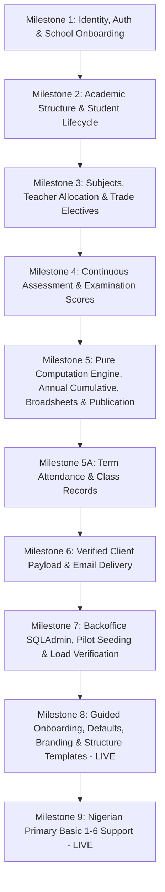

# Backend Engineering Development Plan
**Project:** Olivet Academic Records Management Platform  
**Target Pilot:** Olivet Baptist High School, Oyo, Nigeria  
**Architecture Spec:** [`ARCHITECTURE.md`](./ARCHITECTURE.md) (Authoritative Source of Truth)  
**Agent & Code Guidelines:** [`AGENTS.md`](./AGENTS.md)  
**Document Version:** 1.0.0  
**Target Audience:** Backend Engineering Team
**M9 Status:** LIVE (Nigerian Primary Basic 1-6 Support)

---

## 1. Executive Summary & Team Mission

The backend engineering team is building the authoritative, secure, multi-tenant core of the **Olivet Academic Records Management Platform**. 

Our primary operational goal is to deliver a rock-solid, production-grade system ready for end-of-term academic processing at Olivet Baptist High School, with complete modularity to onboard additional primary (Basic 1–6) and secondary schools.

### Frontend Handoff Principle
The frontend team is building a separate client (web and mobile). The backend team does **not** generate or store static report card PDFs on the server. Instead, our deliverable to the frontend team is a set of clean, predictable, typed REST APIs with standardized JSON response envelopes, culminating in a **cryptographically verified Report Card Document Payload** that the frontend will render and export to PDF on the client side.

---

## 2. Current Implementation State (Phase 1 Baseline)

The foundational scaffolding is completed and committed to `main`:

- [x] **FastAPI App Factory & Middleware:** CORS, standard success/error envelope handlers and custom domain exception handlers ([`app/main.py`](./app/main.py)).
- [x] **Async Database Engine:** SQLAlchemy 2.0 with `asyncpg` connection pooling ([`app/core/database.py`](./app/core/database.py)).
- [x] **Time-Ordered UUIDv7 Standard:** High-throughput B-tree indexing with zero sequential ID exposure ([`app/modules/common/models.py`](./app/modules/common/models.py)).
- [x] **Defense-in-Depth Multi-Tenancy:** Dependency-injected database sessions setting `SET LOCAL app.current_school_id = :school_id` for PostgreSQL Row-Level Security ([`app/core/dependencies.py`](./app/core/dependencies.py)).
- [x] **Hybrid Access Control:** Dependency checking role baseline defaults + scoped user grants ([`app/core/permissions.py`](./app/core/permissions.py)).
- [x] **Security Core:** Argon2 password hashing with fast test parameters and PyJWT token generation ([`app/core/security.py`](./app/core/security.py)).
- [x] **Alembic Async Migrations:** Fully configured with asyncpg ([`alembic/env.py`](./alembic/env.py)).
- [x] **Core Models Implemented:** `School`, `SchoolConfiguration`, `User`, `StaffProfile`, `Permission`, `RoleDefaultPermission`, `UserPermissionGrant`, `AcademicSession`, `AcademicTerm`, `AcademicLevel`, `Department`, `ClassArm`, `ClassGroup`.
- [x] **Automated Test Suite:** 100% passing tests with pytest-xdist ([`tests/`](./tests/)).

---

## 3. Work Breakdown Structure & Milestones



---

### Milestone 1: Identity, Authentication & School Onboarding
**Target Sprint:** Sprint 1  
**Lead Focus:** Identity Module (`app/modules/identity/`)

#### Objectives:
1. Complete the authentication and user management lifecycle.
2. Enable school registration and administrative user bootstrapping.
3. Provide the administrative permission delegation endpoints (HOD, Form Master, Level Coordinator).

#### Tasks & Implementation Details:
- [ ] **Task 1.1: School Onboarding Endpoint (`POST /api/v1/identity/schools`)**
  - Inputs: Name, slug, official code, location, initial admin details.
  - Outputs: Created school tenant and initialized default `SchoolConfiguration`.
  - Roles: `SUPER_ADMIN`.
- [ ] **Task 1.2: Authentication & Rapid Token Revocation (`app/modules/identity/router.py`)**
  - `POST /api/v1/identity/login`: Validates credentials, injects unique UUIDv7 `jti` into access token, sets HTTP-only refresh token cookie.
  - `POST /api/v1/identity/refresh`: Rotates refresh token, checks `token_valid_after`, issues new access token with fresh `jti`.
  - `POST /api/v1/identity/logout`: Reads token `jti`, writes to Redis blacklist (`token:revoked:{jti}`) with remaining TTL for instant sub-millisecond revocation.
  - `GET /api/v1/identity/me`: Returns authenticated profile, school details, and effective permissions.
- [ ] **Task 1.3: Teacher & Staff Onboarding Workflow**
  - `POST /api/v1/identity/staff/invite`: Admin creates a staff profile with status `INVITED`; dispatches email with single-use 72-hour invitation token.
  - `POST /api/v1/identity/staff/bulk-import`: Admin uploads Excel/CSV of school staff roster; Celery worker parses rows, provisions accounts in batch, and queues invitation emails.
  - `GET /api/v1/identity/staff/verify-invite`: Verifies invitation token and returns teacher details to frontend.
  - `POST /api/v1/identity/staff/accept-invitation`: Teacher establishes their password, sets status to `ACTIVE`, and receives initial session tokens.
- [ ] **Task 1.4: Teacher Deactivation Service (`POST /api/v1/identity/users/{user_id}/deactivate`)**
  - Updates `is_active = False`.
  - Advances `token_valid_after = clock_timestamp()` to instantly revoke active access tokens across all devices.
  - Revokes active teaching assignments while preserving historical scores, remarks, and audit trails.
- [ ] **Task 1.5: Permission Delegation API**
  - `POST /api/v1/identity/users/{user_id}/permissions`: Assigns direct scoped grants (`SCHOOL_WIDE`, `DEPARTMENT`, `ACADEMIC_LEVEL`, `CLASS_GROUP`).
  - `DELETE /api/v1/identity/users/{user_id}/permissions/{grant_id}`: Revokes grant.

#### Definition of Done:
- Full auth flow covered by automated integration tests.
- Cross-tenant login isolation verified (token from School A cannot authenticate School B requests).

---

### Milestone 2: Academic Structure & Student Lifecycle
**Target Sprint:** Sprint 2  
**Lead Focus:** Structure & Students Modules (`app/modules/academic_structure/`, `app/modules/students/`)

#### Objectives:
1. Provide full CRUD for academic sessions, terms, levels, departments, and class arms.
2. Implement student registration and session enrollment lifecycle.
3. Build the asynchronous bulk student import pipeline.

#### Tasks & Implementation Details:
- [x] **Task 2.1: Academic Structure Endpoints**
  - CRUD `/api/v1/structure/sessions` and nested `/api/v1/structure/sessions/{session_id}/terms`.
  - CRUD `/api/v1/structure/levels`, `/api/v1/structure/departments`, `/api/v1/structure/arms`, and `/api/v1/structure/class-groups`.
  - `POST /api/v1/structure/class-groups`: Instantiates arm cohorts (e.g., `SS1 Science O`, `JSS1 A`).
  - Implements checks to ensure junior secondary levels function seamlessly with `department_id = NULL`.
- [x] **Task 2.2: Student Management (`app/modules/students/models.py`, `services.py`)**
  - Define `Student` and `StudentEnrollment` models as specified in `ARCHITECTURE.md`.
  - Composite uniqueness: `(school_id, admission_number)`.
  - Status lifecycle: `ADMITTED`, `ACTIVE`, `SUSPENDED`, `WITHDRAWN`, `TRANSFERRED`, `GRADUATED`.
  - `POST /api/v1/students`: Register individual student.
  - `POST /api/v1/students/{student_id}/status`: Admin state transition with mandatory audit log note.
- [x] **Task 2.3: Session Enrollment & Promotion Engine**
  - `POST /api/v1/students/{student_id}/enrollments`: Enrolls an admitted or active student into a `ClassGroup` for a session.
  - Prevents duplicate enrollment in the same session (`uq_student_session`).
- [x] **Task 2.4: Bulk Student Import Pipeline (Celery)**
  - `POST /api/v1/students/bulk-import`: Accepts Excel (`.xlsx`) or CSV file.
  - `GET /api/v1/students/bulk-import/{task_id}`: Reports progress and row-level errors.
  - Task: `app.modules.students.tasks.process_student_bulk_import`.
  - Pydantic v2 row-by-row validation, atomic batch inserts, and detailed error reporting for invalid rows.

#### Definition of Done:
- Successfully import 1,000 student records via Celery task in under 15 seconds.
- Historical enrollment query returns previous arm placements across past sessions for transferred or promoted students.

---

### Milestone 3: Subjects, Teacher Allocation & Trade Electives
**Target Sprint:** Sprint 3  
**Lead Focus:** Subjects Module (`app/modules/subjects/`)

#### Objectives:
1. Build the subject catalog, session offerings, and class-subject mappings.
2. Implement flexible teacher-to-arm assignments supporting single teachers across multiple arms, multiple teachers per arm, and multiple subjects per teacher.
3. Implement student-level elective and trade subject registration.

#### Tasks & Implementation Details:
- [x] **Task 3.1: Subject Catalog & Offerings (`models.py`, `services.py`)**
  - Models: `Subject`, `SubjectOffering`, `ClassSubject`.
  - Support `department_id = NULL` for universal subjects (Maths, English, Civic, and all Junior Secondary subjects).
  - Support `is_trade_subject = TRUE` for national entrepreneurship/trade subjects.
- [x] **Task 3.2: Granular & Cascading Teacher Assignment**
  - Model: `TeacherAssignment` linking `user_id` to `class_subject_id`.
  - `POST /api/v1/class-subjects/{class_subject_id}/teacher-assignments`: Granular arm-level assignment.
  - `POST /api/v1/class-subjects/teacher-assignments/bulk`: Cascading assignment (e.g., assign Mr. Adeola to Chemistry for all SS1 Science arms in one request).
  - Support co-teaching: Unique constraint on `(class_subject_id, teacher_id, is_active)`.
- [x] **Task 3.3: Student Subject Registration (`student_subject_registrations`)**
  - Model: `StudentSubjectRegistration` with `subject_category`: `COMPULSORY_CORE`, `DEPARTMENT_CORE`, `TRADE_ELECTIVE`, `FREE_ELECTIVE`.
  - Auto-registration hook: Enrolling in a class group automatically registers all compulsory core and department core subjects.
  - `GET` and `POST /api/v1/enrollments/{enrollment_id}/subject-registrations`: Allows Form Master or Academic Officer to register a student's chosen trade subject (e.g., Catering Craft vs. Data Processing).
  - Teacher view filter: When a trade subject teacher queries their roster, the query filters by `student_subject_registrations` to return **only** registered students.

#### Definition of Done:
- Verify that Mr. Adeola can be assigned to SS1 O & L Chemistry while Mr. Idowu is assigned to SS1 I & V Chemistry without conflict.
- Verify that a Catering Craft teacher in SS1 Science O only sees the 15 students registered for Catering, not the entire arm of 45 students.

---

### Milestone 4: Continuous Assessment & Examination Scores
**Target Sprint:** Sprint 4  
**Lead Focus:** Assessments Module (`app/modules/assessments/`)

#### Objectives:
1. Implement Olivet's configurable 10/10/10/70 assessment structure (Test 1, Test 2, Assignments/Attendance, Terminal Exam).
2. Build bulk score entry with validation against assessment maximum scores.
3. Enforce the score review lifecycle: `DRAFT` $\to$ `SUBMITTED` $\to$ `APPROVED`.

#### Tasks & Implementation Details:
- [x] **Task 4.1: Assessment Schema Configuration**
  - Model: `AssessmentDefinition` linked to `class_subject_id` and `academic_term_id`.
  - Fields: `name`, `code` (`TEST1`, `TEST2`, `ASSIGN`, `EXAM`), `max_score`, `weight_percentage`, `sequence_order`.
  - Olivet-only seed: Test 1 (10 marks, 10%), Test 2 (10 marks, 10%), Assignments/Attendance (10 marks, 10%), Terminal Exam (70 marks, 70%). Other schools remain configurable.
  - M1 onboarding now seeds this template; this task extends it to per-class-subject assessment definitions.
- [x] **Task 4.2: Score Entry & Validation (`app/modules/assessments/schemas.py`)**
  - Model: `AssessmentScore`.
  - States: `SCORED`, `ABSENT`, `EXEMPT`, `PENDING`.
  - Validation rules:
    - Score must never exceed `max_score`.
    - If `score_status == 'SCORED'`, `raw_score` is mandatory and $\ge 0$.
    - If `score_status` in `('ABSENT', 'EXEMPT', 'PENDING')`, `raw_score` must be `NULL`.
- [x] **Task 4.3: Bulk Score Entry Endpoint (`POST /api/v1/assessments/scores/bulk-entry`)**
  - Pydantic v2 validated payload.
  - Authorization: Strict check that authenticated teacher has an active `TeacherAssignment` for the `class_subject_id` (or user has delegated `scores:edit` permission).
  - Atomic batch upsert.
- [x] **Task 4.4: Score Review & Approval Workflow**
  - `POST /api/v1/assessments/submit`: Teacher submits scores; validates that zero students are left in `PENDING` status.
  - `POST /api/v1/assessments/approve`: Academic Officer or HOD (with delegated `scores:approve` scope) locks scores against further editing.
  - `POST /api/v1/assessments/unlock`: Authorized administrator unlocks score sheet with mandatory reason logged to `audit_logs`.

#### Definition of Done:
- Submitting an assessment with an unrecorded (`PENDING`) score returns `422 Unprocessable Entity` (`ScoresIncompleteException`).
- Score tampering by unassigned teachers blocked with `403 Forbidden`.

---

### Milestone 5: Pure Computation Engine, Annual Cumulative & Broadsheets
**Target Sprint:** Sprint 5  
**Lead Focus:** Computation Module (`app/modules/computation/`)

**Status: LIVE**

#### Objectives:
1. Build the zero-IO pure Python computation engine for subject totals, grading, class averages, and standard competition rankings.
2. Implement Third Term Annual Cumulative computations and promotion decisions.
3. Build the Term Publication snapshotting engine and result token generation.
4. Expose school grading and annual-result configuration through the API.

#### Tasks & Implementation Details:
- [x] **Task 5.0: School Result Configuration (`GET`/`PATCH /api/v1/identity/schools/{school_id}/configuration`)**
  - Stores grading scale, assessment weights, term definitions, annual term weights, and promotion thresholds.
  - Requires `configuration:manage`; new schools receive Olivet-compatible defaults.
- [x] **Task 5.1: Pure Computation Engine (`app/modules/computation/engine.py`)**
  - Pure Python functions with **zero database or HTTP imports**.
  - All mark calculations executed using `Decimal` with `ROUND_HALF_UP`.
  - Dynamic obtainable calculation:
    $$\text{Student Percentage} = \frac{\sum \text{Marks Obtained}}{\sum \text{Registered Subject Maximums}} \times 100$$
  - Standard Competition Ranking ("1224" Ranking) with correct tie handling.
  - Handling `ABSENT` (treated as 0.00, marked `ABS`) vs. `EXEMPT` (omitted from denominator, marked `EX`).
- [x] **Task 5.2: Third Term Annual Cumulative Computation**
  - On Third Term processing:
    - Retrieves Term 1 total, Term 2 total, Term 3 total per subject.
    - Computes cumulative annual score:
      $$\text{Annual Score} = w_1(\text{Term 1}) + w_2(\text{Term 2}) + w_3(\text{Term 3})$$
    - Computes annual cumulative class position.
    - Evaluates promotion criteria and sets `promotion_decision`: `PROMOTED`, `REPEATING`, `PROMOTED_ON_TRIAL`.
- [x] **Task 5.3: Broadsheet API (`GET /api/v1/computation/broadsheet/{class_group_id}`)**
  - Returns a high-density, matrix-formatted JSON object of all students, subjects, scores, totals, ranks, and class statistics for form masters and academic review.
- [x] **Task 5.4: Term Calculation Service (`POST /api/v1/computation/calculate-term`)**
  - Verifies all relevant score sheets are `APPROVED`.
  - Computes and upserts `subject_results` and `term_report_cards` as `DRAFT`.
  - Recalculation is idempotent until publication.
- [x] **Task 5.5: Term Publication Service (`POST /api/v1/publication/publish-term`)**
   - Atomic database transaction:
     - Verifies all class subjects in the term are `APPROVED`.
     - Seals `subject_results` and `term_report_cards` with `frozen_config_snapshot`.
     - Sets `academic_terms.is_locked_for_scoring = TRUE`.
     - Generates 256-bit `result_access_tokens`; only SHA-256 hashes are stored.
     - Returns plaintext tokens once in a `202 Accepted` response.
     - Blocks later updates/deletes of published records with PostgreSQL triggers.

#### Definition of Done:
- Pure computation engine covered by property-based unit tests (`Hypothesis`).
- Published historical values are frozen by both service logic and database triggers.
- Term attendance counts remain zero placeholders until Milestone 5A.

---

### Milestone 5A: Term Attendance & Class Records
**Target Sprint:** Sprint 5A
**Lead Focus:** Structure, Enrollments, and Computation Modules

**Status: PLANNED**

#### Objectives:
1. Replace report-card attendance placeholders with real class attendance records and summaries.
2. Support daily marking, class-wide day marking, backdated corrections, and manual aggregate overrides.
3. Require attendance completeness before term publication.

#### Tasks & Implementation Details:
- [ ] **Task 5A.1: Attendance Models**
  - Add `AttendanceRecord` for daily marks and `AttendanceSummary` for per-student/per-term totals.
  - `source` is `DAILY` or `MANUAL`; manual summaries preserve the admin override and audit trail.
- [ ] **Task 5A.2: Daily Attendance Routes**
  - `POST /api/v1/structure/class-groups/{class_group_id}/attendance`
  - `POST /api/v1/enrollments/{enrollment_id}/attendance`
  - `GET /api/v1/enrollments/{enrollment_id}/attendance`
  - Block future dates; allow backdated entries with an audited reason.
- [ ] **Task 5A.3: Aggregate Attendance Routes**
  - `PATCH`/`GET /api/v1/enrollments/{enrollment_id}/attendance-summary`
  - `PATCH /api/v1/structure/class-groups/{class_group_id}/attendance-summary`
  - Require `present + absent == opened` before publication.
- [ ] **Task 5A.4: Report Card Integration**
  - Freeze attendance counts into `term_report_cards` at publication.
  - Keep assessment `score_status = ABSENT` separate from daily attendance.

---


### Milestone 6: Publication Snapshots, Client Payload & Email Delivery
**Target Sprint:** Sprint 6  
**Lead Focus:** Distribution & Storage Modules (`app/modules/distribution/`, `app/core/storage/`)

#### Objectives:
1. Provide the verified Report Card Document Payload for client-side rendering.
2. Build the pluggable storage service for school branding assets (logos, stamps, signatures).
3. Build the Celery email notification service for dispatching secure magic links to parents.

#### Tasks & Implementation Details:
- [ ] **Task 6.1: Verified Report Card JSON Endpoint (`GET /api/v1/results/verify/{token}`)**
  - Public endpoint with rate limiting (20 req/min).
  - Validates `token_hash`, `expires_at`, and `is_revoked`.
  - Secondary verification: Checks student Date of Birth (`dob`) or admission number PIN.
  - Returns the complete document JSON payload:
    - School details (name, address, logo URL, official stamp URL, principal signature URL).
    - Student details (name, admission number, arm, session, term).
    - Attendance summary (days opened, present, absent).
    - Subject performance matrix (test, exam, total, grade, remark, subject position, class average).
    - Overall summary (total obtained, total obtainable, percentage, class position, total in arm).
    - Annual cumulative summary (if Third Term).
    - Form Master comment, Principal comment, and Form Master signature URL.
    - Cryptographic QR code payload (`qr_payload`) for physical print verification.
- [ ] **Task 6.2: Pluggable Storage Service (`app/core/storage/`)**
  - Abstract base interface: `StorageService` (`upload_file`, `get_file_url`, `delete_file`).
  - Implementations:
    - `LocalStorageBackend`: Saves to local directory for local testing.
    - `CloudinaryStorageBackend`: Uploads institutional logos/stamps to Cloudinary.
    - `S3StorageBackend`: Uploads to AWS S3.
  - Provider selectable via `.env`: `STORAGE_PROVIDER=local|cloudinary|s3`.
- [ ] **Task 6.3: Email Notification Worker (Celery)**
  - Task: `app.modules.distribution.tasks.send_term_result_notifications`.
  - Dispatches institutional emails with the secure magic link (e.g., `https://school.domain/results/{token}`).
  - **Zero file attachments:** Email body contains clear text summary and call-to-action button only.

#### Definition of Done:
- Frontend team receives and confirms the full report card JSON payload contract.
- QR verification string verified authenticatable via `/api/v1/results/verify-qr`.

---

### Milestone 7: Backoffice SQLAdmin, Pilot Seeding & Operational Hardening
**Target Sprint:** Sprint 7  
**Lead Focus:** Operations, Admin & Seed Scripts (`app/admin.py`, `scripts/seed_olivet.py`)

#### Objectives:
1. Configure SQLAdmin dashboard for immediate school operations.
2. Write the automated Olivet configuration seed script.
3. Conduct load testing, penetration testing, and security hardening.

#### Tasks & Implementation Details:
- [ ] **Task 7.1: SQLAdmin Dashboard Configuration (`app/admin.py`)**
  - Register model views: `School`, `SchoolConfiguration`, `User`, `StaffProfile`, `AcademicSession`, `AcademicTerm`, `AcademicLevel`, `Department`, `ClassArm`, `ClassGroup`, `Subject`, `AuditLog`.
  - Enforce authentication backend with session cookies and superuser/school-admin role checks.
- [ ] **Task 7.2: Olivet Pilot Seed Script (`scripts/seed_olivet.py`)**
  - Programmatically provisions Olivet Baptist High School:
    - Levels: JSS1–JSS3, SS1–SS3.
    - Departments: Science, Arts, Commercial (assigned to SS1–SS3).
    - Canonical Arms: `O`, `L`, `I`, `V`, `E`, `T`, `B`, `H`, `S`, `Y`.
    - Department Arm Allocations (Science: O, L, I, V; Commercial: E; Arts: T, B, H, S, Y).
    - Standard Nigerian secondary WAEC/NECO grading scale.
    - Assessment weights: 10/10/10/70 (Test 1, Test 2, Assignments/Attendance, Terminal Exam).
- [ ] **Task 7.3: Security & Penetration Testing**
  - Run BOLA/IDOR vulnerability scanners against score entry endpoints.
  - Test Row-Level Security isolation with two concurrent school sessions.
- [ ] **Task 7.4: Performance Benchmarking**
  - Broadsheet generation for 2,500 students in under 1 second.
  - Bulk score entry submission for 50 students in under 200 milliseconds.

#### Definition of Done:
- Successful end-to-end rehearsal using real Olivet sample rosters: Provisioning $\to$ Enrollment $\to$ Score Entry $\to$ Approval $\to$ Publication $\to$ Client View.

---

### Milestone 8: Guided Onboarding, Defaults, Branding & Structure Templates
**Target Sprint:** Sprint 8
**Lead Focus:** Identity, Structure & Storage (`app/modules/identity/`, `app/modules/academic_structure/`, `app/core/storage/`)

**Status: LIVE**

#### Objectives:
1. Give new schools a guided path to review defaults, save their own profile and configuration, optionally apply an academic structure template, and upload branding.
2. Keep three default classes distinct: school-editable defaults, optional structure templates, and platform defaults that are never exposed.
3. Isolate branding assets by tenant using local storage for the pilot (S3/Cloudinary later).

#### Tasks & Implementation Details:
- [x] **Task 8.1: Public Default-Template Catalog (`GET /api/v1/identity/onboarding/templates`)**
  - Public; returns school configuration defaults and a structure template preview only — no tenant data.
  - Includes grading scale, assessment weights, term definitions, annual rules, timezone, currency, report template, and a preview of levels/departments/arms/optional class groups.
- [x] **Task 8.2: Aggregate Setup Read/Save (`GET`/`PATCH /api/v1/identity/schools/{school_id}/setup`)**
  - Admin-only. `GET` returns profile, full configuration, branding paths/URLs, structure setup status, and `custom_domain.status = PLANNED` (not implemented).
  - `PATCH` is a transactional partial save of profile, full configuration (grading scale, assessment weights, term definitions, annual rules, timezone, currency, report template), and branding references. All supplied fields commit together or none do.
  - **Ordering rule:** assessment weights must be saved before any `ClassSubject` exists, because definitions are cloned at ClassSubject creation. Surface this warning to the frontend.
- [x] **Task 8.3: Branding Uploads (`POST /api/v1/identity/schools/{school_id}/branding/uploads`)**
  - Admin-only multipart upload with `asset_type=logo|stamp|principal_signature`.
  - Reuse the `StorageService` abstraction from Task 6.2; pilot uses `LocalStorageBackend`, S3/Cloudinary are later providers.
  - Namespace assets by school slug/id and verify the tenant on every read/write. Generated PDFs are never stored server-side.
- [x] **Task 8.4: Structure Template Apply (`POST /api/v1/structure/templates/apply`)**
  - Requires `structure:manage`; idempotently creates selected levels, departments, arms, and optionally class groups for a session.
  - Re-application must not create duplicates; junior levels keep `department_id = NULL`.
- [ ] **Task 8.5: Custom Domains (PLANNED, post-pilot — no endpoints shipped)**
  - Document requirements only: DNS verification, verified domains only, `Host` header must not select tenant for authenticated APIs, dynamic CORS, HTTPS/cookies.

#### Definition of Done:
- Success tests for catalog, setup read/save, branding upload, and idempotent template apply.
- Cross-tenant denial tests for setup read/save and branding namespace.
- Validation-failure tests for malformed config, missing/oversized uploads, and unauthenticated access.
- Branding asset isolation test (school A cannot read school B's assets).

---

### Milestone 9: Nigerian Primary Basic 1-6 Support
**Target Sprint:** Sprint 9
**Lead Focus:** Identity, Structure, Subjects & Computation (`app/modules/identity/`, `app/modules/academic_structure/`, `app/modules/subjects/`, `app/modules/computation/`)

**Status: LIVE** — primary routes, templates, defaults, and the report variant are shipped.

#### Objectives:
1. Support Nigerian three-term primary schools in addition to the existing secondary pilot.
2. Provide configurable primary defaults and onboarding/structure templates while reusing the live three-term computation and publication flow.
3. Keep primary data model-compatible: no departments, no electives, no trade subjects, and no new permission codes.

#### Scope decisions:
- Levels: `Basic 1`–`Basic 6`, category `PRIMARY`, codes `BASIC1`–`BASIC6`; arms `A`, `B`, `C`, `D`; no departments.
- Every primary subject is compulsory core (`is_elective = FALSE`, `is_trade_subject = FALSE`, registration category `COMPULSORY_CORE`). No electives or trade subjects.
- Grading default: A 70–100 EXCELLENT, B 60–69.99 VERY GOOD, C 50–59.99 GOOD, D 45–49.99 PASS, E 40–44.99 FAIR, F 0–39.99 FAIL; grade point `0.00` for all bands.
- Assessment default: `TEST1` 10, `TEST2` 10, `ASSIGN` 10, `EXAM` 70 (30% CA / 70% exam).
- Annual: same three terms, equal term weights; `>= 50%` promoted, `40–49.99%` promoted on trial, `< 40%` repeating. Reuse the current three-term computation; no generic multi-term refactor in M9.
- Report template default id: `default_primary_v1`.

#### Data model & migration:
- `schools.school_type VARCHAR(16) NOT NULL DEFAULT 'SECONDARY'` with `CHECK (school_type IN ('PRIMARY', 'SECONDARY'))`; backfill existing rows to `SECONDARY`.
- `academic_levels.category` check constraint extended to `('PRIMARY', 'JUNIOR_SECONDARY', 'SENIOR_SECONDARY')`.
- Reuse nullable `department_id` on `class_groups`/`subject_offerings` with `NULL` required for primary rows; no new tables.
- Alembic revision `b1c4d7e9a2f0_m9_primary_school_support.py` applies the schema change with a verified downgrade path. Defaults/templates are seeded by service/seed code, not DDL.

#### Endpoints (all LIVE; extensions of canonical routes):
| Method | Path | M9 change | Permission |
| --- | --- | --- | --- |
| `GET` | `/api/v1/identity/onboarding/templates` | Public catalog returns both secondary and primary templates. | `ANONYMOUS` |
| `POST` | `/api/v1/identity/schools` | Accept `school_type`; seed matching defaults and report template. | `SUPER_ADMIN` |
| `GET`, `PATCH` | `/api/v1/identity/schools/{school_id}/setup` | Read/save `school_type` and selected template. | `SCHOOL_ADMIN` |
| `POST` | `/api/v1/structure/templates/apply` | Accept `template_type = PRIMARY`; create Basic 1–6, arms A–D, core subject offerings and class subjects idempotently. | `structure:manage` |
| Unchanged | `subjects`, `class-subjects`, `computation`, `publication`, `results` routes | Reused as-is; primary report payload uses `department: null` and `class_teacher_comment`. | Existing permissions |

#### Tasks & Implementation Details:
- [x] **Task 9.1: Documentation & architecture alignment**
  - Mark M9 LIVE in `ARCHITECTURE.md`, this plan, and frontend docs.
  - Record shipped primary scope, defaults, endpoints, and report payload variant.
- [x] **Task 9.2: Schema & migration**
  - Add `schools.school_type`, extend `academic_levels.category` with `PRIMARY`, backfill existing schools.
  - Verified `alembic upgrade head` and `alembic downgrade -1` via `b1c4d7e9a2f0_m9_primary_school_support.py`.
- [x] **Task 9.3: Primary defaults & templates**
  - Seed primary grading scale (A–F, grade point `0.00`), assessment weights (10/10/10/70), equal term weights, promotion thresholds (`50%`/`40%`), Basic 1–6 levels, arms A–D, core subject list, and `default_primary_v1`.
  - Keep all primary subjects `is_elective = FALSE` and `is_trade_subject = FALSE`.
- [x] **Task 9.4: Onboarding `school_type`**
  - Accept `PRIMARY|SECONDARY` at `POST /api/v1/identity/schools` and in setup read/save.
  - Return both secondary and primary templates from `GET /api/v1/identity/onboarding/templates`; preserve the existing secondary response as-is. Changing school type without explicit config reseeds matching defaults.
- [x] **Task 9.5: Structure & subject template apply**
  - Extend `POST /api/v1/structure/templates/apply` with `template_type`.
  - Primary template `nigeria_primary_basic1_6` creates Basic 1–6 levels, arms A–D, 10 core subjects, 60 subject offerings, and 240 class subjects across 24 groups; no departments or elective/trade registration path.
  - Re-application is idempotent and backfills registrations (active-row partial unique indexes).
- [x] **Task 9.6: Tests**
  - Success tests for primary onboarding, both-template catalog, and idempotent primary template apply.
  - Validation tests for invalid `school_type`/`template_type`, department-bearing primary rows, and elective/trade attempts.
  - Cross-tenant denial tests for setup and template apply; pure-engine tests for primary grading, 30/70 assessment split, equal term weights, and promotion outcomes.
  - Report payload test asserting `department: null` and `class_teacher_comment` for primary. Full suite passes (65 passed).

#### Definition of Done:
- Migration upgrades/downgrades cleanly; existing secondary tenants and levels are unchanged.
- Primary onboarding and template apply produce the documented defaults with no departments, electives, or trades.
- Idempotency, validation, cross-tenant isolation, computation, and report-payload tests pass.
- M9 is LIVE in all documentation; migration and tests verified, full suite passes (65 passed).

---

## 4. Frontend & Backend Collaboration Contracts

### 4.1 Standard Response Envelopes

Every API endpoint must use the canonical domain-namespaced routes in `ARCHITECTURE.md` §6.2 and return one of these two structures:

#### Success Response (`200 OK`, `201 Created`, `202 Accepted`)
```json
{
  "success": true,
  "data": { ... }
}
```

#### Error Response (`400`, `401`, `403`, `404`, `422`, `500`)
```json
{
  "error": {
    "code": "INSUFFICIENT_PERMISSIONS",
    "message": "You don't have permission to approve scores for Science. If you need this access, please ask your school administrator or academic officer.",
    "details": [],
    "path": "/api/v1/assessments/approve"
  }
}
```

### 4.2 Report Card Document Payload (Handed to Frontend for PDF Assembly)
When the frontend fetches `GET /api/v1/results/verify/{token}?dob=YYYY-MM-DD`, the backend returns this exact contract:

```json
{
  "success": true,
  "data": {
    "school": {
      "name": "Olivet Baptist High School",
      "official_code": "OBHS-OYO",
      "address": "Oyo-Ogbomoso Road, Oyo, Oyo State, Nigeria",
      "logo_url": "/storage/olivet-oyo/branding/obhs-logo.png",
      "stamp_url": "/storage/olivet-oyo/branding/obhs-stamp.png",
      "principal_signature_url": "/storage/olivet-oyo/branding/principal-sig.png"
    },
    "student": {
      "admission_number": "OBHS/2022/0412",
      "full_name": "Tayo Olusola Babatunde",
      "gender": "M",
      "academic_level": "SS 1",
      "department": "Science",
      "class_group": "SS1 Science O",
      "session": "2024/2025",
      "term": "Third Term"
    },
    "attendance": {
      "days_opened": 65,
      "days_present": 63,
      "days_absent": 2
    },
    "subjects": [
      {
        "subject_code": "MTH",
        "subject_name": "General Mathematics",
        "ca1_score": 18.50,
        "ca2_score": 19.00,
        "exam_score": 54.00,
        "terminal_total": 91.50,
        "grade": "A1",
        "remark": "EXCELLENT",
        "subject_position": 2,
        "class_average": 64.20,
        "first_term_total": 88.00,
        "second_term_total": 90.00,
        "cumulative_annual_score": 89.83,
        "cumulative_annual_grade": "A1"
      }
    ],
    "terminal_summary": {
      "total_obtainable": 900.00,
      "total_obtained": 748.50,
      "percentage": 83.17,
      "class_position": 4,
      "total_students_in_arm": 45,
      "form_master_comment": "An exemplary student with outstanding academic discipline.",
      "form_master_signature_url": "/storage/olivet-oyo/signatures/teacher-adeola.png",
      "principal_comment": "Excellent academic performance. Promoted to Senior Secondary 2."
    },
    "annual_cumulative_summary": {
      "is_annual_final": true,
      "annual_cumulative_percentage": 82.40,
      "annual_class_position": 3,
      "promotion_decision": "PROMOTED",
      "promoted_to": "SS 2 Science O"
    },
    "verification": {
      "qr_payload": "VERIFY:OBHS/2022/0412:2024-T3:83.17:PROMOTED:SIG_8f9a2c",
      "issued_at": "2026-11-13T14:30:00Z",
      "is_authentic": true
    }
  }
}
```

Branding URLs above are illustrative. M8 uploads use local pilot storage namespaced by school slug/id; S3/Cloudinary are later providers. Generated PDFs are not stored server-side.

**M9 (LIVE) primary variant:** the same payload contract is reused with `student.department = null` and `terminal_summary.class_teacher_comment` (homeroom/class teacher) in place of the secondary form-master comment; primary grades are letters `A`–`F` and the template id is `default_primary_v1`. See `ARCHITECTURE.md` §6.3.2 and §17. Frontends should render this variant for primary schools.

---

## 5. Coding Standards & Quality Gates for Backend Engineers

1. **Strict Typing:** All Python code must be typed. Run `mypy app/` before opening a pull request.
2. **Service Layer Rule:** Route handlers in `router.py` must never query the database or execute business logic directly. They must validate inputs via Pydantic schemas and delegate to functions in `services.py`.
3. **Multi-Tenancy Rule:** Any database read/write on tenant data must pass through `get_tenant_db` dependency. Writing raw queries without `SET LOCAL app.current_school_id` is an automatic PR rejection.
4. **Pure Computation Rule:** Never import SQLAlchemy, database connections, or FastAPI objects into `app/modules/computation/engine.py`.
5. **Decimal for Scoring:** Never use floating-point numbers (`float`) for scores, totals, or percentages. Always use `Decimal` with financial half-up rounding.
6. **Automated Testing Threshold:** Every new endpoint must have:
   - A success integration test (`200 OK` / `201 Created`).
   - A validation test (`422 Unprocessable Entity`).
   - An unauthorized tenant isolation test (`403 Forbidden` / `404 Not Found`).
   - Test execution time must remain under **5 seconds** for the entire unit suite.

---

## 6. Definition of Done (DoD) for Backend PRs

A feature or task is considered **Done** when:
- [ ] Code is implemented according to `ARCHITECTURE.md` specifications.
- [ ] Alembic migration generated and applied cleanly (if models changed).
- [ ] Unit & integration tests written and passing in `.venv/bin/pytest`.
- [ ] No hardcoded tenant IDs or external domain names in code.
- [ ] Pydantic request/response schemas documented with OpenAPI descriptions.
- [ ] Tested with cross-tenant isolation assertion.
- [ ] For setup/template/branding work: success, cross-tenant denial, validation failure, idempotent template apply, and branding asset isolation tests included.
- [ ] Reviewed and approved by at least one backend teammate.
