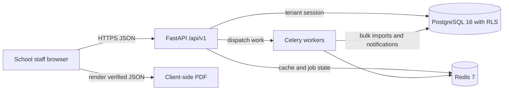
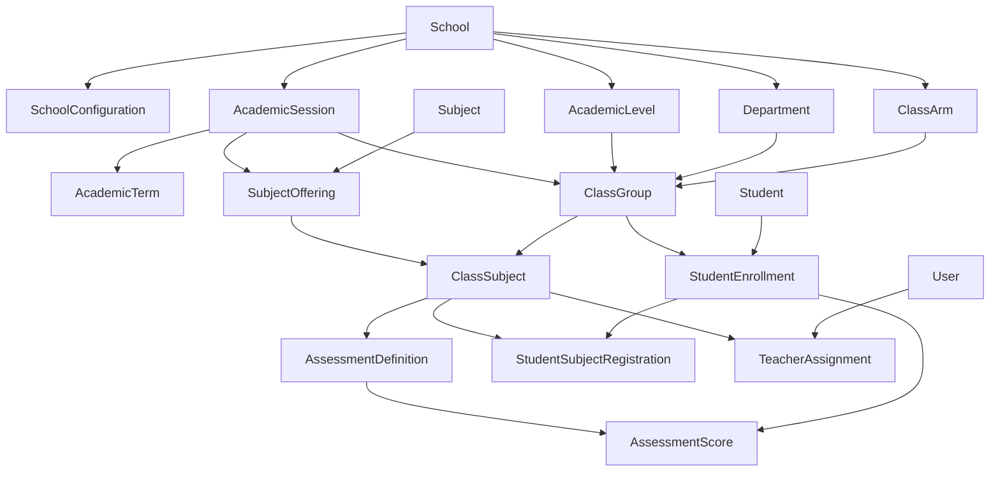
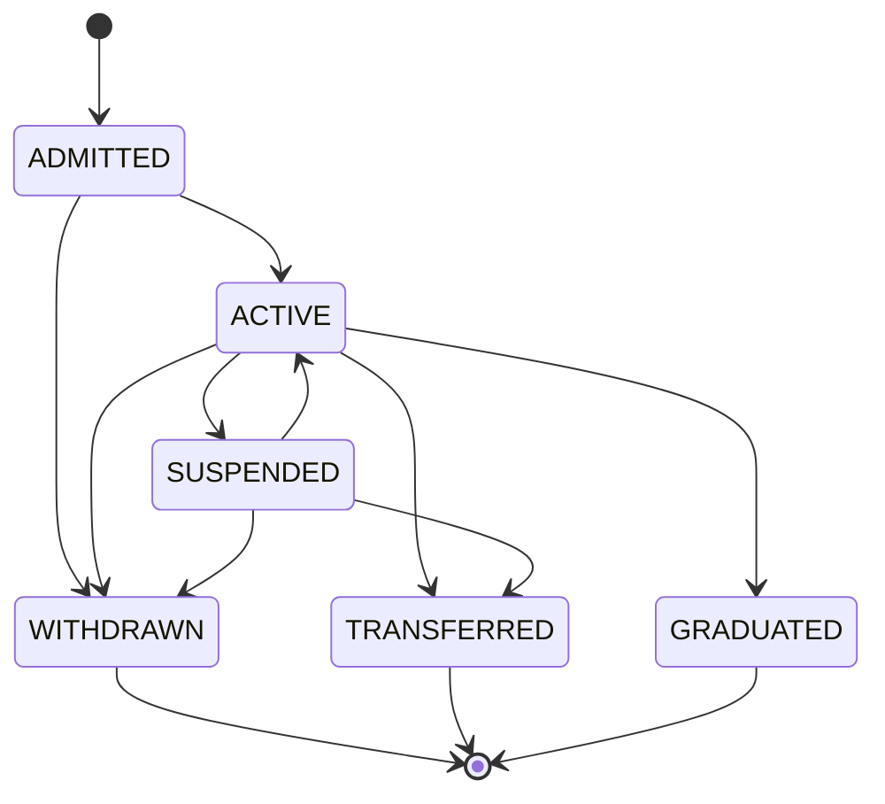
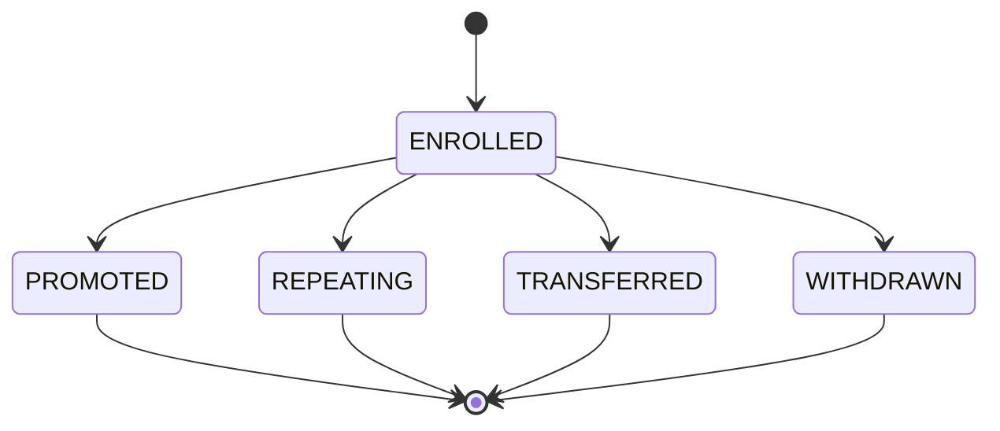
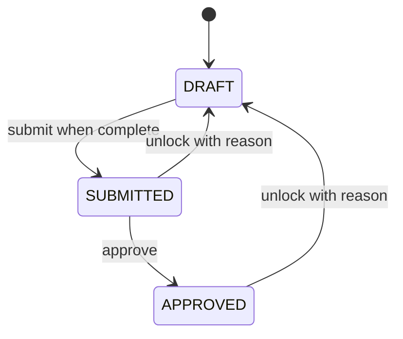

# Platform Overview

## Purpose

Olivet is a multi-tenant academic records platform for Nigerian primary and secondary schools. The pilot tenant is Olivet Baptist High School, Oyo, a junior and senior secondary school. Nigerian three-term primary support for Basic 1–6 (M9) is **LIVE**; schools can be configured without changing application code.

The frontend should feel like a familiar school records system while remaining driven by the school's configuration: sessions, terms, levels, departments, arms, subjects, assessment weights, grading scales, and permissions are data, not hardcoded UI assumptions.

## What the platform does

Live today:

- Onboard a school tenant and its first administrator.
- Invite staff, accept invitations, manage delegated permissions, and deactivate staff.
- Configure academic sessions, terms, levels, departments, class arms, and class groups.
- Register students, assign them to class groups, enroll them per session, and transition their lifecycle status.
- Bulk import students and staff asynchronously from Excel or CSV.
- Maintain subjects, subject offerings, class subjects, teacher assignments, and elective/trade registrations.
- Define assessments, enter scores, submit score sheets, approve them, and unlock them with a reason.
- Compute term and cumulative annual results, rank students, and produce broadsheets.
- Publish term results, create immutable snapshots, and issue expiring result links.
- Support Nigerian three-term primary schools with Basic 1–6 levels, four arms, primary defaults/templates, and no departments or electives (M9).

Planned next:

- Offer a guided onboarding wizard: review public defaults, save school setup, optionally apply a structure template, and upload branding (M8).
- Deliver report-card JSON payloads for client-side PDF rendering (M6).
- Provide audit log access, SQLAdmin operations, and production hardening (M7).

## Architecture at a glance



Key properties:

- FastAPI with async SQLAlchemy 2.0 and `asyncpg`.
- PostgreSQL Row-Level Security for tenant isolation.
- UUIDv7 primary keys for time-ordered indexes and non-enumerable identifiers.
- Celery and Redis for bulk imports and notifications.
- No server-side report-card PDF generation or storage.
- Immutable published academic records enforced by M5 snapshots and database triggers.

## Tenancy and security model

Every tenant table carries:

- `school_id UUID NOT NULL REFERENCES schools(id)`.
- Request-scoped database sessions that run `SET LOCAL app.current_school_id = :school_id`.
- Queries that still filter by `school_id` as defense in depth.

Frontend implications:

- A school user belongs to exactly one school tenant in normal operation. Platform super admins may lack a school context.
- Cross-tenant identifiers must return a not-found response rather than leaking that a record exists elsewhere.
- Never construct API URLs from a `school_id` supplied by the browser. The backend derives the tenant from the authenticated user.
- School onboarding (`POST /api/v1/identity/schools`) is the public entry point for creating a tenant and first administrator.

Additional constraints:

- Historical records are soft-deleted with `deleted_at`; academic and staff history is not hard-deleted.
- Users are deactivated rather than deleted.
- Sensitive academic records become frozen on publication through M5 snapshots and database triggers.
- Access tokens are short-lived and revocable by `jti`.

## Domain model



### Structure

- **Academic session**: a school year, with start and end dates. One session can be marked current per school; marking a new session current unsets the previous one.
- **Academic term**: a date range inside a session, ordered by `term_order`. One term can be current per school. A term can be locked for scoring; while locked, term details cannot be changed and the term cannot be retired.
- **Academic level**: a level such as Basic 1, JSS1, or SS1, with a category of `PRIMARY` (M9, LIVE), `JUNIOR_SECONDARY`, or `SENIOR_SECONDARY` and a sort order.
- **Department**: senior-secondary department such as Science, Arts, or Commercial. Primary (Basic 1–6) and junior-secondary classes do not use a department.
- **Class arm**: the arm letter or label for a class, such as `O`, `L`, `I`, `V`, `E`, `T`, `B`, `H`, `S`, or `Y` for the pilot, or `A`–`D` for primary schools (M9, LIVE).
- **Class group**: the join of session, level, optional department, and arm. It may have one class teacher. Its display name is either supplied or composed as `{level.code} {department.name} {arm.name}`; primary and junior classes omit the department.

### Students and enrollment

- A **student** is a person with a school-wide admission number, demographics, guardian information, and lifecycle status. Primary UIs call this person a **pupil** (M9, LIVE); the data model and API remain `Student`.
- An **enrollment** links a student to a class group for one academic session.
- Enrollment is the unit that owns subject registrations, scores, and eventually report cards.
- A student can have only one enrollment per session.
- Enrolling an `ADMITTED` student changes them to `ACTIVE`.
- Enrollment automatically registers compulsory subjects. Trade and free electives require explicit registration. In primary schools (M9, LIVE) every subject is compulsory core, so all registrations are automatic and no elective/trade step exists.

### Subjects and teaching

- A **subject** is the school-wide catalog entry, for example Chemistry or Data Processing.
- A **subject** carries `is_elective` and `is_trade_subject` flags. A **subject offering** connects that subject to a session, level, and optional department; primary and junior offerings must use `department_id = NULL`.
- A **class subject** connects an offering to a specific class group. It is the unit teachers are assigned to and the unit results are computed for.
- A **teacher assignment** links a staff user to a class subject.
- A **student subject registration** links an enrollment to the class subject the student actually takes.

This distinction matters for electives: not every student in an arm takes every class subject. Score sheets and result totals must use the active registrations for that class subject, never the whole class roster. Primary schools (M9, LIVE) have no electives, so every pupil takes every core class subject.

### Assessments and scoring

- An **assessment definition** describes one score component for a class subject in a term, such as Test 1, Test 2, Assignments/Attendance, or Terminal Examination.
- Creating a class subject clones the school's assessment weight schema into definitions for every non-retired term in that session.
- An **assessment score** stores a student's raw score and status: `SCORED`, `ABSENT`, `EXEMPT`, or `PENDING`.
- A **score sheet status** tracks the class subject's lifecycle in a term: `DRAFT`, `SUBMITTED`, then `APPROVED`.
- Submission requires every active registered student to have a non-`PENDING` status for every assessment definition.
- Approval requires prior submission.
- Unlocking returns a submitted or approved sheet to `DRAFT`, recording who unlocked it, when, and why. Already-draft sheets cannot be unlocked.

## State machines

### Student lifecycle



`WITHDRAWN`, `TRANSFERRED`, and `GRADUATED` are terminal. Only `ADMITTED` and `ACTIVE` students can be enrolled.

### Enrollment lifecycle



### Score sheet lifecycle



## Olivet pilot defaults

Onboarding stores the following school configuration:

- Grading scale:

| Grade | Range | Remark |
| --- | --- | --- |
| A1 | 75.00-100.00 | Excellent |
| B2 | 70.00-74.99 | Very Good |
| B3 | 65.00-69.99 | Good |
| C4 | 60.00-64.99 | Credit |
| C5 | 55.00-59.99 | Credit |
| C6 | 50.00-54.99 | Credit |
| D7 | 45.00-49.99 | Pass |
| E8 | 40.00-44.99 | Pass |
| F9 | 0.00-39.99 | Fail |

- Assessment weights:

| Code | Name | Max score | Weight |
| --- | --- | --- | --- |
| `TEST1` | Test 1 | 10 | 10 |
| `TEST2` | Test 2 | 10 | 10 |
| `ASSIGN` | Assignments/Attendance | 10 | 10 |
| `EXAM` | Terminal Examination | 70 | 70 |

- Default term definitions named First Term, Second Term, and Third Term. These are configuration values; academic term rows are created explicitly during structure setup.
- Timezone: `Africa/Lagos`.
- Currency: `NGN`.
- Report-card template identifier: `default_v1`.

The target Olivet blueprint in `ARCHITECTURE.md` includes JSS1-JSS3 and SS1-SS3, Science/Arts/Commercial departments, and arm letters `O, L, I, V, E, T, B, H, S, Y`. These values are seed defaults, not hardcoded business logic.

### Nigerian primary defaults (M9 — LIVE)

Primary defaults mirror the secondary template's 10/10/10/70 assessment structure but use a six-band primary grading scale and no departments.

- Levels: `Basic 1`–`Basic 6` (codes `BASIC1`–`BASIC6`, category `PRIMARY`); arms `A`, `B`, `C`, `D`; no departments.
- Subjects: all compulsory core; no electives or trade subjects.

| Grade | Range | Remark | Grade point |
| --- | --- | --- | --- |
| A | 70.00–100.00 | Excellent | 0.00 |
| B | 60.00–69.99 | Very Good | 0.00 |
| C | 50.00–59.99 | Good | 0.00 |
| D | 45.00–49.99 | Pass | 0.00 |
| E | 40.00–44.99 | Fair | 0.00 |
| F | 0.00–39.99 | Fail | 0.00 |

| Code | Name | Max score | Weight |
| --- | --- | --- | --- |
| `TEST1` | Test 1 | 10 | 10 |
| `TEST2` | Test 2 | 10 | 10 |
| `ASSIGN` | Assignments/Attendance | 10 | 10 |
| `EXAM` | Terminal Examination | 70 | 70 |

This is 30% continuous assessment / 70% examination. Annual results use the same three terms with equal weights: `>= 50%` promoted, `40–49.99%` promoted on trial, below `40%` repeating. Report template default id: `default_primary_v1`. Primary reports show `department: null` and `class_teacher_comment` (homeroom teacher).

### Defaults and structure templates (M8 — LIVE)

| Class | Meaning | Frontend use |
| --- | --- | --- |
| **School-editable defaults** | Seeded config/profile: grading scale, assessment weights, term definitions, annual rules, timezone, currency, report template. | Pre-fill the setup form; admins may change and save via `PATCH /identity/schools/{school_id}/setup`. |
| **Optional structure templates** | Preview of levels/departments/arms/optional class groups; applied only on explicit opt-in. M9 (LIVE) adds a primary template with Basic 1–6, arms A–D, and core subject offerings/class subjects. | Offer as an optional wizard step; `POST /structure/templates/apply` is idempotent. Let admins choose primary vs secondary. |
| **Platform defaults (not exposed)** | Internal TTLs, rate limits, rounding, audit retention. | Never render or offer to edit. |

- **Ordering rule:** save assessment-weight edits before creating any `ClassSubject`, because definitions are cloned at creation time. Put setup editing before structure/subject creation in the wizard.
- Branding uploads use local pilot storage namespaced by school; no server-side PDF storage.
- M9 (**LIVE**): the public catalog returns both secondary (`olivet_nigeria_default`) and primary (`nigeria_primary_default`) templates; onboarding lets admins choose the school type. The primary template (`nigeria_primary_basic1_6`) applies levels, arms, and core subject offerings/class subjects with no departments. Render the matching school-type and template choices.
- Custom domains are **PLANNED post-pilot**: DNS verification, verified domains only, `Host` must not select tenant for authenticated APIs, dynamic CORS, HTTPS/cookies.

## API conventions

- All application routes live under `/api/v1`.
- Allowed domains: `identity`, `structure`, `students`, `enrollments`, `subjects`, `class-subjects`, `assessments`, `computation`, `publication`, `results`, `audit`.
- Resource names are plural and kebab-case.
- Path parameters use named identifiers such as `{student_id}`.
- Verbs are reserved for workflow or bulk actions: `submit`, `approve`, `unlock`, `publish-term`, `bulk-import`, `bulk-entry`, `bulk`.
- Success responses always use the success envelope.
- Failure responses always use the error envelope.
- Paginated collections use `items` plus `meta`.

### Date and time handling

- Dates are ISO `YYYY-MM-DD`.
- Timestamps are ISO 8601 with timezone.
- Student bulk import also accepts `DD/MM/YYYY`, `DD-MM-YYYY`, and `DD.MM.YYYY`.
- Display dates in the school's timezone, currently `Africa/Lagos`.

### Authentication

```mermaid
sequenceDiagram
    participant Browser
    participant API
    Browser->>API: POST /api/v1/identity/login
    API-->>Browser: access token + refresh token; refresh cookie set
    Browser->>API: GET /api/v1/identity/me with bearer token
    API-->>Browser: user, school, and effective permission codes
    Browser->>API: POST /api/v1/identity/refresh when access expires
    API-->>Browser: rotated token pair
    Browser->>API: POST /api/v1/identity/logout
    API-->>Browser: tokens revoked and cookie cleared
```

## Live and planned capability matrix

| Capability | Status | Notes |
| --- | --- | --- |
| School onboarding | **LIVE** | Public tenant creation with first school administrator. |
| School grading and annual-result configuration | **LIVE** | `GET`/`PATCH /identity/schools/{school_id}/configuration`. |
| Default-template catalog (public) | **LIVE** | M8; public preview of config defaults and structure templates. |
| School setup aggregate read/save | **LIVE** | M8; admin-only `GET`/`PATCH /identity/schools/{school_id}/setup`. |
| Branding uploads | **LIVE** | M8; local pilot storage, namespaced by school. |
| Structure template apply | **LIVE** | M8; idempotent `POST /structure/templates/apply`. |
| Primary school type and Basic 1–6 templates | **LIVE** | M9; onboarding chooses primary vs secondary; primary has no departments/electives/trades. |
| Primary grading, assessment, and annual defaults | **LIVE** | M9; A–F scale with grade point `0.00`, 10/10/10/70, equal term weights, 50%/40% promotion. |
| Primary report variant | **LIVE** | M9; `department = null`, letter grades, `default_primary_v1`, and `class_teacher_comment` in the verified payload. |
| Custom domains | **PLANNED** | Post-pilot only; no endpoints. |
| Login, refresh, logout | **LIVE** | JWT access token, HTTP-only refresh cookie, Redis revocation. |
| Current user and effective permissions | **LIVE** | `GET /identity/me`. |
| Staff invitations | **LIVE** | 72-hour invitation token. |
| Staff permission grants | **PARTIAL** | Grant create/revoke is live and `DEPARTMENT`/`ACADEMIC_LEVEL`/`CLASS_GROUP` scoping is enforced for structure, subjects, teacher assignments, enrollments, and scores, but there is still no grant-list endpoint. |
| Staff deactivation | **LIVE** | Deactivated users cannot authenticate. |
| Structure configuration | **LIVE** | Sessions, terms, levels, departments, arms, class groups. |
| Student registration and lifecycle | **LIVE** | Create, update, status transitions. |
| Student enrollment | **LIVE** | One enrollment per student per session; auto-registers compulsory subjects. |
| Student bulk import | **LIVE** | Asynchronous with polling. |
| Staff bulk import | **LIVE** | Asynchronous with polling. |
| Subject catalog and offerings | **LIVE** | Junior offerings reject departments. |
| Class subjects and teacher assignments | **LIVE** | Per class subject and bulk assignment. |
| Elective and trade registration | **LIVE** | Explicit registration for non-compulsory subjects. |
| Assessment definitions | **LIVE** | Auto-seeded per class subject and term. |
| Score entry | **LIVE** | Bulk-shaped entry endpoint, including one-row saves. |
| Score sheet submit, approve, unlock | **LIVE** | Completeness and lifecycle enforced. |
| Result computation and broadsheets | **LIVE** | `POST /computation/calculate-term` and `GET /computation/broadsheet/{class_group_id}`. |
| Cumulative annual results and promotion | **LIVE** | Third-term annual scores, annual position, and promotion decision are persisted. |
| Term publication and frozen snapshots | **LIVE** | `POST /publication/publish-term`; published rows are frozen by service logic and DB triggers. |
| Result access tokens | **PARTIAL** | Hashed tokens are generated and returned once; verification and delivery are not live. |
| Report-card JSON payload | **PLANNED** | Contract described in `BACKEND_DEV_PLAN.md`; not live. |
| Email/SMS notifications | **PLANNED** | Celery notification queue exists; result notifications are not live. |
| Term attendance and class attendance summaries | **PLANNED** | M5A; report cards currently store zero attendance placeholders. |
| Audit log read API | **PLANNED** | Writes are recorded; no read endpoint. |
| SQLAdmin dashboard | **PLANNED** | Not mounted in `app/main.py`. |
| Olivet seed script | **PLANNED** | Only runtime role SQL exists today. |

## Computation and publication behavior

M5 introduces:

- `SubjectResult`: subject totals, grades, remarks, ranks, class statistics, annual cumulative fields, status, and `frozen_config_snapshot`.
- `TermReportCard`: term totals, position, zero attendance placeholders, comments, promotion decision, publication status, and `frozen_config_snapshot`.
- `ResultAccessToken`: hashed time-limited token with access count, maximum access count, revocation, expiry, and last-access metadata.

Rules the frontend must preserve:

- Published results are immutable. Never recalculate historical scores on read.
- Report cards are assembled from verified JSON payloads, not live queries against mutable scores.
- Result links expire, can be revoked, and have an access limit.
- The frontend renders PDFs locally from the payload.
- `PENDING` scores must block submission, approval, and publication.
- `ABSENT` contributes `0.00` and is displayed as `ABS`.
- `EXEMPT` omits that assessment and scales the attempted work proportionally.
- Total obtainable marks depend on each student's active subject registrations.
- `publish-term` returns plaintext tokens only in the initial response; treat them as one-time secrets.
- Attendance counts are placeholders until M5A; do not present them as real attendance data.

## Frontend design implications

- Build navigation and actions from effective permissions, not role names alone.
- Fetch `/identity/me` after login and after permission changes.
- Treat `202 Accepted` imports as background jobs with progress polling.
- Preserve server ids and timestamps. Do not generate ids client-side.
- Use server-provided display names for class groups, but allow custom display names.
- Distinguish subjects, offerings, class subjects, and registrations in every screen and selector.
- Do not assume every student in a class takes every subject.
- Do not assume `/identity/me` proves class-level visibility. It returns permission codes only, not which department/level/class-group a scoped grant covers -- the backend enforces that scope on each resource, but the frontend still can't read it back from `/me`.
- Build publication against the live `POST /publication/publish-term` route; do not build PDF export against verification routes until M6.
- Display human-friendly `error.message` text and use `error.code` only for branching.
- Support empty states for schools before sessions, terms, class groups, subjects, and enrollments exist.
- M8 endpoints are live; the guided wizard can be rendered in onboarding navigation.
- Do not derive the school tenant from the `Host` header or a custom domain.
- Keep assessment-weight editing before class-subject creation in the wizard.
- M9 is **LIVE**: offer primary school type selection, primary templates, and the primary report variant.
- Hide departments, electives, and trades for primary schools; label people as pupils and homeroom/class teachers, while keeping `Student`/`ClassGroup` ids in API calls.
- Primary subjects are all compulsory core: score sheets and totals include the whole class roster, and no subject-registration step is needed.
