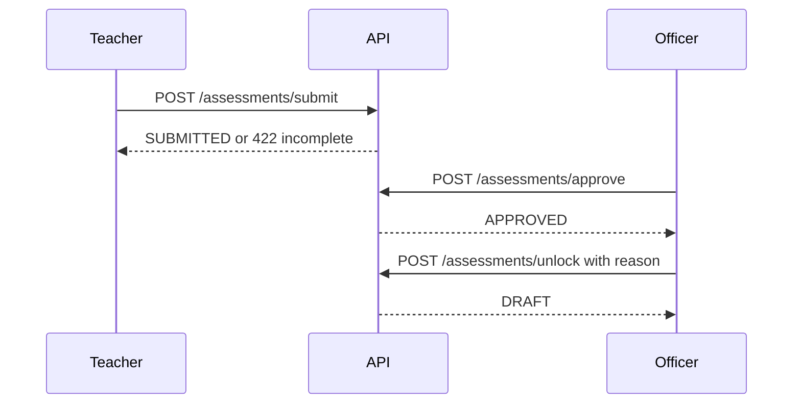

# User Journeys

## How to read this document

Each journey identifies whether the workflow is **LIVE** or **PLANNED**. Planned flows describe the intended contract from `ARCHITECTURE.md` and `BACKEND_DEV_PLAN.md`; they are not available through the current API.

All endpoints are relative to `/api/v1`. All success responses use the standard envelope, and all failures use the standard error envelope.

```mermaid
flowchart LR
    Onboard[M1 Onboard school and staff] --> Wizard[M8 Guided setup: defaults, template, branding - LIVE]
    Wizard --> Structure[M2 Configure structure]
    Structure --> Students[M2 Register and enroll students]
    Students --> Subjects[M3 Offer subjects and register electives]
    Subjects --> Scores[M4 Enter and approve scores]
    Scores --> Compute[M5 Compute results]
    Compute --> Publish[M6 Publish and share results]
    Publish --> Verify[M6 Parent verifies and prints]
```



## M1: Identity and school onboarding

**Status: LIVE**

### 1.1 Create the school tenant

**Actor:** platform operator or provisioning flow.

`POST /identity/schools` is currently public in the backend, even though the architecture catalogue labels it a platform-admin operation. Do not expose it in the normal staff application.

Request:

```json
{
  "name": "Olivet Baptist High School",
  "slug": "olivet-oyo",
  "official_code": "OBHS-OYO",
  "state": "Oyo",
  "city": "Oyo",
  "address": "Oyo-Ogbomoso Road, Oyo, Oyo State, Nigeria",
  "country_code": "NG",
  "admin_email": "principal@olivet.example",
  "admin_first_name": "Grace",
  "admin_last_name": "Adeyemi",
  "admin_password": "a-secure-password"
}
```

Response `201`:

```json
{
  "success": true,
  "data": {
    "id": "01912345-...",
    "slug": "olivet-oyo",
    "name": "Olivet Baptist High School",
    "official_code": "OBHS-OYO",
    "country_code": "NG",
    "state": "Oyo",
    "city": "Oyo",
    "address": "Oyo-Ogbomoso Road, Oyo, Oyo State, Nigeria",
    "is_active": true,
    "created_at": "2026-11-17T09:00:00Z"
  }
}
```

Side effects:

- Creates the school.
- Creates the initial `SCHOOL_ADMIN` user.
- Stores the school configuration, including grading scale, assessment weights, default term definitions, timezone, currency, and report-card template id.
- Does not create academic sessions, term rows, levels, departments, arms, class groups, students, or subjects. Those remain explicit setup steps.
- Global permission definitions are seeded at application startup, not by this request.

The response does not return an access token. Redirect to sign-in.

### 1.2 Sign in

`POST /identity/login`

```json
{
  "email": "principal@olivet.example",
  "password": "a-secure-password"
}
```

Response:

```json
{
  "success": true,
  "data": {
    "access_token": "eyJ...",
    "refresh_token": "eyJ...",
    "token_type": "bearer",
    "expires_in": 900
  }
}
```

The refresh token is also set as the HTTP-only `refresh_token` cookie on path `/api/v1/identity`.

After login:

1. Store the access token in memory only.
2. Call `GET /identity/me`.
3. Build navigation from `data.permissions`.
4. Do not store the refresh token in `localStorage` or `sessionStorage`.

### 1.3 Invite a staff member

**Permission:** `users:manage`.

`POST /identity/staff/invite`

```json
{
  "email": "teacher@olivet.example",
  "first_name": "Adebayo",
  "last_name": "Okafor",
  "phone_number": "+2348012345678",
  "role": "TEACHER",
  "staff_id_number": "OLV-001",
  "specialization": "Chemistry"
}
```

Response `201`:

```json
{
  "success": true,
  "data": {
    "email": "teacher@olivet.example",
    "role": "TEACHER",
    "invitation_token": "eyJ...",
    "expires_at": "2026-11-20T09:00:00Z",
    "message": "Staff invitation generated successfully. Share this invitation link with the teacher."
  }
}
```

Rules:

- Allowed invitation roles: `TEACHER`, `ACADEMIC_OFFICER`, `SCHOOL_ADMIN`.
- Invitation tokens expire after 72 hours.
- The single-invite endpoint returns the token but does not send an email. The frontend or an external delivery flow must share the invitation link.
- Bulk staff import queues invitation emails, but the current email task only logs the prepared invitation rather than integrating a live email provider.

### 1.4 Accept an invitation

The invitation page reads `token` from the URL.

1. `GET /identity/staff/verify-invite?token=...`
2. Show the returned staff name, email, school name, and role.
3. Collect password and confirmation. The password must be at least 8 characters and both values must match.
4. `POST /identity/staff/accept-invitation`

```json
{
  "invitation_token": "eyJ...",
  "password": "new-secure-password",
  "confirm_password": "new-secure-password"
}
```

Response is the same token response as login and also sets the refresh cookie. Continue to `/identity/me`.

Handle expired, already-used, malformed, or unknown tokens with the returned human-friendly message and a path back to the sign-in screen.

### 1.5 Bulk import staff

**Permission:** `users:manage`.

`POST /identity/staff/bulk-import` with multipart form field `file`.

- Accepted files: `.csv`, `.xlsx`.
- Maximum size: 5 MB.
- Maximum rows: 2,000.
- Required columns: `email`, `first_name`, `last_name`, `staff_id_number`.
- Optional columns: `phone_number`, `role`, `specialization`.
- Role defaults to `TEACHER` when omitted.
- Allowed roles: `TEACHER`, `ACADEMIC_OFFICER`, `SCHOOL_ADMIN`.
- Common header aliases are accepted, for example `staff_id`, `staffid`, `phone`, `mobile`, `firstname`, `lastname`.
- Normalizes emails to lowercase and roles to uppercase.
- Empty files and unsupported extensions are rejected synchronously.
- Valid files return `202 Accepted` with a `task_id`.
- Import is atomic: any validation error creates no staff.

Accepted response:

```json
{
  "success": true,
  "data": {
    "task_id": "01912345-...",
    "message": "Your staff list has been queued for import. You can check its progress using the task ID."
  }
}
```

Poll `GET /identity/staff/bulk-import/{task_id}`.

Typical states: `PENDING`, `STARTED`, `SUCCESS`, `FAILURE`.

Completed result:

```json
{
  "task_id": "01912345-...",
  "state": "SUCCESS",
  "result": {
    "status": "completed",
    "created": 12,
    "invitations_queued": 12,
    "email_errors": 0,
    "errors": []
  }
}
```

Validation failure result:

```json
{
  "task_id": "01912345-...",
  "state": "SUCCESS",
  "result": {
    "status": "failed_validation",
    "created": 0,
    "invitations_queued": 0,
    "errors": [
      {
        "row": 4,
        "message": "Role must be one of TEACHER, ACADEMIC_OFFICER, or SCHOOL_ADMIN."
      }
    ]
  }
}
```

The `row` value refers to the spreadsheet row number, including the header row. Show row-level errors in a table and allow the user to correct and re-upload.

### 1.6 Delegate a permission

**Permission:** `users:manage`.

`POST /identity/users/{user_id}/permissions`

```json
{
  "permission_code": "scores:approve",
  "scope_type": "CLASS_GROUP",
  "department_id": null,
  "academic_level_id": null,
  "class_group_id": "01912345-..."
}
```

The response returns the created grant. See [personas-and-permissions.md](./personas-and-permissions.md) for scope limitations.

Revoke with `DELETE /identity/users/{user_id}/permissions/{grant_id}`.

### 1.7 Deactivate a staff member

**Permission:** `users:manage`.

`POST /identity/users/{user_id}/deactivate`

Response:

```json
{
  "success": true,
  "data": {
    "user_id": "01912345-...",
    "is_active": false,
    "message": "The account for Adebayo Okafor has been deactivated and signed out on all devices."
  }
}
```

Effects:

- Existing sessions are invalidated.
- Staff profile becomes `INACTIVE`.
- Active teacher assignments are deactivated.
- Class groups where the user was class teacher are cleared.
- Historical records remain.

Refresh class-group and staff views after success.

## M8: Guided onboarding, defaults & branding

**Status: LIVE.**

The wizard is optional. Defaults can be reviewed from the **public** catalog, but
every write step requires an authenticated school administrator. School-specific
setup is never public.

### 8.1 Journey

1. **Review defaults** — call `GET /identity/onboarding/templates` (public) to show seeded configuration defaults and a structure-template preview. No tenant data is involved.
2. **Edit and save setup** — as `SCHOOL_ADMIN`, call `GET /identity/schools/{school_id}/setup`, then `PATCH .../setup` to save profile, full configuration, and branding references transactionally.
3. **Optionally apply a structure template** — call `POST /structure/templates/apply` with `structure:manage` to create selected levels, departments, arms, and optionally class groups for a session. Idempotent; safe to retry.
4. **Upload branding** — call `POST /identity/schools/{school_id}/branding/uploads?asset_type=logo|stamp|principal_signature` with a multipart image file. Assets are stored locally for the pilot, namespaced by school.
5. **Continue** — either sign in (`POST /identity/login`) or continue to manual setup through the `/structure` routes. The wizard never blocks manual setup.

### 8.2 Endpoints (LIVE)

| Method | Path | Auth | Purpose |
| --- | --- | --- | --- |
| `GET` | `/identity/onboarding/templates` | Public | Config defaults + structure template preview. |
| `GET` | `/identity/schools/{school_id}/setup` | Admin-only | Profile, full config, branding paths/URLs, structure status, `custom_domain.status = PLANNED`. |
| `PATCH` | `/identity/schools/{school_id}/setup` | Admin-only | Transactional partial save of profile, full config, branding references. |
| `POST` | `/identity/schools/{school_id}/branding/uploads` | Admin-only | Multipart logo/stamp/principal-signature upload. |
| `POST` | `/structure/templates/apply` | `structure:manage` | Idempotent template application for a session. |

Full configuration means grading scale, assessment weights, term definitions, annual rules, timezone, currency, and report template.

### 8.3 Rules the UI must enforce

- Three default classes: **school-editable defaults** (seeded config/profile), **optional structure templates** (explicit opt-in only), and **platform defaults** (never exposed or editable).
- **Save assessment-weight edits before creating any `ClassSubject`**: definitions are cloned at creation time, so later edits do not update existing classes. Put setup editing before structure/subject creation and show this warning.
- Branding assets are tenant-isolated (namespaced by school slug/id) and use local pilot storage; S3/Cloudinary come later. Generated PDFs are never stored server-side.
- Custom domains are **PLANNED post-pilot** — no endpoints; require DNS verification, verified domains only, no tenant selection from `Host` on authenticated APIs, dynamic CORS, and HTTPS/cookies.
- A `school_id` that differs from the authenticated tenant must be treated as not found (no cross-tenant reads/writes/uploads).

## M2: Academic structure, students, and enrollment

**Status: LIVE**

### 2.1 Recommended setup order

1. Create the academic session.
2. Create terms inside the session.
3. Create levels.
4. Create departments.
5. Create class arms.
6. Create class groups.
7. Register students.
8. Enroll students into class groups.
9. Optionally import students in bulk.

**Permission for all structure routes:** `structure:manage`.

Route family:

- Sessions: `GET/POST /structure/sessions`, `GET/PATCH/DELETE /structure/sessions/{session_id}`.
- Terms: `GET/POST /structure/sessions/{session_id}/terms`, `GET/PATCH/DELETE /structure/terms/{term_id}`.
- Levels: `GET/POST /structure/levels`, `GET/PATCH/DELETE /structure/levels/{level_id}`.
- Departments: `GET/POST /structure/departments`, `GET/PATCH/DELETE /structure/departments/{department_id}`.
- Arms: `GET/POST /structure/arms`, `GET/PATCH/DELETE /structure/arms/{arm_id}`.
- Class groups: `GET/POST /structure/class-groups`, `GET/PATCH/DELETE /structure/class-groups/{class_group_id}`.

`DELETE` retires a record through soft deletion.

### 2.2 Create an academic session

`POST /structure/sessions`

```json
{
  "name": "2026/2027",
  "start_date": "2026-09-01",
  "end_date": "2027-07-31",
  "is_current": true
}
```

Rules:

- End date must be after start date.
- Only one session is current per school. Marking a new session current unsets the previous one.
- A current session cannot be retired.
- A session with `ENROLLED` students cannot be retired.
- Retiring is soft deletion.

### 2.3 Create terms

`POST /structure/sessions/{session_id}/terms`

```json
{
  "name": "First Term",
  "term_order": 1,
  "start_date": "2026-09-01",
  "end_date": "2026-12-15",
  "is_current": true,
  "is_locked_for_scoring": false
}
```

Rules:

- Term dates must fall inside the session dates.
- Term name and order must be unique within the session.
- Only one term is current per school. Marking a new term current unsets the previous one.
- A locked term cannot have its details changed or be retired.
- A current term cannot be retired.
- `is_locked_for_scoring` currently protects term configuration. The live M5 publication workflow sets it, but score entry routes do not yet read it.

Olivet's configuration stores default term definitions named First Term, Second Term, and Third Term. The academic term rows themselves are created through this endpoint.

### 2.4 Create levels, departments, and arms

`POST /structure/levels`

```json
{
  "name": "Junior Secondary 1",
  "code": "JSS1",
  "level_order": 1,
  "category": "JUNIOR_SECONDARY"
}
```

- `category` must be `JUNIOR_SECONDARY` or `SENIOR_SECONDARY`.

`POST /structure/departments`

```json
{
  "name": "Science",
  "code": "SCI"
}
```

`POST /structure/arms`

```json
{
  "name": "O"
}
```

### 2.5 Create a class group

`POST /structure/class-groups`

Senior example:

```json
{
  "academic_session_id": "01912345-...",
  "academic_level_id": "01912345-...",
  "department_id": "01912345-...",
  "class_arm_id": "01912345-...",
  "class_teacher_id": "01912345-...",
  "display_name": "SS1 Science O"
}
```

Junior example:

```json
{
  "academic_session_id": "01912345-...",
  "academic_level_id": "01912345-...",
  "department_id": null,
  "class_arm_id": "01912345-...",
  "class_teacher_id": null
}
```

Rules:

- Junior-secondary class groups must have `department_id=null`.
- Senior-secondary class groups may have a department.
- Session, level, department, and arm must be unique together among active class groups.
- Class teacher must be an active `TEACHER`, `ACADEMIC_OFFICER`, or `SCHOOL_ADMIN`.
- If `display_name` is omitted, the backend composes `{level.code} {department.name} {arm.name}` for senior classes or `{level.code} {arm.name}` for junior classes.
- A class group with active `ENROLLED` enrollments cannot be retired.

Update only supports `display_name` and `class_teacher_id`.

### 2.6 Register a student

**Permission:** `students:register`.

`POST /students`

```json
{
  "admission_number": "OBHS/2026/0001",
  "first_name": "Tayo",
  "middle_name": "Olusola",
  "last_name": "Babatunde",
  "date_of_birth": "2010-05-14",
  "gender": "M",
  "guardian_name": "Mrs. Babatunde",
  "guardian_email": "guardian@example.com",
  "guardian_phone": "+2348012345678",
  "enrollment_date": "2026-09-01"
}
```

Rules:

- Date of birth must be before enrollment date.
- New students start as `ADMITTED`.
- Admission number must be unique within the school.
- Registration does not assign a class. Enrollment does.

List students with filters:

- `page`, `page_size`
- `q` for search
- `status`
- `include_archived`

Get or update one student with `GET/PATCH /students/{student_id}`. Archived statuses set `deleted_at`, so include archived records when building history views.

### 2.7 Change student status

**Permission:** `students:status`.

`POST /students/{student_id}/status`

```json
{
  "status": "SUSPENDED",
  "reason": "Disciplinary review pending."
}
```

Allowed transitions:

- `ADMITTED -> ACTIVE | WITHDRAWN`
- `ACTIVE -> SUSPENDED | WITHDRAWN | TRANSFERRED | GRADUATED`
- `SUSPENDED -> ACTIVE | WITHDRAWN | TRANSFERRED`
- Terminal: `WITHDRAWN`, `TRANSFERRED`, `GRADUATED`

Reason is mandatory and must be 5-500 characters. The UI should show only valid next statuses.

### 2.8 Enroll a student

**Permission:** `students:enroll`.

`POST /students/{student_id}/enrollments`

```json
{
  "class_group_id": "01912345-..."
}
```

Rules:

- Student must be `ADMITTED` or `ACTIVE`.
- Student can have only one enrollment per academic session.
- The class group determines the session.
- `ADMITTED` becomes `ACTIVE`.
- The enrollment starts as `ENROLLED`.
- Non-elective class subjects for the class group are automatically registered:
  - Universal offerings become `COMPULSORY_CORE`.
  - Department offerings become `DEPARTMENT_CORE`.
- Elective and trade subjects are never auto-registered.

List enrollments with `GET /students/{student_id}/enrollments`. Get or update one with `GET/PATCH /enrollments/{enrollment_id}`. The response includes class-group and session summaries for display.

### 2.9 Update or promote an enrollment

**Permission:** `students:enroll`.

`PATCH /enrollments/{enrollment_id}`

```json
{
  "enrollment_status": "PROMOTED",
  "promoted_to_class_group_id": "01912345-...",
  "reason": "Completed SS1 with satisfactory results."
}
```

Rules:

- `ENROLLED -> PROMOTED | REPEATING | TRANSFERRED | WITHDRAWN`
- `PROMOTED`, `REPEATING`, `TRANSFERRED`, and `WITHDRAWN` are terminal.
- `PROMOTED` requires the destination class group.
- Destination class group must belong to a later academic session.
- This endpoint records the promotion destination; it does not create the student's enrollment in the next session. Create that enrollment separately when appropriate.

### 2.10 Bulk import students

**Permission:** `students:bulk_import`.

`POST /students/bulk-import` with multipart form field `file`.

- Accepted files: `.csv`, `.xlsx`.
- Maximum size: 5 MB.
- Maximum rows: 5,000.
- Required columns: `admission_number`, `first_name`, `last_name`, `date_of_birth`, `gender`, `guardian_name`, `guardian_email`, `guardian_phone`, `enrollment_date`.
- Optional column: `middle_name`.
- Common aliases are accepted, for example `admission_no`, `dob`, `parent_name`, `parent_email`, `parent_phone`, and `admission_date`.
- Dates accept `YYYY-MM-DD`, `DD/MM/YYYY`, `DD-MM-YYYY`, and `DD.MM.YYYY`.
- Gender normalizes `M`/`MALE` to `M` and `F`/`FEMALE` to `F`.
- Import is atomic: any validation error creates no students.
- Imported students start as `ADMITTED`.
- Import does not enroll students into class groups.

Accepted response contains `task_id` and a human-friendly message. Poll `GET /students/bulk-import/{task_id}`.

Completed result:

```json
{
  "task_id": "01912345-...",
  "state": "SUCCESS",
  "result": {
    "status": "completed",
    "created": 250,
    "errors": []
  }
}
```

Validation failure example:

```json
{
  "task_id": "01912345-...",
  "state": "SUCCESS",
  "result": {
    "status": "failed_validation",
    "created": 0,
    "errors": [
      {
        "row": 12,
        "message": "A student with admission number OBHS/2026/0004 already exists in your school. Please check the number and try again."
      }
    ]
  }
}
```

Celery failure without a structured result returns a generic failed status. Show a retry path and avoid promising which rows were affected.

## M3: Subjects, offerings, class subjects, and electives

**Status: LIVE**

### 3.1 Create subjects

**Permission:** `subjects:manage`.

`POST /subjects`

```json
{
  "name": "General Mathematics",
  "code": "MTH",
  "is_elective": false,
  "is_trade_subject": false
}
```

- `is_trade_subject=true` only makes sense with `is_elective=true`.
- Subject codes should be stable; display names may change.
- Subjects support `GET/POST /subjects` and `GET/PATCH/DELETE /subjects/{subject_id}`. `DELETE` soft-deletes the subject.

### 3.2 Create a subject offering

`POST /subjects/offerings`

```json
{
  "subject_id": "01912345-...",
  "academic_session_id": "01912345-...",
  "academic_level_id": "01912345-...",
  "department_id": null
}
```

Rules:

- Junior-secondary offerings must have `department_id=null`.
- Senior-secondary offerings may be department-specific.
- Universal offerings use `department_id=null`.
- Offering uniqueness is session + level + subject + department.
- An offering's department cannot be changed once class subjects link to it.
- Offerings support `GET/POST /subjects/offerings` and `GET/PATCH/DELETE /subjects/offerings/{offering_id}`. Update currently changes only `department_id`, and `DELETE` soft-deletes the offering.

### 3.3 Link an offering to a class group

`POST /class-subjects`

```json
{
  "subject_offering_id": "01912345-...",
  "class_group_id": "01912345-..."
}
```

Rules:

- Offering and class group must belong to the same academic session.
- The class subject must be unique per offering and class group.
- Class subjects support `GET/POST /class-subjects`, `GET/DELETE /class-subjects/{class_subject_id}`. There is no update route.
- Creating a class subject automatically seeds assessment definitions for every non-retired term in the session using the current assessment weight schema.
- A class subject cannot be retired while it still has active teacher assignments or active student registrations.

### 3.4 Assign teachers

Granular assignment requires the class subject:

`POST /class-subjects/{class_subject_id}/teacher-assignments`

```json
{
  "teacher_id": "01912345-..."
}
```

Bulk cascade:

`POST /class-subjects/teacher-assignments/bulk`

```json
{
  "subject_offering_id": "01912345-...",
  "teacher_id": "01912345-...",
  "class_group_ids": ["01912345-...", "01912345-..."]
}
```

Bulk behavior:

- Creates missing class subjects for the offering and selected class groups.
- Seeds their assessment definitions.
- Skips class groups from another session.
- Skips missing class groups.
- Skips teachers already actively assigned.
- Returns `assigned` and `skipped` arrays with reasons.

List assignments with `GET /class-subjects/{class_subject_id}/teacher-assignments`. Deactivate one with `DELETE /class-subjects/{class_subject_id}/teacher-assignments/{assignment_id}`.

A single class subject can have multiple active teachers. One teacher can be assigned to multiple class subjects.

### 3.5 Register an elective or trade subject

**Permission:** `subjects:register_electives`.

`POST /enrollments/{enrollment_id}/subject-registrations`

```json
{
  "class_subject_id": "01912345-..."
}
```

Rules:

- The class subject must belong to the student's current class group.
- Only elective subjects can be registered manually.
- Non-elective subjects are already auto-registered and return an error if registered manually.
- Category becomes `TRADE_ELECTIVE` when the subject is marked trade, otherwise `FREE_ELECTIVE`.
- Re-registering an inactive registration reactivates it.
- Active duplicate registration returns a conflict.

Bulk registration:

`POST /class-subjects/{class_subject_id}/subject-registrations/bulk`

```json
{
  "student_enrollment_ids": ["01912345-...", "01912345-..."]
}
```

Returns `registered` and `skipped` arrays. Skips include enrollment not found, class group mismatch, non-elective subject, and duplicates.

List current registrations with `GET /enrollments/{enrollment_id}/subject-registrations`. Deactivate one with `DELETE /enrollments/{enrollment_id}/subject-registrations/{registration_id}`.

### 3.6 Frontend implications

- A class roster is not the same as a subject roster.
- Subject score sheets must show only actively registered students.
- Trade subjects are a subset of electives.
- Use class subject ids, not subject ids, when working with scores, teachers, and registrations.
- There is no live teacher-facing "my assignments" endpoint. Do not fabricate one in the frontend.

## M4: Assessment definitions, scores, and score-sheet approval

**Status: LIVE**

### 4.1 Assessment definitions

**Permission:** `subjects:manage`.

Creating a class subject seeds definitions for each non-retired term using the school's assessment weight schema. For Olivet defaults:

| Code | Name | Max | Weight | Type |
| --- | --- | --- | --- | --- |
| `TEST1` | Test 1 | 10 | 10 | `CONTINUOUS_ASSESSMENT` |
| `TEST2` | Test 2 | 10 | 10 | `CONTINUOUS_ASSESSMENT` |
| `ASSIGN` | Assignments/Attendance | 10 | 10 | `CONTINUOUS_ASSESSMENT` |
| `EXAM` | Terminal Examination | 70 | 70 | `EXAMINATION` |

Custom definitions can be created with `POST /assessments/definitions`:

```json
{
  "academic_term_id": "01912345-...",
  "class_subject_id": "01912345-...",
  "name": "Practical",
  "code": "PRAC",
  "assessment_type": "PRACTICAL",
  "max_score": 20,
  "weight_percentage": 20,
  "sequence_order": 5
}
```

Allowed `assessment_type` values:

- `CONTINUOUS_ASSESSMENT`
- `EXAMINATION`
- `PRACTICAL`

List definitions with `GET /assessments/definitions`; get or update one with `GET/PATCH /assessments/definitions/{definition_id}`. There is no delete route.

A definition cannot be updated once any score exists for it. The frontend should disable weight and max-score editing after score entry begins.

### 4.2 Read a score sheet

**Permission:** `scores:enter`.

`GET /assessments/scores?class_subject_id=...&assessment_definition_id=...`

Response:

```json
{
  "success": true,
  "data": {
    "assessment_definition": {
      "id": "01912345-...",
      "school_id": "01912345-...",
      "academic_term_id": "01912345-...",
      "class_subject_id": "01912345-...",
      "name": "Test 1",
      "code": "TEST1",
      "assessment_type": "CONTINUOUS_ASSESSMENT",
      "max_score": "10.00",
      "weight_percentage": "10.00",
      "sequence_order": 1,
      "created_at": "2026-11-17T09:00:00Z"
    },
    "rows": [
      {
        "student_enrollment_id": "01912345-...",
        "admission_number": "OBHS/2026/0001",
        "first_name": "Tayo",
        "last_name": "Babatunde",
        "score_status": "PENDING",
        "raw_score": null
      }
    ]
  }
}
```

Rows are active subject registrations only, sorted by last name then first name. Missing scores appear as `PENDING`.

Resource-level rules:

- The route requires `scores:enter`, now enforced the same way as score entry: an actively assigned `TEACHER`, `ACADEMIC_OFFICER`/`SCHOOL_ADMIN`/`SUPER_ADMIN`, or a `SCHOOL_WIDE`/scoped delegation covering the class subject's class group.
- An unassigned teacher requesting another class subject's sheet gets `403`, not a silent read. Still don't expose arbitrary class-subject/assessment-definition ids in the UI -- the backend blocks it, but the frontend shouldn't invite the attempt.

### 4.3 Enter scores

There is one score-entry endpoint, and it is bulk-shaped even for a single row.

`POST /assessments/scores/bulk-entry`

```json
{
  "class_subject_id": "01912345-...",
  "assessment_definition_id": "01912345-...",
  "scores": [
    {
      "student_enrollment_id": "01912345-...",
      "score_status": "SCORED",
      "raw_score": 8.5
    },
    {
      "student_enrollment_id": "01912345-...",
      "score_status": "ABSENT",
      "raw_score": null
    }
  ]
}
```

Validation rules:

- `SCORED` requires `raw_score`.
- `ABSENT`, `EXEMPT`, and `PENDING` require `raw_score=null`.
- Raw score cannot exceed the definition's `max_score`.
- Student must be actively registered for the class subject.
- Score sheet must still be `DRAFT`.

Response is partial-success aware:

```json
{
  "success": true,
  "data": {
    "records_processed": 2,
    "records_updated": 1,
    "errors": [
      {
        "student_enrollment_id": "01912345-...",
        "message": "This student is not registered for this class subject."
      }
    ],
    "assessment_summary": {
      "assessment_name": "Test 1",
      "max_score": "10.00",
      "class_subject": "General Mathematics - SS1 Science O"
    }
  }
}
```

Do not treat a `200` response as fully successful when `errors` is non-empty. Show per-student errors and refresh the sheet.

If the sheet is no longer draft, the entire request fails with the friendly "scores are locked" message. Ask an academic officer to unlock.

### 4.4 Submit, approve, and unlock



Submit:

```json
{
  "academic_term_id": "01912345-...",
  "class_subject_id": "01912345-..."
}
```

- Requires `scores:submit`.
- Expected combinations = number of assessment definitions × number of active registrations.
- Every combination must exist with a status other than `PENDING`.
- Missing combinations return `422` with code `SCORES_INCOMPLETE` and `details[0].missing_students_count`.
- Only `DRAFT` can be submitted.

Approve:

- Requires `scores:approve`.
- Only `SUBMITTED` can be approved.
- Approval locks the sheet for editing.

Unlock:

```json
{
  "academic_term_id": "01912345-...",
  "class_subject_id": "01912345-...",
  "reason": "Correcting a mis-keyed examination score."
}
```

- Requires `scores:unlock`.
- Reason length is 5-500 characters.
- Already-`DRAFT` sheets return a validation error.
- Returns status to `DRAFT` and records actor, time, and reason.

Score sheet state response includes submitted, approved, and unlocked metadata.

### 4.5 What the frontend must not do at M4

- Do not calculate official subject totals or class positions yet. M5 owns the computation engine.
- Do not show unregistered students on a subject sheet.
- Do not allow editing a submitted or approved sheet.
- Do not show approve or unlock actions to plain teachers.
- Do not use `scores:modify` as a live gate. No route checks it directly today.

## M5: Result computation, broadsheets, and publication

**Status: LIVE**

### 5.1 Calculation flow

1. Academic officer calculates a term.
2. Backend verifies all relevant score sheets are approved.
3. Pure engine computes subject totals, grades, remarks, subject positions, class statistics, totals, percentages, and class positions.
4. Results are persisted as `subject_results` and `term_report_cards` with status `DRAFT`.
5. Third-term processing additionally computes annual cumulative scores, annual positions, and a promotion decision.
6. Calculation can be repeated until publication; it is idempotent for the same term.

### 5.2 Endpoints

| Method | Path | Permission |
| --- | --- | --- |
| `POST` | `/computation/calculate-term` | `scores:approve`, with resource scope enforced |
| `GET` | `/computation/broadsheet/{class_group_id}` | `scores:approve` or assigned form master |
| `POST` | `/publication/publish-term` | `reports:publish` |
| `GET`, `PATCH` | `/identity/schools/{school_id}/configuration` | `configuration:manage` |

`calculate-term` returns:

```json
{
  "success": true,
  "data": {
    "academic_term_id": "8f2f4a9f-2c2a-7f4a-8e0e-2a5b2a4b7c11",
    "class_group_id": null,
    "students_calculated": 45,
    "subject_results_upserted": 405
  }
}
```

The request body is `{"academic_term_id": "...", "class_group_id": null}`. Omitting `class_group_id` calculates all class groups in the term.

The broadsheet returns a high-density matrix of students, subjects, component scores, totals, ranks, and class statistics.

### 5.3 Computation rules

- Use `Decimal` with `ROUND_HALF_UP`.
- Scaled score = `raw_score × (weight_percentage / max_score)`.
- `ABSENT` contributes `0.00` and displays as `ABS`.
- `EXEMPT` is omitted from the denominator and scales attempted work proportionally.
- `PENDING` blocks submission, approval, and publication.
- Student percentage uses marks obtained divided by that student's registered subject maximums.
- Ranking uses standard competition ranking (`1, 2, 2, 4`).
- Annual weights and promotion thresholds come from `annual_results_schema`.
- Published historical values never recalculate from current configuration.

### 5.4 Publication flow

1. Backend verifies every score sheet in the term is `APPROVED`.
2. Backend seals `frozen_config_snapshot` on `subject_results` and `term_report_cards`.
3. Backend sets `academic_terms.is_locked_for_scoring = TRUE`.
4. Backend generates 256-bit result tokens, stores only SHA-256 hashes, and returns plaintext tokens once in a `202 Accepted` response.
5. PostgreSQL triggers block future updates or deletes of published result rows.
6. Email/SMS delivery remains in M6; do not assume parents have received a link immediately.

`publish-term` accepts `{"academic_term_id": "..."}`. Treat every returned token as a one-time secret.

### 5.5 Persisted result fields

`SubjectResult` includes term, class subject, enrollment, total score, grade, grade point, remark, subject position, class statistics, annual cumulative fields, status, approver metadata, and `frozen_config_snapshot`.

`TermReportCard` includes term and enrollment ids, totals, percentage, class position, total students in arm, zero attendance placeholders, comments, annual cumulative fields, promotion decision, publication status/timestamp, and `frozen_config_snapshot`.

`promotion_decision` values are `PROMOTED`, `PROMOTED_ON_TRIAL`, and `REPEATING`. `WITHDRAWN` may appear later through student lifecycle handling.

## M5A: Term attendance and class records

**Status: PLANNED**

M5A will replace the zero attendance placeholders with real data. Planned routes:

| Method | Path | Purpose |
| --- | --- | --- |
| `POST` | `/structure/class-groups/{class_group_id}/attendance` | Mark attendance for a whole class on a date |
| `POST` | `/enrollments/{enrollment_id}/attendance` | Mark or correct one student's attendance |
| `GET` | `/enrollments/{enrollment_id}/attendance` | List daily attendance records |
| `PATCH`, `GET` | `/enrollments/{enrollment_id}/attendance-summary` | Manually override or read one summary |
| `PATCH` | `/structure/class-groups/{class_group_id}/attendance-summary` | Bulk class summary update |

Design rules:

- Daily records and manual aggregate overrides are both supported; summaries carry `source = DAILY` or `MANUAL`.
- Future dates are blocked; backdated entries require an audited reason.
- Publication will require `present + absent == opened`.
- Assessment `score_status = ABSENT` stays separate from daily attendance.
- Until M5A is live, do not present report-card attendance as real data.

## M6: Verified report-card payload and notifications

**Status: PARTIAL**

Publication and token generation are live from M5. Public verification, the report-card JSON payload, branding storage, and email/SMS delivery remain planned.

### 6.1 Endpoints

| Method | Path | Status |
| --- | --- | --- |
| `POST` | `/publication/publish-term` | **LIVE** |
| `GET` | `/results/verify/{token}` | **PLANNED**; public, with token plus date of birth or admission PIN |
| `GET` | `/results/verify-qr` | **PLANNED**; public |

### 6.2 Result access token behavior

- Only a hash of the token is stored.
- Token has an expiry.
- Token can be revoked.
- Default maximum access count is 20.
- Last access time and IP are recorded.
- Public verification is planned to be rate-limited to 20 requests per minute per IP.
- Secondary verification uses date of birth or an admission-number PIN.
- There is no authenticated parent or student account.

### 6.3 Planned verified report-card payload

`GET /results/verify/{token}?dob=YYYY-MM-DD` returns:

```json
{
  "success": true,
  "data": {
    "school": {
      "name": "Olivet Baptist High School",
      "official_code": "OBHS-OYO",
      "address": "Oyo-Ogbomoso Road, Oyo, Oyo State, Nigeria",
      "logo_url": "/storage/olivet-oyo/branding/obhs-logo.png",
      "stamp_url": "/storage/olivet-oyo/branding/obhs-stamp.png",
      "principal_signature_url": "/storage/olivet-oyo/branding/principal-sig.png"
    },
    "student": {
      "admission_number": "OBHS/2022/0412",
      "full_name": "Tayo Olusola Babatunde",
      "gender": "M",
      "academic_level": "SS 1",
      "department": "Science",
      "class_group": "SS1 Science O",
      "session": "2024/2025",
      "term": "Third Term"
    },
    "attendance": {
      "days_opened": 65,
      "days_present": 63,
      "days_absent": 2
    },
    "subjects": [
      {
        "subject_code": "MTH",
        "subject_name": "General Mathematics",
        "ca1_score": 18.5,
        "ca2_score": 19.0,
        "exam_score": 54.0,
        "terminal_total": 91.5,
        "grade": "A1",
        "remark": "EXCELLENT",
        "subject_position": 2,
        "class_average": 64.2,
        "first_term_total": 88.0,
        "second_term_total": 90.0,
        "cumulative_annual_score": 89.83,
        "cumulative_annual_grade": "A1"
      }
    ],
    "terminal_summary": {
      "total_obtainable": 900.0,
      "total_obtained": 748.5,
      "percentage": 83.17,
      "class_position": 4,
      "total_students_in_arm": 45,
      "form_master_comment": "An exemplary student with outstanding academic discipline.",
      "form_master_signature_url": "/storage/olivet-oyo/signatures/teacher-adeola.png",
      "principal_comment": "Excellent academic performance. Promoted to Senior Secondary 2."
    },
    "annual_cumulative_summary": {
      "is_annual_final": true,
      "annual_cumulative_percentage": 82.4,
      "annual_class_position": 3,
      "promotion_decision": "PROMOTED",
      "promoted_to": "SS 2 Science O"
    },
    "verification": {
      "qr_payload": "VERIFY:OBHS/2022/0412:2024-T3:83.17:PROMOTED:SIG_8f9a2c",
      "issued_at": "2026-11-13T14:30:00Z",
      "is_authentic": true
    }
  }
}
```

Notes:

- `annual_cumulative_summary` is only meaningful for a Third Term final report.
- Subject fields are frozen at publication.
- The frontend renders and exports the report card PDF locally.
- The QR payload is for physical print verification; the frontend should not treat it as a secret.
- All assets are paths/URLs served by the planned storage service; M8 uploads use local pilot storage namespaced by school, with S3/Cloudinary later.
- Generated PDFs are not stored server-side; the frontend renders and exports them locally.

### 6.4 Planned parent journey

1. Parent receives an email with `https://school.example/results/{token}`.
2. Parent opens the page and sees the school identity and verification form.
3. Parent enters date of birth or admission PIN.
4. Frontend calls `GET /results/verify/{token}?dob=...`.
5. Backend validates token, expiry, revocation, access count, and secondary factor.
6. Frontend renders the report card from the returned payload.
7. Parent prints or downloads a locally generated PDF.
8. Expired, revoked, exhausted, or mismatched tokens show an actionable message and a contact path to the school.

## M7: Backoffice, seeding, and operational hardening

**Status: PLANNED**

Planned work:

- Mount SQLAdmin at a protected admin surface.
- Register school, configuration, user, staff, structure, subject, and audit views.
- Add authenticated admin session handling and school-admin checks.
- Add `scripts/seed_olivet.py`.
- Seed JSS1-JSS3 and SS1-SS3.
- Seed Science, Arts, and Commercial departments for SS1-SS3.
- Seed arms `O, L, I, V, E, T, B, H, S, Y`.
- Allocate Science to `O, L, I, V`, Commercial to `E`, and Arts to `T, B, H, S, Y`.
- Run BOLA/IDOR checks, RLS isolation tests, load tests, and performance benchmarks.
- Rehearse the full journey: provision, enroll, score, approve, publish, and verify.

The frontend should not link to SQLAdmin or assume seeded Olivet structure exists. Until the seed script is live, administrators create structure through `/structure` routes or another provisioning process.

## Cross-cutting async import behavior

Both student and staff imports follow the same shape:

1. Client uploads a file.
2. Backend validates extension and size synchronously.
3. Backend stages the file in Redis for one hour.
4. Backend queues a Celery task and returns `202` with `task_id`.
5. Client polls the status endpoint.
6. Completed task returns a structured result.
7. Validation failure returns `status=failed_validation` with row-level errors.
8. Infrastructure failure returns a generic failed state.

Recommended polling:

- Start after one second.
- Back off to 2-5 seconds.
- Stop on `SUCCESS`, `FAILURE`, or a terminal `result.status`.
- Allow the user to navigate away and return with the `task_id`.
- Do not resubmit automatically; a new upload creates a new job.

## UI behavior checklist

- Show human-friendly backend messages verbatim.
- Branch on `error.code`, not on message text.
- Use `SCORES_INCOMPLETE.details[0].missing_students_count` to guide the user.
- Treat non-empty `errors` inside a successful bulk score entry as partial failure.
- Refresh affected records after every mutation.
- Refresh `/identity/me` after permission changes or staff deactivation.
- Show archived students only when the user asks for history.
- Hide terminal transition options after a student or enrollment reaches a terminal state.
- Result publication is live. Do not show PDF export or public verification in production navigation until M6 is live.
- Treat M8 guided-setup routes as absent until verified; do not render the wizard in production navigation yet.
- Do not derive tenant identity from `Host` or a custom domain.
- When M8 is live, keep assessment-weight editing before class-subject creation in the wizard.
